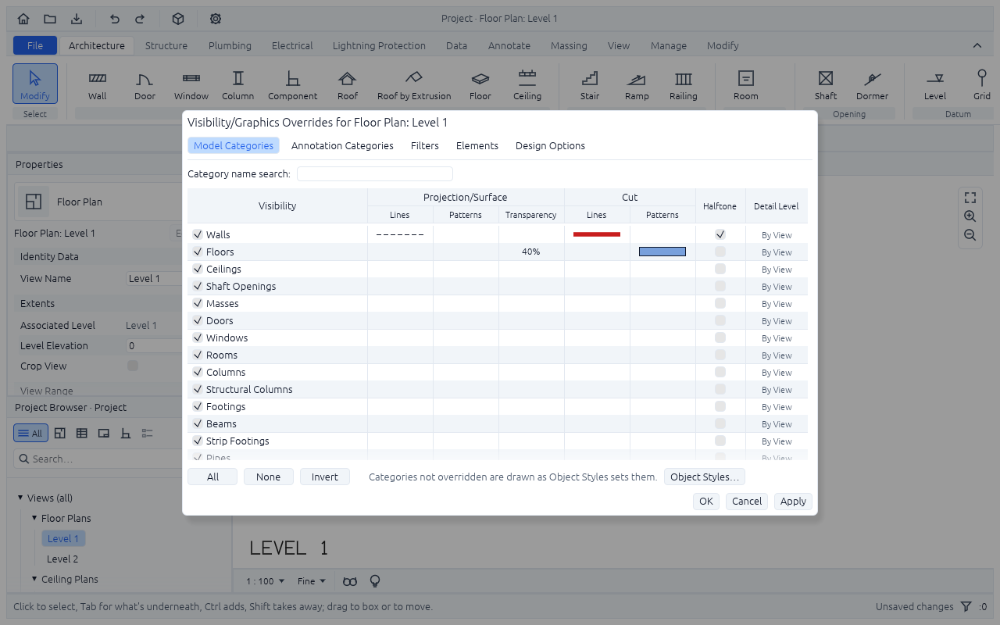

<p align="center">
  
</p>

<h1 align="center">BIMCraft</h1>

<p align="center">
  <b>Building information modeling; an open-source, clean-room take on the Autodesk Revit workflow, rebuilt in pure Rust.</b>
</p>

<p align="center">
  Model a building the way Revit does: levels, walls, doors and windows, floors and ceilings, rooms, columns, stairs,
  ramps and railings, roofs and shafts that know about each other. Draw plans, sections, elevations and a 3D view from them, lay them out on sheets, and read and
  write IFC. Every action is a command, so agents can drive it as well as you can.<br>
  <i>By IPedrax.</i>
</p>

<p align="center">
  
  
  
  
  
</p>

<br>

<p align="center">
  
  <br><sub><b>The sample house</b> (<code>cargo run --release -p bimcraft -- --sample</code>): Revit's layout in BIMCraft's own icons and colours, with dimensions, door and window tags, a spot elevation, a note, a section and the four elevation marks, all built from BIMCraft commands.</sub>
</p>

https://github.com/user-attachments/assets/46488109-fdc4-4ce5-a6bd-92b3b95af16c

<p align="center">
  <sub><b>BIMCraft in 34 seconds</b> (AI-generated voiceover; <a href="docs/video/showcase.mp4">download the mp4, 8.4 MB</a>): the sample house built from 58 lines of text, its plans, sections, sheets and 3D view, a wall moved with its doors and room areas following, IFC in and out, and an agent building a house over MCP.</sub>
</p>

<p align="center">
  <a href="#screenshots">Screenshots</a> ·
  <a href="#why-bimcraft">Why BIMCraft</a> ·
  <a href="#what-works-today">What works today</a> ·
  <a href="#quick-start">Quick start</a> ·
  <a href="#the-desktop-app">The desktop app</a> ·
  <a href="#drive-it-from-agents-mcp-and-the-cli">Agents, MCP and the CLI</a> ·
  <a href="#commands">Commands</a> ·
  <a href="#architecture">Architecture</a> ·
  <a href="#roadmap">Roadmap</a> ·
  <a href="#downloads">Downloads</a> ·
  <a href="#license-and-credits">License and credits</a>
</p>

## Screenshots

<table>
  <tr>
    <td width="50%"></td>
    <td width="50%"></td>
  </tr>
  <tr>
    <td><sub><b>3D view</b>: from the south-east, as Revit's default 3D view looks. Orbit, pan and zoom; click to select.</sub></td>
    <td><sub><b>Section</b>: the cut in poché, the roof along its slope, what lies beyond in hidden line, levels and grids.</sub></td>
  </tr>
  <tr>
    <td width="50%"></td>
    <td width="50%"></td>
  </tr>
  <tr>
    <td><sub><b>Sheets</b>: views placed at a scale under a title block, printed to PDF a page each.</sub></td>
    <td><sub><b>Dark mode</b>: the window and the views go dark; sheets stay white paper.</sub></td>
  </tr>
  <tr>
    <td width="50%"></td>
    <td width="50%"></td>
  </tr>
  <tr>
    <td width="50%"></td>
    <td width="50%"></td>
  </tr>
  <tr>
    <td><sub><b>Snaps and the ruler</b>: guides at angles from east and from the line before, so a 60° corner comes out exact.</sub></td>
    <td><sub><b>Wall grips</b>: drag an end, with the same snaps and guides from the other end.</sub></td>
  </tr>
  <tr>
    <td><sub><b>Schedules</b>: the fields chosen, project parameters and calculated ones among them, totalled.</sub></td>
    <td><sub><b>Schedule Properties</b>: fields, filters, sorting and grouping, as Revit's tabs have them.</sub></td>
  </tr>
  <tr>
    <td width="50%"></td>
    <td width="50%"></td>
  </tr>
  <tr>
    <td><sub><b>Graphics overrides</b>: what a view hides and how it draws the rest, by category, filter and element.</sub></td>
    <td><sub><b>Visibility/Graphics</b>: categories, filters and elements, projection and cut each with their own line and fill.</sub></td>
  </tr>
  <tr>
    <td width="50%"></td>
    <td width="50%"></td>
  </tr>
  <tr>
    <td><sub><b>Phases</b>: what stood before in halftone, what comes down dashed red, what is new as the category draws it.</sub></td>
    <td><sub><b>Phasing</b>: phases in order, and phase filters that say how a view shows each status.</sub></td>
  </tr>
  <tr>
    <td width="50%"></td>
    <td width="50%"></td>
  </tr>
  <tr>
    <td><sub><b>Textures</b>: a material's texture at its real size on the faces it lies on: brick in courses, boards, glass.</sub></td>
    <td><sub><b>Paint</b>: a material laid over one face, as Revit's Paint does; Remove Paint takes it off.</sub></td>
  </tr>
  <tr>
    <td width="50%"></td>
    <td width="50%"></td>
  </tr>
  <tr>
    <td><sub><b>Family Editor</b>: parameters, types, forms (extrusions, revolves, voids) and a door's or window's plan symbols, with a preview.</sub></td>
    <td><sub><b>Materials</b>: a texture from a pattern or a picture of yours, its tile size, and a favorite kept for every project.</sub></td>
  </tr>
  <tr>
    <td width="50%"></td>
    <td width="50%"></td>
  </tr>
  <tr>
    <td><sub><b>Structure</b>: beams, structural columns, isolated and wall footings and structural floors; Revit's Structure tab on one new element, the run (<a href="docs/disciplines.md">design</a>).</sub></td>
    <td><sub><b>Section</b>: a beam is cut across its section, a round run (a pipe, a steel tube) in a ring.</sub></td>
  </tr>
  <tr>
    <td width="50%"></td>
    <td width="50%"></td>
  </tr>
  <tr>
    <td><sub><b>Beam tool</b>: two clicks, or a chain of them, each step a beam; sketched before the click.</sub></td>
    <td><sub><b>Beam properties</b>: heights at both ends, justification, and the system it belongs to.</sub></td>
  </tr>
  <tr>
    <td width="50%"></td>
    <td width="50%"></td>
  </tr>
  <tr>
    <td><sub><b>Pipe tool</b>: two clicks, or a chain; centred on its height by default, falling or rising with a second height.</sub></td>
    <td><sub><b>Pipe type</b>: its diameter (or width and depth, if it isn't round) and its material.</sub></td>
  </tr>
  <tr>
    <td width="50%"></td>
    <td></td>
  </tr>
  <tr>
    <td><sub><b>Section</b>: a pipe is cut in poché along the line, across it in a ring.</sub></td>
    <td></td>
  </tr>
  <tr>
    <td width="50%"></td>
    <td width="50%"></td>
  </tr>
  <tr>
    <td><sub><b>Device tool</b>: the Type Selector lists only the families of its kind; Space turns what you place.</sub></td>
    <td><sub><b>Cable tray type</b>: a width by a depth, or round, in a material.</sub></td>
  </tr>
  <tr>
    <td width="50%"></td>
    <td width="50%"></td>
  </tr>
  <tr>
    <td><sub><b>Plumbing</b>: the starter fixtures, a pipe falling to a drain and a riser, in 3D with the walls hidden.</sub></td>
    <td><sub><b>Electrical</b>: a tray, a board, luminaires and devices at their mounting heights.</sub></td>
  </tr>
  <tr>
    <td width="50%"></td>
    <td width="50%"></td>
  </tr>
  <tr>
    <td><sub><b>Lightning Protection (SPDA)</b>: NBR 5419's vocabulary on the same runs and fixtures; Revit has no such tab.</sub></td>
    <td><sub><b>SPDA in 3D</b>: terminals, down conductors and the earthing ring and rods.</sub></td>
  </tr>
  <tr>
    <td width="50%"></td>
    <td width="50%"></td>
  </tr>
  <tr>
    <td><sub><b>Data tab</b>: outlets, a rack, a patch panel and cabling, in NBR 14565's words.</sub></td>
    <td><sub><b>Data in 3D</b>: a tray, cables dropping to their outlets, a rack.</sub></td>
  </tr>
</table>

## Performance sample

Start an original 20-storey, 9,521-element tower with `bimcraft --highrise`, or generate a native
file with `bimcraft-cli run --highrise --save highrise.bimcraft`. The script is
[`samples/highrise.txt`](samples/highrise.txt). See the [performance baseline](docs/performance.md)
for reproducible core/UI measurements and the remaining optimization work. Private local IFC
fixtures and their results belong in the ignored `test_model/` folder.

The 3D view can be drawn on the graphics card: File > Settings > Performance > Draw the 3D view on the graphics card, off until you
turn it on. On that tower at 1920 × 1080 a changed frame took 1.3 ms on an NVIDIA GeForce RTX 3060, against 108 ms on the processor,
and what is under the cursor is found in a bounding volume hierarchy instead of read from the picture. The card draws what the processor
draws, with the same lighting, textures, edges, level lines and surfaces seen through (a mass, or what Visibility/Graphics makes
transparent). Hidden line, wireframe, sections and sheets are still drawn on the processor, and so is everything when the card fails, when the window runs on OpenGL (the card is for Vulkan, Metal and DirectX 12) or when the computer has none; the Performance page says which.

## Why BIMCraft

- **The workflow you know.** Revit's ribbon, the green contextual Modify tab, the Options Bar, Properties with the Type
  Selector and Edit Type, the Project Browser, views in tabs, and Revit's shortcuts: WA, DR, WN, RM, CL, DI, TG, MV, CO,
  RO, MM, AL, TR, SL, ME, CS, SA, VV, EH, MS, WB, FB, RB, UF, MH, and KS to list them all. Click to select, Ctrl adds, Shift takes away, Tab reaches what's
  underneath.
- **A real building model.** Doors and windows live in their walls, rooms find their boundaries from the walls around
  them, walls joined at a corner stay joined when one moves, dimensions and tags follow what they measure and name, and
  every change is checked against the model's rules and can be undone.
- **Open files.** IFC2x3 and IFC4 come in from Revit and other BIM tools, and IFC4 goes back out, checked with
  IfcOpenShell. Sheets print to PDF; any view saves as PNG, plans as SVG. Revit's own `.rvt` format has no public
  specification; `bimcraft-cli` reads a `.rvt` file with a reader fenced in [docs/rvt-provenance.md](docs/rvt-provenance.md):
  `info` shows its release, levels and element counts by category, and `run` and `convert` (and the MCP server's `open`) import
  its levels, walls, floors and ceilings, doors and windows, columns, rooms and roofs (flat ones by footprint, and gables and sheds
  by extrusion) into a project, listing what was left out and why. The desktop app's File > Open takes a `.rvt` too: it is read
  while the window says so, comes in as a new unsaved project, and a "Revit import report" lists what came in and what was left out.
- **Built for agents.** Every tool, button and field is a command. Agents call any of them with JSON, inspect the model to
  check their work, and render any view to look at it, over MCP or the CLI.
- **Fast and native.** Pure Rust and egui: no Electron, no web view. Packaged for Windows, Linux and macOS; developed on
  Linux, and the macOS app isn't tried by hand yet.
- **Free.** MIT OR Apache-2.0, with no account and no subscription.

## What works today

BIMCraft is in early, fast development. Honest status:

| Area | Works today |
|---|---|
| Datums | Levels with elevations, each a plane over its extent (a rectangle in plan; by default the model's, a metre past it): sections and elevations draw a level where they see its extent, and the 3D view outlines its plane (its far two edges, all four when selected), hidden behind what's in front, its name lettered on a head past the far edges' right end, a click on either picking it; selected, its ends in a section or an elevation and the middles of its plane's edges in 3D are grips that drag its extent; grids that name themselves 1, 2, 3… or A, B, C… |
| Walls | Chains of walls, straight or curved (each turning `arc` degrees), on any of Revit's six location lines (the wall's or its core's centre line, a finish or a core face, exterior or interior); compound types with layers (structure, substrate, thermal, membrane, finish) from the exterior in, the exterior being to the left of start to end, so walls drawn clockwise face out; joins at any angle, mitred, three or more walls sharing a node, a wall ending on another stopped at its face, and sharp corners squared off; base level and offset; the top at a level or an unconnected height (by default, up to the next level), or attached to the underside of a roof or a floor (a base, onto one), following it where it's over the wall; flip, as Revit's arrows do |
| Doors, windows | Hosted in walls: place one at a point on the wall (`at`), or by wall and offset; marks number themselves; flip facing and hand; refused when they don't fit their wall or overlap. Of one of the project's own types (a width, a height, a sill), or of a family of their own: a new project comes with a single door, a double door, a fixed window and a casement window, and more load from `.json` files. A family's forms (frame, leaf, handle, sashes, panes) are drawn in the opening, its `Width` and `Height` size the hole in the wall, its `Sill Height` is a window's sill, its formulas read `Wall Thickness`, and its plan symbols (a door's swing) go with it as it flips; sections show them beyond their line, never cut |
| Floors | A boundary you give, open through any openings inside it, or the outline of the walls on the level, open over each loop of them standing free inside, a courtyard (a loop joined to the outer walls, or with a room in it, is rooms, and floored over); the top at the level or a height offset from it, or sloped along a slope arrow (from its tail, where it's at the offset, rising so many degrees toward its head, as Revit's slope arrow does), as thick as its type across the slope; walls attached to one follow it; in plan, its openings, the slope arrow and its slope |
| Ceilings | In the room around a point, out to its walls' faces (Revit's automatic ceiling) and open round any walls standing free inside it (a courtyard's loop, a core), or along a boundary, open through any openings inside it; their underside 2600 mm up by default, their type's thickness over it; types with square tiles, which the reflected ceiling plan draws, stopping at the openings |
| Massing | A mass is an outline extruded from a level (and an offset) up to the next level, a level or a height, as Revit's conceptual mass is, in its own category (`mass`) that Visibility/Graphics hides (Show Mass, MH, does it for a view in one step): dashed in plan where the cut plane passes through it and in a section where the line cuts it (outlined, not filled), a see-through solid in 3D. Give it a `top` outline with as many points as its footprint (twin for twin, the same way round) and it is lofted straight between the two, or a `lean` (the footprint moved sideways for its top: a sloped mass); the plan then draws the outline at the height it cuts, the section the line where it cuts the skin, 3D a closed skin of triangles, and area, perimeter and volume, per level too, come from the cross sections between the outlines, exactly. `mass_floors` makes a floor at each level it crosses, outlined as the mass is there; the floors hold their mass and level, so running it again updates them instead of doubling them (`prune` deletes the ones on levels the mass no longer crosses; without it they are listed as `stale`). `wall_by_face` (on faces that stand plumb), `floor_by_face` and `roof_by_face` (on the top outline) make a wall on each edge, and a floor and a roof on its top face, and remember their mass and face: `update_by_face` (UF) rebuilds them from the mass as it is now, as Revit's Update to Face does, and refuses the lot, naming each, when a face is gone. The `massfloor` schedule has a row for each level each mass crosses (floor area, perimeter, and the volume up to the next level or the mass's top, to sum into gross floor area and volume); the `mass` schedule one row for each mass. IFC writes a mass as a building element proxy of object type `Mass` (a lofted one as a closed face set, with a `BIMCraft_Mass` property set that says how its corners pair up), and reads one back; a mass with a courtyard in it, or whose outline changes from base to top with no such set, is left out and listed. Masses take the project parameters, phases and design options as other elements do, and move, copy, mirror and rotate with them. What a mass made is ordinary in a copy, after a split, in IFC and once its mass is deleted |
| Shaft openings | A hole along an outline from a level (and an offset) up to the next level, a level or a height, cut through every floor, ceiling and roof it reaches into: in 3D, sections, areas and IFC; in plan, its outline and a cross where the plan cuts it, and the hole in a floor seen below |
| Columns, stairs, roofs | Columns of rectangular or round types, turned to any angle, from their level up to the next (or a height, or a level); cut in plan, in poché. Stairs from a start point toward an end point, in as many risers as keep each at most 180 mm, treads 280 mm deep, up to the next level: one straight run, or runs with a landing between each two (as deep as the stair is wide) after so many risers, the next run going on straight, turning left or right, or coming back beside the last; in plan, their risers up to the cut line and the rest dashed, landings over the cut plane dashed, and the walk line marked UP (DN from the level above). Roofs on a level and an offset from it, by footprint: flat, or over any outline every edge sloping up at one slope until the slopes meet, in hips, valleys and ridges (its straight skeleton), but the edges left upright as gable ends; round courtyards too, holes in the footprint whose edges are eaves like the outline's (or gables); by default over the walls of the level below, 500 mm past their faces, at 30°, and open over each loop of them standing free inside, a courtyard (a loop joined to the outer walls, or with a room in it, is rooms, and roofed over). Or by extrusion: a profile drawn along a line, swept across. Openings through them, and a roof that runs into another (a dormer's) ends where it meets that one's top. Dormers: walls standing on a roof's slope under a gable roof of their own, with a window in front, the roof open under them. In plan, their ridges, hips and valleys, and from the level below their edge dashed overhead |
| Rooms | Placed at a point, bounded by the walls around it, and following them when they change; free-standing islands (a shaft) are subtracted; area and perimeter at the wall centre line |
| Ramps, railings | Ramps from a start point toward an end point at a slope (8.33%, 1 in 12, by default) up to a level or a height, in one run or turning at landings as stairs do, solid down to their level; in plan, their outline, dashed over the cut plane, and the walk line. Railings down a side of a stair or a ramp, 50 mm in from its edge, climbing with it and going wherever it goes, or along a path on a level; a rail at their type's height over what they run along, and balusters their type's spacing apart; in plan, their line, dashed over the cut plane |
| Structure | Beams, structural columns, isolated footings, wall (strip) footings and structural floors, Revit's Structure tab on the design in [docs/disciplines.md](docs/disciplines.md). A beam, or a wall footing, is a **run**: a straight element from one point to another, of a type with a section (`width` across by `depth` deep, or round) made of a material of the library, at a height over its level (the height of its top, middle or bottom line at each end, so it can slope up to 75°), in a named `system`; a chain of points makes one for each step. A structural column is a column of its own category and types; an isolated footing is a column laid down, its top at the level by default and as thick as `thickness`. A floor says it is `structural`. In plan a run hangs under its level (seen from it, with its centre line dashed to pick it by), crosses the cut plane (in poché) or lies overhead (dashed); a section cuts a rectangular run across its section, and the 3D view draws a sloped prism or, round, a tube; snaps find their ends and middles. Each has a schedule (Id, Type, Level, Length, Width, Depth, with System to group a schedule by), a place in Visibility/Graphics, project parameters and phases, and its IFC class: IfcBeam, IfcColumn, IfcFooting (`PAD_FOOTING`, `STRIP_FOOTING`) and IfcSlab, each with `LoadBearing` in its `Pset_*Common`, swept along its own axis; IFC import reads them back, taking a column or slab whose `Pset_*Common` says it carries load as structural |
| Plumbing | Pipes, plumbing fixtures, pipe fittings and pipe accessories, Revit's Plumbing & Piping panel on the same **run** the Structure tab uses. A pipe is round (its `width` its outside diameter) in PVC or copper, at a height over its level at each end (a drain falls, a riser stands upright: the same point twice and two heights), its line the middle unless told, in a named `system` (Água fria, Esgoto) that IFC carries as an `IfcSystem` its pipes are assigned to. A section cuts a pipe in a ring (the poché of a circle, an ellipse when the line is oblique). A fixture is a component of a family whose category says what it is: the project starts with a basin, a WC, a bathtub, a kitchen sink, a shower, a floor drain, elbows, tees and a gate valve, original drawings in the project's language, written to IFC as `IfcSanitaryTerminal`, `IfcWasteTerminal` (`FLOORTRAP`), `IfcPipeFitting` and `IfcValve` and read back into a family of the same category. Fittings and valves are centred on their pipe, so placing one at the pipe's height lines them up; there are no connectors yet |
| Electrical | Conduits, cable trays, wires, distribution boards, outlets and switches and luminaires, Revit's Electrical panel on the same run and the same fixtures. A conduit (eletroduto) and a wire are round, a cable tray (eletrocalha) a width by a depth, each at a height over its level at each end (a riser stands upright), in a named `system` (a circuit: Circuito 3) that IFC carries as an `IfcSystem`. The project starts with PVC and steel conduits, perforated trays in three sizes and copper wires, and a distribution board (12, 24 and 36 circuits), a ceiling and a recessed luminaire, an outlet and a switch, each at the mounting height its type says (an outlet's 300, 1100 or 2100 mm to its centre; a luminaire hung from the slab), original drawings in the project's language, written as `IfcCableCarrierSegment` (`CONDUITSEGMENT`, `CABLETRAYSEGMENT`; a `CABLELADDERSEGMENT` from another tool is read as a tray), `IfcCableSegment`, `IfcElectricDistributionBoard`, `IfcOutlet`, `IfcSwitchingDevice` and `IfcLightFixture`, and read back |
| Lightning protection (SPDA) | Air terminals (captores), down conductors (condutores de descida), earthing electrodes (hastes de aterramento), inspection boxes and earthing conductors (the ring or mesh), the vocabulary of NBR 5419; Revit has no such tab, so its tools are BIMCraft's own, on the same runs and fixtures. A down conductor is a run that stands upright down a wall (the same point twice and two heights), round in steel or copper or a flat strip; an earthing conductor runs under the level; both belong to a named system. The project starts with a Franklin air terminal in three heights, an earthing rod driven 2.4 or 3 m and a round inspection box, original drawings in the project's language. IFC4 has no lightning protection, so the terminals, rods and boxes are `IfcBuildingElementProxy` of object type `LightningTerminal`, `EarthingRod` and `InspectionBox`, which a reader can filter on and BIMCraft reads back into a family of its category; the conductors are `IfcCableSegment` `CONDUCTORSEGMENT`, told apart by a `Category` BIMCraft writes. A conductor under the level shows in a plan whose view range reaches it (its View Depth) |
| Data (lógica, dados e voz) | Data outlets, voice outlets, racks, patch panels, the cable trays of the Electrical tab and structured cabling, the vocabulary of NBR 14565. Cabling is a run like a wire, round, in a named `system` (a link, a network), a Cat6, a Cat6A or an optical cable to start from. The project starts with a data and a voice outlet (a plate with its jacks cut in), a patch panel and a floor rack in three sizes, each at the height its type says, original drawings in the project's language, written as `IfcOutlet` (`DATAOUTLET`, `TELEPHONEOUTLET`), `IfcCommunicationsAppliance` (`NETWORKAPPLIANCE`) and, for the rack, which IFC4 has no class for, an `IfcBuildingElementProxy` of object type `Rack`, and read back into a family of the same category (an `IfcOutlet` of another type is read as a power outlet) |
| Types | Wall, floor, ceiling, door, window, column, structural column, footing, beam, strip footing, pipe, conduit, cable tray, wire, down conductor, earthing conductor, cable, roof and railing types; editing one changes every element that uses it (a run type's roundness and material too) |
| Materials | A library of materials in each project, as Revit's Material Browser: each with a shading colour, a cut pattern and a surface pattern (solid, diagonal, crosshatch, horizontal, vertical, grid, brick, concrete or insulation), drawn in code. Wall, floor, roof and ceiling types are built of layers, each a function, a material from the library and a thickness of its own, adding up to the type's: a wall's from the exterior in, the others' from the top down. Plans and sections cut each layer and hatch it with its material's cut pattern where it's wide enough to hold it (a drafting pattern, the same on screen and on paper); a floor's top in plan and a ceiling's underside in its ceiling plan show their surface pattern at its size in the building; the 3D view shades each layer in its material's colour. A material may have a texture over its colour in the 3D view: a pattern drawn in code (brick, block, boards, concrete, plaster, tile, roof tiles, fabric, metal or insulation, each at its real size) or a picture you add (a PNG or a JPEG, kept in the project, at most 1024 px a side, up to 24 of them), laid on every face of what's made of the material at the size you give it, turned and moved as you say, by the face's own axes (across a wall, a slab's east and north); the library's materials come with theirs. Paint (PT) lays a material, with its texture, over one face of an element, a wall's exterior or a floor's top, over what its type is made of, as Revit's Paint does. A material, with its picture, can be kept in your Favorites, a file of your own (`favorites.json` in your configuration folder, or where `BIMCRAFT_FAVORITES` says) that every project reads; textures show in the 3D view alone (plans and sections keep their patterns), and IFC carries the colour |
| Editing | Modify any field, of one element or many in one step (a wall put on another location line stays where it is); move, copy, rotate and mirror, with the walls joined to them stretching to stay joined and doors and windows going with their walls (a mirrored wall runs back the other way, its exterior mirrored); trim or extend two walls to a corner; split a wall, an arc into two arcs; flip walls; delete (a wall takes its doors and windows with it, and they their tags; a roof or floor walls are attached to lets them go); undo and redo |
| Snaps and the ruler | Points picked while drawing stick to what the plan has there, as Revit's snaps do: the ends, middles and centres of walls (an arc's too), grids, columns and components, and the corners of floors, ceilings, roofs and shafts; where two straight walls or grids cross; the foot of the perpendicular from the last point to a straight wall or grid; and a wall's centre line, so a wall drawn onto it meets it. Each shows its own marker and its name. A direction from the last point sticks to multiples of an angle (5°, 15°, 30°, 45° or 90°; 15° by default), from east and from the line before it, so corners come out exact, sharp ones too: a dashed guide shows it, and where it crosses a wall or grid the point lands there. The line being drawn carries a ruler: graduations at round lengths, its length and its angle (at the corner it turns once there's a line before it, drawn as an arc). Manage > Snaps switches each snap and sets the angle steps, and Revit's SE, SM, SI, SC, SP and SN take one snap alone for the next point (SO none, SS back); Measure (ME) lays a ruler between two snapped points and reads its length, parts and angle; the `measure` command does the same |
| Annotation | Aligned dimensions between parallel references, one segment or a chain: wall faces, centre lines and ends, door and window centres and jambs, grids; angular dimensions between two lines that meet, and radial ones on round columns and curved walls; all measuring the model as it is, so they follow what they measure (a change that would turn a reference out of parallel with the others is refused). Tags on any element showing its type, a door's or window's mark, a room's name or any field of its schedule, going where their doors and windows go, with or without a leader; tag everything not tagged yet in one go. Text notes in plans, sections, elevations and on sheets, of any size and angle, over several lines, with a leader; spot elevations reading the top of what they stand on in plan (a floor, a roof's slope, a stair's tread), or the height of a point in a section |
| Views | A floor plan per level with Revit's view range: cut at its cut plane (1200 mm up by default), what lies below seen from it down to the bottom, faint beyond it down to the view depth, and roofs overhead up to the top: wall poché with clean joins at any angle, compound walls' layers, hatched with their materials' cut patterns where they're wide enough (else lighter where they aren't structure), door swings, window glass, room tags, grid bubbles, dimensions, door and window tags; PNG and SVG, which letter the view's name at the plan's bottom left (the window doesn't: its tab names it, and a viewport on a sheet has its own title). Sections and elevations along any line: the cut in poché (a roof's along its slope, a compound wall's, floor's, roof's or ceiling's with its layers), what lies beyond in hidden line, levels named with their heights, grids; the four building elevations in one go; their marks on every plan; PNG. Crop regions on plans and sections: the view shows only what's inside, grids stopping at its edge with their bubbles. A reflected ceiling plan per level: its walls cut at 2300 mm (over the doors, through the windows), looking up at the ceilings, their tiles and the shafts through them. A 3D view, from any angle: walls with their doors and windows cut out, slabs and ceilings with their shafts cut out, columns, stairs and roofs, door leaves and glass, shaded (each layer in its material's colour), with an edge wherever faces meet, but none between the facets of a curve (a curved wall's, a round form's, an imported mesh's where its triangles turn less than 20°), which shades smoothly across them; PNG. A plan or a section always has a scale, 1 : n (1 : 100, or 1/8" = 1'-0" in feet and inches, until set): it stands for paper at that scale, and its annotation (lettering, grid bubbles, marks, dimension ticks) and its line weights are that paper's, so on screen a line is as thick as it would print at the zoom (at least a pixel; Thin Lines draws all of them one). A line weight is a pen, 1 to 16, or 0, a hairline, the thinnest line the screen, a PNG or a printer draws, at any scale and zoom; what pens 1 to 16 draw is the project's Line Weights (Manage > Line Weights, as Revit's): the model's pens at each of a list of scales, a view taking the nearest scale's, and the annotation's (dimensions, tags, text, grids, levels, marks) at any scale, edited by scale, added and deleted, applied as one undo step and saved with the project. Which pen each model category draws its own lines in, cut and seen, is the project's Object Styles (Manage > Object Styles, as Revit's), in every plan and section, a view's Visibility/Graphics over them. Detail lines draw in one view (a plan, a section, an elevation or a sheet) in a line style: a pen, a colour and a line pattern, its dashes, dots and spaces mm on paper so it reads the same at any scale (Manage > Line Styles, styles and patterns made, changed, renamed and deleted as one undo step; a project starts with Thin, Medium and Wide Lines, a Hairline, Hidden, Centre and Overhead Lines). A cut wall's outline is inked over its poché, and not across where walls join. A plan or a section has a detail level too: coarse (what it cuts in one poché, an opening as its gap and jambs), medium (a compound element's layers and an opening's leaf, swing and glass) or fine, as it has always drawn (the layers' patterns too); the 3D view has a visual style: shaded, hidden line (paper-white faces with their edges, what a face hides staying hidden) or wireframe (every edge, seen through the faces). A viewport takes its view's scale; a sheet keeps annotation at paper size. A view fitted into an image (a PNG, Zoom to Fit) leaves as much room round it as its annotation takes at its scale, which grows with the scale, so 1 : 500 doesn't cut its grid bubbles or level names off. A level can have more plans than its own, as Revit's Duplicate View makes them (`duplicate_view`, DP): each a plan view with its own view range, crop and graphics and its own dimensions, tags, notes and spot elevations over the same model; with detailing it starts with its source's annotation; a dependent view follows its parent's view range and graphics (scale and detail too), has a crop of its own, and shows its parent's annotation as well as its own. They go on sheets, take view templates and have ceiling plans as levels do. Sections, elevations, schedules, sheets and the 3D view aren't duplicated yet. The 3D view has a section box, as Revit's: six planes square to the axes that keep what lies between them, the model's surfaces and its point clouds alike, turned on and off with BX or its Properties, each face dragged by its grip in the view or typed in Properties, its extents kept while it's off; the levels it doesn't reach are left out. A plan can follow it (Section Box in the plan's Properties): it then shows what the box keeps, cut at the box's top, seen down to its bottom and cropped to its sides, and snaps to a scan where the box's top cuts it |
| Linked models | `link` (LK, Manage > Link Model) shows another project, a BIMCraft file or an IFC, as a reference in this one, as Revit's Link Revit does: what it builds (walls, floors, roofs, ceilings, columns, beams, stairs, railings, pipes and the other runs, components, masses) is drawn halftone in plans, ceiling plans, sections and the 3D view and written into the images, sheets and PDFs, and the picks snap to it. It can't be selected or edited, and the schedules, the checks and the IFC export never see it, so an architect's model is the base to draw the electrical wiring or the plumbing over. It stands origin to origin, moved and turned as the link says (its Origin and Angle in Properties, or `move` and `rotate` on it; it is picked in the Project Browser's Linked Models group, where a right click reloads or removes it); a level of it at the height of one of the project's stands on that one, the others are named after the link. A project keeps the path (relative to its file where it can be) and reads the file again when it opens, saying which links it couldn't read; Reload All, in the right-click menu of the Project Browser's Linked Models, reads them again. A linked project's own links, views, sheets and annotation stay out. Still to come: shared coordinates, per-view visibility and overrides of a link, hosting on a linked wall, and unloading |
| Visibility and graphics | What each view hides, and how it draws the rest, as Revit's Visibility/Graphics does, for each plan, section, elevation and 3D view: whole categories left out (walls, doors, rooms, grids, dimensions, levels in a section…), or single elements; lines and fills overridden by category, by element and by view filter: a colour, weight and dash for what the view cuts and for what it sees (a plan's below its cut plane, the annotation; in 3D, and in a section beyond its line, the edges' colour), the cut's poché colour or a 3D view's surface colour (a weight is a pen, 0 a hairline at any scale), halftone (halfway to the paper) and, in 3D, transparency, where what lies behind shows through and a click still picks the element (halftone and transparency only add: a filter or an element can't take its category's away). A hidden door or window leaves its opening in the wall, and snaps, Tag All, Select All and a view's framing take what it shows. View filters pick elements out by rules, a schedule filter's (a field of the category, how to compare it, a value, project parameters among the fields), on the categories chosen; a view applies them in order, the first prevailing where they disagree, and one that hides hides whatever the others say; an element's own override beats the filters', and those beat the category's. View templates keep a view's categories, filters, phase, design options, scale, detail level, visual style and, for a plan, view range under a name, for other views to follow: what a template controls isn't the view's to change, and changed, every view following it follows. A project's filters and templates are saved with it; sheets print each view as its graphics say |
| Phasing and design options | Phases in order, as Revit's Phasing has them (a project starts with Existing and New Construction): each element is made in one (its `Phase Created`, the first unless it says) and may be taken down in a later one (`Phase Demolished`), so in a view's phase it is new, existing, demolished (taken down in it) or temporary (made and taken down in it), and what is made after the phase, or taken down before it, isn't there. A view has a phase (the project's last unless it says) and a phase filter, which shows each status as its category does, as the project's overrides for that status say (existing in halftone and demolished dashed red to begin with, both yours to change) or not at all; a project starts with Show All, Show Complete, Show New, Show Previous + Demolished and Show Previous + New. A door or window with no phase of its own follows its wall. Phases are added, inserted, renamed and combined, and what was made, taken down or shown in one goes along; phase filters are made and changed. Design options are sets of options, as Revit's Design Options: an element in an option of a set (`Design Option`, `set: option`) shows only in a view that shows that option, the set's primary unless the view chooses, and one in none shows everywhere. Options are added, renamed, made the primary and taken out (one with elements in it stays until they are moved); accepting the primary keeps its elements and takes the others' and the set away, and deleting a set takes its elements too. What a session makes is made in the phase of the view it is drawn in, when that view has a phase or a phase filter of its own, and in the active design option; a copy is made in them too, and isn't taken down with the element it was copied from, while what is made with a phase or an option given keeps it. Schedules and view filters read the phase and the option as fields (a schedule sorts and groups the phases in the project's order, Existing before New Construction, whatever their names; a rule that names a phase, an option or a set follows it when it is renamed or combined); the desktop's Demolish tool (DW) takes an element down in the phase of the view it is clicked in, and a second click takes it back; templates can control a view's phase and its options; sheets print each view in its phase; a project's phases, filters, overrides and sets are saved with it. A project saved before phases that holds a project parameter named `Phase Created`, `Phase Demolished` or `Design Option` opens with it renamed (`Phase Created Parameter`), its values with it |
| Sheets | ISO A0 to A4, landscape, with a title block (project, sheet name and number, scale); plans, sections, elevations and the 3D view placed on them at a scale and titled, schedules as ruled tables, text notes on the paper, a view on one sheet; PNG, and PDF: one sheet, or every sheet a page |
| Schedules | Schedule views of rooms, doors, windows, walls, floors, ceilings, roofs, columns, structural columns, footings, beams, strip footings, pipes, conduits, cable trays, wires, down conductors, earthing conductors, cables, components, stairs, ramps, railings or levels, as Revit's Schedule/Quantities makes them: the fields chosen and ordered from the category's own (Area, Width, Count…), the project parameters for it and, for components, their families' parameters; calculated fields, formulas over the row's other fields as a family's are (`Area * 120`, `Perimeter * Finish Height / 1e6`); filters (equals, greater than, contains, begins with, has a value…) that every row holds to, comparing values as the schedule shows them; sorting by fields in turn, ascending or descending (the phase fields in the project's order of phases, not by name), and grouped, a row for each set of their values, its count and totals summed; totals under the rows. Every project has a Room, Door, Window, Wall, Floor and Level Schedule, each the project's own once changed; CSV; on sheets, totals and all |
| Project parameters | Values of your own that each element of their categories holds (text, numbers, lengths, yes or no, unset a no), as Revit's project parameters are: set in Properties or with `modify`, shown, filtered and sorted in schedules and read by their formulas, and written to IFC in a `Project Parameters` property set and read back from it; renamed, schedules follow; taken off a category, its elements and schedules lose them |
| Units | Lengths shown and typed in millimetres, centimetres, metres, fractional inches, decimal feet, or feet and fractional inches (to 1/16"), areas in m² or ft², in drawings, schedules and the desktop alike; a length typed with its own unit (`10' 6 1/2"`, `3 m`) reads as that. The model, files and every command keep millimetres |
| Languages | English, Brazilian Portuguese or Spanish, for the desktop and for each project (and Simplified Chinese for the desktop alone, drawn with a Chinese font the system has: a drawing's lettering has no hanzi): a project's language names what commands make (levels, sections, elevations, rooms, schedules) and is what its drawings print (SOBE or SUBE on stairs, ESCALA in the title block, schedule headings); what's already named stays. Commands' messages stay English, for agents |
| Families | BIMCraft's own parametric components, never Autodesk's `.rfa`: a family has parameters (lengths, numbers, angles, yes or no, materials; each type's, or each component's), types that set them, and forms, each a profile drawn in its own axes and swept across them, every size a number or a formula as Revit's are (`Width / 2`, `if(Depth > 600, 4, 2)`), each form of a material, there while a yes/no parameter or a formula says. A new project comes with ten of them (tables, chairs, beds, sofas, desks, wardrobes, base cabinets, WCs, washbasins, bathtubs), named and worded in its language; more load from .json files. A component places a family's type at a point, turned and mirrored, its instance parameters its own; plans show it from above, the parts under a higher one hidden (a table's legs under its top), and sections and elevations beyond their line, never cut, as Revit shows furniture; the 3D view shades each form in its material's colour, textured as its material is. A form may be turned about an axis in its plane (a pipe, a bowl, a shade: `axis`, and `from` and `to` in degrees, up to a full turn), and a `void` form cuts the solid forms listed before it that it passes through (a hole, a notch, a sink's bowl, a sash round its pane), exactly: a solid cut by a solid, in any shape. The Family Editor in the desktop edits a family's parameters, types, forms and symbols as text, shows it on a preview you can turn, and makes it the project's, saves it to a `.json` file, or keeps it, with the materials it's made of, in the Favorites |
| IFC import | IFC2x3 and IFC4 files, as Revit and other BIM tools write them: storeys, straight and curved walls with their doors and windows (cut to a roof over them, attached to it), floors level or sloped and ceilings, with the holes in them, rooms, columns (structural ones, which carry load, in their own category), beams, strip footings, pipes, conduits, cable trays, wires, conductors and cables (runs, found as the longest direction a body spreads in and the section square to it, an upright one running up, with the justification and the `IfcSystem` BIMCraft wrote), isolated footings, structural floors, grids, stairs and ramps of straight flights with the landings between them, railings (by their axis, or a straight one by its body), roofs flat, sloping all round over any footprint with gable ends, courtyards and openings through them, or one profile swept across, masses (proxies of object type `Mass`, a lofted one with its `BIMCraft_Mass` property set), and the openings through floors, ceilings and roofs (as shafts), each measured from its geometry, whether the file extrudes a profile, writes a Brep or a triangle mesh; material layer sets as their types' layers, stacked from the face the file says, with each material's colour; furniture, sanitary and waste terminals, pipe fittings, valves, distribution boards, outlets (power, data and telephone), switching devices, communications appliances, light fixtures and proxies (a lightning terminal, an earthing rod, an inspection box or a rack by its object type) as components of families made of their bodies, a family of the category its class says, a family for each family the file names, a type for each type, and a mirror image of a type that type mirrored; project parameters from a `Project Parameters` property set, each of the kind its values are; phases and design options from a `BIMCraft_Phasing` property set (the project's phases, phase filters, overrides and option sets from the one on the project, each element's phase and option from its own; what the project can't have is left out and listed, and the element stays); walls that nearly meet are joined; a model at map coordinates is moved near the origin; what can't come in is listed, with why |
| Revit files (read only; the command line and the desktop) | A Revit `.rvt` or `.rfa` file of release 2015 to 2027 (checked on Autodesk's sample projects of 2023, 2024, 2025 and 2026, and the Snowdon Towers files) is read by a reader of its own, `crates/rvt`, ported in part from [rvt-rs](https://github.com/DrunkOnJava/rvt-rs) and fenced by [docs/rvt-provenance.md](docs/rvt-provenance.md). `info` shows its release, build and document GUID, the last save (the saver's name when worksharing records it, and the path it was saved to; shown by `info`, never written into a project or an IFC file), the title, the levels with their names and elevations, and the number of elements in each `BuiltInCategory`, how many of them are placed instances. `run x.rvt`, `convert x.rvt out.ifc` and the MCP server's `open` import the file as a new project: its levels, straight and curved walls with their compound layers and materials (the exterior on the side the file's flip says), floors and ceilings from their sketches (holes and separate loops included), doors and windows in the walls that hold them, columns, rooms with their numbers and names, and roofs (by footprint, those that rise coming in level, and ones by extrusion whose profile is straight lines in a plane square to an axis and whose box the profile and the type's thickness reproduce to a millimetre), converted from feet to millimetres and checked by `Model::check`. Only what a record says is read, and the reply says what is not. Where the record's own box gives a stand-in (a curtain wall as the plane of its box, a sloped or stepped floor, ceiling or roof level at the bottom of its box, a sketch that closes nothing as the footprint of its box, a column as the rectangle of its box) the element comes in as that stand-in and a note in `skipped` says what was not read of it; that is an approximation, and it is not counted as read whole. Anything else the reader cannot decode (a roof by extrusion that is not a straight-line profile, a skylight, a room no walls enclose, stairs, groups, families) is left out and listed in the reply's `skipped` as `N kinds left out, why`. In the desktop, File > Open, the system's open event (Finder, Open With) and a file named on the command line take a `.rvt`: the window stays alive while a box says "Opening a Revit file", asks about unsaved changes first as for any file, and the project that comes in is new and unsaved (Save asks for a `.bimcraft` name; nothing is written back to the `.rvt`, and it is not in File > Open Recent). The status box says how many elements came in and how many were left out, and File > Revit import report lists what came in by category and the notes of what was left out, grouped by cause with their ids. A build without the reader has no `.rvt` option and says why. Joins are BIMCraft's own, and a door's swing is not read. Checked against rvt-rs's own IFC export of the same files, the imported walls, floors, ceilings, openings, columns and roofs agree to a fraction of a millimetre (walls differ where a join is a butt there and a mitre here). A file is read under limits (its size, its streams, what each inflates to) and a damaged or hostile one is an error that says what is wrong. Nothing is taken from inside the file (families, templates, icons) for BIMCraft's own content. Builds that include the reader are Apache-2.0 (see License); `--no-default-features` leaves it out |
| Element ids | Every element, model or annotation, view, sheet or schedule, has an id, six digits from 100000 up, which commands, schedules and the desktop show and take, and a GUID, made once and never changed, as Revit's ElementId and UniqueId: what points at an element (a wall its level, a door its wall, a dimension what it measures, a viewport its view) holds its GUID, so an element that comes in from another file under a new id (Insert from File, `insert`; the same file inserted into itself is copied whole, each copy with a GUID of its own) breaks nothing. IFC writes each element's GUID as its GlobalId and reads it back as one; a file from before GUIDs opens with them, its ids moved up to six digits (1 is 100000). The library has them too: each type, material, picture, family, project parameter, view filter and template, phase, phase filter, design option set and design option has an id (counting down from 999999, so a new project's elements still start at 100000) and a GUID, kept through renames; in a file, whatever names one (a wall's type, a layer's material, a view's template, the phase an element is made in, its values of project parameters, keyed by the parameter's) holds its GUID, so renaming changes nothing in a file but the name. Commands take a library entry by its name or its GUID; `library` lists them, and Insert from File matches them by GUID, then by name. So do their parts: each type's layers and each family's forms and plan symbols hold an id and a GUID, kept while they stay where they are in their list (a type's layers given again, the Family Editor's forms moved), a copy getting its own; a family's types and parameters are library entries, so a component's type and its instance values (keyed by the parameter) are GUIDs in a file, and the materials a family's forms and parameters name too. Inside a family, its forms and types name its own parameters as its formulas do |
| Files | `.bimcraft` projects (JSON, file format 6: every save is 6, so an earlier build refuses even a plain project saved by this one, saying it is from a newer BIMCraft); IFC4 export with storeys, walls swept up from their plan outline (mitred where they join, an arc in short chords) or, attached to a roof, as closed shells, walls, floors, roofs and ceilings with their material layer sets (each material with its colour), slabs (sloped ones as closed shells), ceilings as coverings, spaces and columns, beams (`IfcBeam`), footings (`IfcFooting`), pipes (`IfcPipeSegment`), conduits, cable trays and wires (`IfcCableCarrierSegment`, `IfcCableSegment`) and structural columns and floors, each along its own axis and, if structural, with `LoadBearing` in its `Pset_*Common`, the runs of a system assigned to an `IfcSystem` of its name, stairs and ramps as their flights, landings and railings (each railing with its rail's top line as its axis), roofs as closed shells of flat faces (hip, gable, shed or flat), openings that cut the walls and hold the doors and windows, an opening for each slab, ceiling and roof a shaft passes through, masses as building element proxies of object type `Mass` (a lofted one as a closed face set), and components as furniture, sanitary or waste terminals, pipe fittings, valves, distribution boards, outlets, switching devices, communications appliances, light fixtures or proxies, named `Family:Type` as Revit names them, each form a closed face set in its material's colour, each element's values of the project parameters in a `Project Parameters` property set (dimensions, tags, notes and spot elevations belong to views, and stay out of it), and each element's phase and design option in a `BIMCraft_Phasing` property set: its `Phase Created` is always named in it, the first phase too (said to be implied, for another tool to read; a door or window says only what it holds, as one with no phase follows its wall), `Phase Demolished` and `Design Option` where it holds them, and the project's phases in order, with the phase filters, overrides and option sets it changed, in one on the project; a project that uses none of it writes none |
| Agents | MCP server, scripts, and every command callable with JSON |
| Desktop | Revit's layout: ribbon tabs with a contextual Modify tab, the Options Bar, Properties with the Type Selector and Type Properties, the Project Browser and views in tabs; a plan and a reflected ceiling plan per level that pan and zoom, sections and elevations, a 3D view that orbits, and sheets; tools for walls (straight or arcs, on the location line picked), doors, windows, columns, roofs by footprint (and Gable Edge, to stand a roof's edge upright) and by extrusion, dormers, floors (and a floor's slope arrow), ceilings, shaft openings, sketch mode (Edit Boundary on a floor, a ceiling, a roof or a shaft, and Boundary Line or Sketch Ceiling for a new one: lines, rectangles, arcs and Pick Walls, sketch lines with ids of their own picked by click or box and moved by their grips, Finish Edit Mode saying what's wrong and marking the lines), masses (and floors, walls and roofs from them), stairs and ramps (run by run, turning at landings), railings, rooms, levels, grids, dimensions (aligned, angular, radial), spot elevations, text, detail lines, filled and masking regions, tags, sections and elevations; Flip, Attach Top/Base and Detach Top/Base for walls; a wall, floor, roof or ceiling type's layers in Type Properties, and the project's materials in Manage > Materials; project parameters in Manage > Project Parameters, and their values in Properties; schedules from View > Schedules, their fields, filters, sorting and totals in Schedule Properties; the Component tool, families and their types in the Type Selector, the Project Browser and Type Properties, a component's own parameters in Properties, and Load Family; Crop View with grips to drag a crop region's edges, and the view range in Properties; project units, metric or feet and inches; Revit's selection (click, Ctrl, Shift, Tab, window and crossing boxes); dragging and the Modify panel (Align, Offset, Mirror, Split, Move, Copy, Rotate, Trim/Extend to Corner) and its Phasing panel (Demolish); Paint and Remove Paint on its Geometry panel, for the 3D view; typed lengths and temporary dimensions; undo and redo; open, save and export; a light and a dark theme; English, Portuguese or Spanish. The Manage tab has the Materials window (with textures and pictures), the Favorites, Line Weights, Object Styles, Line Styles, Fill Patterns, and the Family Editor (New Family, Edit Family) |
| Updates | The desktop app asks GitHub for the latest release when it starts, on a thread of its own, so it never delays the start, and says so in a banner when one is newer: Update now, Later or Skip this version. Update now downloads the new version and checks its SHA-256 against the digest GitHub lists for it; Restart and install then asks to save, closes, replaces the program in place and starts again with the same project. That works for the copy the Windows installer made, an AppImage and the macOS app, where you can write to their folder. Any other copy (a package from your distribution, a tarball, a build from source) gets a Download button for the release's page, and a Flatpak, which has no network, never checks. File > Check for updates at startup switches the check off, and `BIMCRAFT_NO_UPDATE_CHECK` keeps the app from making any request. `bimcraft-cli` and the MCP server never phone home; see [Updates](#updates) for what the check does and doesn't protect against, and for what has run on which system |

The IFC4 export is checked with [IfcOpenShell](https://ifcopenshell.org) 0.9: the sample house has no schema or EXPRESS rule
errors, every element builds its geometry, and the walls' volumes (with the openings cut out), the roof's and the slabs' and
ceilings' (with their shafts cut out) match a hand calculation, as do the roofs' of an L-shaped house with a dormer and an
extrusion roof beside it, and of houses round a courtyard, their floors and ceilings open over it too, and of a house of
layered walls, floors, ceilings and roofs, each with its material layer set, and of a flat furnished from the library, a
mirrored chair among it. Import is checked against it too: the sample comes back the same from IFC, element by element, also with its
geometry turned into triangle meshes by IfcOpenShell, and a building IfcOpenShell's API writes comes in whole, its roofs
(slabs per slope, round a courtyard too, or a profile extruded) and its floors and ceilings round a courtyard (a profile with
a void, or a mesh) among it, and its walls' and slabs' layers on the faces their layer sets are stacked from, and its furniture (a stool type placed
twice, one turned, a proxy, a meshed basin) as components where it stood. Project parameters go out as property sets IfcOpenShell
reads back typed as they were (text, a real, a length, a boolean), and come in from a property set its API writes, in metres. A phased sample has no schema or EXPRESS rule errors either, and
IfcOpenShell reads each element's `BIMCraft_Phasing` set and the project's list of phases; they come back from IFC as they went
out, and from a set its API writes (labels and a list value), while a set another tool calls its own, `Phasing` say, is left unread.

## Quick start

The engine and the CLI need Rust 1.90 or later; the desktop app needs 1.95 (egui 0.36).

```sh
git clone https://github.com/IPedrax/bimcraft
cd bimcraft
cargo run --release -p bimcraft -- --sample       # opens the sample house
```

In a browser, nothing to install (the same window, built for WebAssembly; details in [docs/areas/web.md](docs/areas/web.md)):

```sh
rustup target add wasm32-unknown-unknown && cargo install trunk
cd apps/bimcraft-web && trunk serve --release              # http://127.0.0.1:8080/#sample
```

Without a window:

```sh
cargo build --release
./target/release/bimcraft-cli run --sample --save house.bimcraft --save house.ifc --save plan.png
```

That builds the sample house and saves the project, an IFC4 file and the Level 1 plan:

<p align="center">
  
</p>

`--cmd 'render {"view": "{3D}", "path": "house-3d.png"}'` adds the 3D view (`azimuth` and `elevation` turn it);
`render {"view": "Section 1"}` draws the sample's section, `South` (or `North`, `East`, `West`) one of its elevations, and
`render {"view": "A102"}` one of its sheets. `--save sheets.pdf` prints every sheet, a page each.

A script is one command per line, `id {json params}`, with lengths in millimetres:

```text
wall {"points": [[0,0],[8000,0],[8000,6000],[0,6000]], "closed": true, "type": "Exterior - 300mm"}
door {"at": [2000, 0]}
window {"at": [8000, 3000]}
room {"point": [4000, 3000], "name": "Living"}
floor {}
roof {}
```

A script stops at its first failing line and names it. Through MCP, `script {"text": …, "atomic": true}` runs it all or nothing:
a line that fails takes back the lines before it, and one that goes through is a single undo step.

```sh
bimcraft-cli run --script house.txt --save house.ifc
bimcraft-cli convert building.ifc building.bimcraft   # an IFC file from Revit or any BIM tool, as a project
bimcraft-cli info house.bimcraft                      # levels, counts, types and warnings
bimcraft-cli info building.rvt                        # a Revit file: release, last save, levels, elements by category
bimcraft-cli convert building.rvt building.ifc        # a Revit project, imported, then written as IFC4
bimcraft-cli convert house.bimcraft plan.svg
bimcraft-cli commands                                 # every command and its parameters
```

## The desktop app

`bimcraft [FILE] [--sample]` opens a `.bimcraft` project, imports an `.ifc` file, or starts on the sample house. The layout
is Revit's, so it should feel familiar: the Quick Access Toolbar; the ribbon's File, Architecture, Annotate, View and Modify
tabs, with a green contextual tab (Modify | Place Wall, Modify | Walls) for the tool or the selection; the Options Bar;
Properties over the Project Browser; views in tabs with a navigation bar; and the tool's prompt in the status bar. The
icons and colours are BIMCraft's own: BIMCraft starts in your system's theme. View > Dark Mode opens a menu for Light, Dark,
Dark UI, Light Canvas, or As the System; File > Settings offers the same choices. The choice is saved between sessions.

Autosave runs in the background every two minutes while the model has unsaved changes (File > Settings > Files changes
the interval or disables it). A saved project's recovery copy is `<project filename>.autosave.bimcraft` beside the project;
an untitled project's copy is under the system temporary folder's `bimcraft-autosave` directory. Opening a project with a
copy offers **Recover**, **Discard**, or **Postpone**. Recover opens unsaved work, Discard removes the copy, and Postpone
protects it for later through File > Recover Autosave. Orphaned untitled copies are offered at startup. Successful Save
or an explicit Don't Save removes the current recovery copy, except a postponed copy. See [autosave design](docs/autosave.md).

| To | Do |
|---|---|
| Draw walls | Wall (WA), click points: each click builds a wall from the point before, one undo step each; Enter or Esc ends the chain, and a click back on its start closes it. Ends snap to wall ends and location lines; Shift keeps a segment square. The Draw panel draws a Line, or a Start-End-Radius Arc: its start, its end, then a point it passes through. The Options Bar sets the height (up to a level, or unconnected), the Location Line (the line of the wall you click along) and Chain. A wall's exterior is to your left as you go, so draw clockwise for walls that face out |
| Flip, attach walls | Select walls, and Modify \| Walls has Flip (or Space) to turn their exterior side round about their location line, Attach Top/Base to pick a roof or a floor for their tops (or, as the Options Bar says, their bases) to follow, and Detach Top/Base. Properties shows their Location Line (pick another and the wall stays where it is) and whether they're attached |
| Place doors, windows | Door (DR) or Window (WN), click a wall; the Type Selector at the top of Properties picks the type. Before the click the door or window is sketched in the wall under the cursor, with how far it stands from each end of the wall |
| Place rooms | Room (RM), click inside walls; the outline and area show before you click, and the tag's area follows the walls |
| Place columns | Column (CL), click where it stands; it snaps to wall ends and centre lines. The Options Bar sets how high it goes (up to a level, or unconnected), the Type Selector rectangular or round |
| Plumbing tab | Plumbing > Pipe (PI), Plumbing Fixture (PX), Pipe Fitting (PF), Pipe Accessory (PA). A pipe takes two clicks or a chain of them, as a beam does; the Options Bar sets its justification (the middle by default) and its height over the level, and Properties its two heights, so a drain falls and a riser rises. A fixture, a fitting or a valve is a family's type where you click, the Type Selector listing only the families of its kind, Space turning it. Edit Type of a pipe sets its diameter, whether it is round and its material |
| Electrical tab | Electrical > Electrical Equipment (EE), Device (DV), Lighting Fixture (LF), and Conduit & Wire > Conduit (CN), Cable Tray (CT), Wire (EW). A run takes two clicks or a chain, as a pipe does, its Options Bar the justification (the middle) and the height; a board, a device or a luminaire is a family's type where you click, the Type Selector listing only the families of its kind (an outlet and a switch under Device), Space turning it. Edit Type of a tray sets its width and depth, of a conduit or a wire its diameter |
| Lightning Protection tab | Lightning Protection > Air Terminal (AT), Down Conductor (DC), Earthing Electrode (EG), Inspection Box (IB), Earthing Conductor (GC): free letters, since Revit has none. Runs and fixtures as the other tabs'; the vocabulary is the standard's (captor, condutor de descida, haste de aterramento, caixa de inspeção, condutor de aterramento) |
| Data tab | Data > Data Outlet (DT), Voice Outlet (VO), Rack (RK), Patch Panel (PN), and Cabling > Cable Tray (CT, the Electrical tab's), Cabling (CB). Free letters where Revit has none; the Type Selector lists only the families of the tool's kind |
| Structure tab | Structure > Column (CL on this tab; Revit's own), Beam (BM), Floor: Structural (SB), and Foundation > Isolated Footing (FI), Wall Footing (FW; Revit's FT is Filters here). A beam or a wall footing takes two clicks, or a chain of them (Options Bar > Chain), each step a beam; the Options Bar sets a beam's justification (top, centre or bottom) and its height over the level, a footing's thickness and where its top is, a structural column's height. The tool sketches what the click would make and the beam's length; a beam seen under, over or through the plan is picked by its centre line; Properties shows its Start and End Level Offset, Z Justification and System, and Edit Type its section. A structural floor is the Floor tool with its `structural` flag |
| Add stairs, ramps | Stair: click where it starts (the middle of its first riser), then where its run ends. Past the end of a run of all its risers, it climbs to the level above in one run; short of it, a landing follows, and the next click says which way the next run goes from it: on, left, right, or back beside the last. Risers are at most 180 mm; the Options Bar sets its width and Railings, Properties its riser, tread and top. Ramp: the same clicks, its runs as long as the Options Bar's slope makes them, as high as its Height says |
| Add railings | Railing: click a stair or a ramp for a railing down each side, or click a path's points and press Enter for one along it on the plan's level; the Type Selector picks its type, Type Properties its height and baluster spacing |
| Roof the building | Roof, in a plan: click inside the walls, and a roof goes on the level above, over their outline and past their faces, whatever its shape, and open over a courtyard: a loop of walls standing free inside the others, with no room in it; its hips and valleys show before you click. The Options Bar sets the slope (0° for a flat roof), the overhang, and gable ends for a rectangle. Select a roof, and Modify \| Roofs has Gable Edge: click an edge of its footprint (a courtyard's too) to stand it upright, a gable end, and again to slope it. Roof by Extrusion: click a line's start and end, then how far across the roof is swept; its profile rises from the line at the Options Bar's slope to a ridge over its middle, or with Shed along its whole length |
| Dormers | Architecture > Opening > Dormer: click a roof's slope where the dormer's front wall goes; the Options Bar sets its width, its height over the roof at the front, its roof's slope and whether its front has a window. Its walls stand on the roof, its own gable roof runs back into the host, and the host opens under it |
| Floors, slopes | Floor: click inside the walls, and a slab goes under their outline, open over a courtyard (a loop of walls standing free inside the others, with no room in it), its top at the level; Properties sets its Height Offset From Level. Selected, Shape Editing > Slope Arrow: click its tail, then its head, and the floor rises toward the head at the Options Bar's slope; Properties changes the slope |
| Ceilings | Ceiling: click inside a room, and a ceiling fills it out to its walls' faces, open round any walls standing free inside it, at the Options Bar's height (2600 mm); the outline shows before you click, and the Type Selector picks a plain one or tiles. The Project Browser's Ceiling Plans open each level's reflected ceiling plan |
| Shafts | Architecture > Opening > Shaft: click two opposite corners; the Options Bar sets how high it goes (up to a level, or unconnected). It cuts the floors, ceilings and roofs on its way |
| Masses | Massing > Conceptual Mass > Mass (MS): click the footprint's corners; the Options Bar sets how high it goes (up to a level, or unconnected); Enter, or the first corner again, finishes. Before you do, the outline it would make shows, with its area. With a mass selected, Model by Face makes Mass Floors (MF: a floor at each level it crosses), Wall by Face (WB: a wall on each edge), Floor by Face (FB) and Roof by Face (RB) on its top face, and Update to Face (UF) makes what they made follow the mass again; Show Mass (MH) hides and shows masses in the view on screen. Properties shows its constraints, its Top Outline (corners as `x, y; x, y`, blank for none: typed, the mass is lofted), area, volume and gross floor area. View > Schedules lists Mass and Mass Floor schedules |
| Add levels, grids | Level (LL) takes an elevation in the Options Bar; Grid (GR) takes two clicks |
| Select | Click; Ctrl adds, Shift takes away, Tab reaches what's underneath (the wall under a door). Drag across empty floor for a box: left to right takes what's wholly inside, right to left what it crosses too; in a section or an elevation, any drag draws one. The selection stays as you open other views, the 3D view and schedules among them |
| Edit, delete | Properties edits the parameters of everything selected, in one step, grouped as Revit groups them; the Type Selector changes the type; Delete removes the selection |
| Move, copy | Drag a selected element, or Move (MV) and Copy (CO): click a base point, then where it goes. Walls joined to a moved wall stretch to stay joined, so room areas follow; doors and windows slide along their walls. Constrain keeps the move square; Multiple goes on copying |
| Rotate, mirror | Rotate (RO) turns the selection about its middle: click the angle's start, then its end, or type an angle in the Options Bar; Place Centre moves the centre. Mirror Pick Axis (MM) mirrors across a wall or grid you pick, Mirror Draw Axis (DM) across a line you click; Copy is on, as in Revit |
| Align, trim, split, offset | Align (AL): pick a reference line (a grid, a wall's face or centre line), then the wall to line up with it. Trim/Extend to Corner (TR): pick two walls on the parts to keep. Split Element (SL): click a wall where to cut it. Offset (OF): point to a wall, and a copy goes to the cursor's side at the Options Bar's distance |
| Dimension, tag | Annotate > Aligned (DI): pick parallel references, each the line nearest the cursor (a wall's face, centre line or end, a door's or window's centre or jamb, a grid), then click away from them where the dimension line goes; more picks make a chain. Angular: pick two lines that meet, then click where the arc goes; the angle on that side. Radial: pick a round column, then click where the radius goes. Annotate > Tag by Category (TG): click any element with a place in a plan (a door or window, a wall, a column, a component, a floor, ceiling or roof, a room, a beam or pipe, a stair) to tag it with its type, a door's or window's with its mark, a room's with its name, or with any other field its schedule has (Height, Area, a project parameter) typed in Label in the Options Bar, with a leader when it says so; Tag All tags the doors and windows of the view not tagged yet. Drag a dimension or a tag to move it |
| Spot elevations, text | Annotate > Spot Elevation (EL): click a floor, a roof, a stair or a wall in plan, and it reads the height of its top there, following it; in a section, click a point to mark its height. Annotate > Text (TX): type the note in the Options Bar (`\n` breaks a line), then click its top left corner, in a plan, a section or on a sheet; Properties sets its size and angle |
| Crop, view range | View > Crop View crops a plan or a section to what it shows; drag the grips at its edges' middles to move them (a section's sides move its line). Off shows it all again: a section or an elevation, all there is along its line, past its ends. Properties of a plan holds its View Range: Top (clear it for the level above), Cut Plane, Bottom and View Depth, in mm above the level |
| Filled regions | Annotate > Filled Region (FR) and Masking Region start a boundary sketch. Edit Type opens Type Properties for a selected region or the current sketch: create, duplicate and rename types; choose foreground and background patterns and colors separately; set masking; check the combined preview. The Patterns tab creates and edits patterns. Apply/OK save the draft as one undo step; Cancel drops unapplied work. A type change updates every region using it; the palette's Type Selector controls the instance's type. Non-masking fills keep cut foreground patterns and projected model lines visible; masking fills cover the model. Sketches snap to visible model edges, detail lines, existing region boundaries and their own geometry, with the configured snaps and angle guides. |
| Visibility/Graphics | View > Visibility/Graphics (VV, VG) opens the active view's dialog, a table as Revit's: a row for each model category (searched by name, with All, None and Invert, and Object Styles… for what isn't overridden), its visibility, then Projection/Surface Lines, Patterns and Transparency, Cut Lines and Patterns, each cell showing what it overrides (the line as it draws, the fill's colour, the percent) and opening its own small dialog (lines: a colour, weight and dash, each with a box that turns it on; patterns: a fill colour; transparency, seen in 3D; Clear Overrides), Halftone a box in the row, and Detail Level, By View until a category can have its own; the Annotation Categories have their lines and halftone; Filters applies the project's filters in order, each a row alike, with Add, Remove, Up and Down; Elements lists what's hidden or overridden one by one. Design Options picks which option of each set the view shows (the primary unless it chooses). OK and Apply send what changed as one `graphics` command, one undo step; Cancel drops it. A view that follows a view template shows what the template controls, and leaves it be |
| Hide in View | Select, then Modify > View: Hide Element (EH) leaves the elements out of the view, Hide Category (VH) every category the selection is of, Override Graphics (EO) opens Visibility/Graphics on its Elements tab with the selection added. Unhide Elements (EU) opens that tab, with what's hidden; tick a box to bring it back |
| Temporary hide and isolate | The view control bar under a plan, a section or the 3D view: Temporary Hide/Isolate hides the selected elements (HH) or their categories (HC), or isolates them (HI) or their categories (IC), in that view only, and Reset (HR) brings it all back; the view wears a cyan frame meanwhile. The four hide and isolate items are greyed out until something is selected, as in Revit. Apply Hide/Isolate to View makes it the view's own, as one undo step. Reveal Hidden Elements (RH) draws what the view hides for good in magenta, and again hides it. None of this is saved or undone: it is the window's |
| Scale, detail level, visual style | The view control bar's first buttons. In a plan, a section or an elevation, Scale lists 1 : 1 to 1 : 1000, or in a project in feet and inches the architect's scales (12" = 1'-0" to 1/32" = 1'-0") and the engineer's (1" = 10'-0" to 1" = 200'-0"), and takes any other typed in Custom, as n, 1 : n or `1/4" = 1'-0"` (every view has one: 1 : 100, or 1/8" = 1'-0" in feet and inches, until it is given another, and its annotation and line weights are the paper's at that scale); Detail Level picks Coarse, Medium or Fine. In the 3D view, Visual Style picks Shaded, Hidden Line or Wireframe; WF, HL and SD do too, as in Revit. Each is one undo step, saved with the project, and in a sheet's viewport the view draws as it says. A view's Properties have the same: View Scale (the scales the Scale menu lists), Scale Value 1: (a typed scale) and Detail Level, or in the 3D view Visual Style. A view that follows a view template that controls one shows the template's value, greyed out, with the template's name on hover |
| Filters, view templates | View > Filters (FT): New makes a view filter; tick its categories and add rules as a schedule's filter has them. View > View Templates (VT): name one and Create from This View; tick what it controls (categories, filters, view range, phase and phase filter, design options, view scale, detail level, visual style) and set the template's scale, detail level and visual style in the same dialog; Follow in This View, or the View Template field in a view's Properties, makes the view follow it |
| Phasing | Manage > Phasing (PH). Project Phasing lists the phases in order: type a name and Add at End, Insert Before or Insert After the one picked, Rename it, or Combine with Previous or Next, which takes it out and gives what was made, taken down and shown in it to its neighbour. Phase Filters picks a filter (New Filter makes one) and sets how it shows each of New, Existing, Demolished and Temporary: By Category, Overridden or Not Displayed. Graphic Overrides edits how each status draws where a filter says Overridden, and Apply Overrides sends it as one command. A view's Phasing group in Properties holds its Phase Filter and its Phase (the last unless one is picked); a selected element's holds Phase Created and Phase Demolished, and its Design Option once the project has any |
| Demolish | Modify > Phasing > Demolish (DW), then click an element in a plan, a section or the 3D view: its `Phase Demolished` becomes the view's phase (the project's last unless the view has one), as one undo step, and it shows demolished there by the view's phase filter. Click it again, and it comes back. A door or window with no phase of its own comes down with its wall without being touched, and a click on it says so; something that holds no parameters, such as a dimension, says so and stays as it was. The tool stays on until Esc |
| Design options | Manage > Design Options (DO): New Set (with a name typed) makes a set with one option; pick an option and Add Option, Rename Option, Make Primary or Delete Option, or Edit Option, which makes it the active one. Accept Primary keeps the primary's elements and takes the others' and the set away; Delete Set takes the set with every element in its options. The status bar's Active design option (once there are sets) is what new elements are made in, Main Model for none, and the view on screen shows it too; it turns red in a view that shows another option of its set, and picking it again shows it there |
| Lengths | While a tool waits for its next point, type a length and press Enter: it goes that far toward the cursor. A selected wall shows its length as a temporary dimension, and a selected door or window two, to its middle from the faces of the walls meeting its wall either side of it (or its wall's ends); a selected column, structural column, footing or component shows how far it stands from the nearest wall centre line or grid east, north, west and south, and the Column and Component tools sketch the same before the click; click a number to type a new one (the wall's end moves, the opening slides along its wall, the column or component moves) |
| Snaps and the ruler | While a tool picks points, what a click would land on is marked: a square for an end, a triangle for a middle, a cross for a crossing, a circle for a centre, a right angle for a perpendicular, a diamond for the nearest point of a wall, a dot on an angle guide, each named beside it. Past the last point a dashed guide runs at the angle the direction sticks to (from east, and from the line before), and the new line wears a ruler: its length and angle read beside it, and at a corner the angle between the two walls, shown as an arc, so a 60° corner is easy to hit. Shift keeps a step square. Manage > Snaps turns each snap off, and sets the angle steps or turns them off; typed over the plan, SE, SM, SI, SC, SP or SN snap to endpoints, midpoints, intersections, centres, perpendiculars or the nearest point alone for the next point, SO to nothing, and SS puts the snaps back (the status bar says which is waiting; a click, Esc, another tool or another view ends it) |
| Measure | Annotate > Measure (ME): click two points; a ruler with its graduations lies between them, reading its length, its angle and its parts along x and y. Esc takes the ruler away, then the tool |
| Turn a wall's points | Select one wall: a grip stands at each end. Drag one to move that end: its angle and length follow the cursor, with the snaps and angle guides from the other end, and the walls joined there follow; Ctrl keeps the wall's length, so it turns about its other end. Beside each end is the wall's angle: click it and type a new one, and the wall turns about that end (a wall joined at its other end stays joined, the corner sliding along the wall it meets) |
| Edit types | Edit Type opens Type Properties: change the type everywhere it's used, or Duplicate it into a new one. A wall type's layers, from the exterior in, or a floor's, roof's or ceiling's, from the top down: each one's function, material and thickness; Insert Layer, and Out and In (Up and Down) and Delete on each |
| Place components | Component (CM): pick a family's type in the Type Selector, or in the Project Browser's Families, then click where it goes; Space turns it a quarter turn first. Selected, its own parameters are in Properties, its type's in Type Properties (Edit Type), with Duplicate. Load Family, on Modify \| Place Component, loads a family saved as .json. A door's or a window's family is picked in the Type Selector of the Door or Window tool, or of a selected door or window, as `Family: Type` beside the project's own types, which a new door takes from the project's single door or fixed window; its Edit Type is the family type's |
| Family Editor | Manage > New Family (a category's template) and Edit Family (the family of what's selected, or of the component being placed): the family's name and category; Parameters (name, kind, instance, value, formula); Types (a name and the type parameters' values, a blank one the family's own; add, duplicate, delete); Forms (a profile's corners, a circle, a revolve's axis and degrees, a void, its plane, from and to, material and the parameter or formula it's visible by; moved up and down, deleted; Add Box, Cylinder, Revolve, Void); Symbols for a door or window. A preview of the type picked, turned by dragging. Apply makes the project's family what's typed, one undo step; OK also closes; Save Family writes a `.json` file; Load Family reads one; Add to Favorites keeps it in your Favorites |
| Favorites | Manage > Favorites: the materials and families you keep for every project, listed with a swatch; Add to Project (under another name when the project has that one) and Remove. A material comes in with the picture its texture is made of, a family with the materials it's made of |
| Paint | Modify > Paint (PT), in the 3D view: pick the material in the Options Bar, then click a face; Remove Paint takes it off the face clicked |
| Materials | Manage > Materials: the project's library. Pick a material, or New for another, and set its name, colour, cut pattern and surface pattern; Delete takes one out that no layer uses. A layer picks its material from the library. Texture picks a pattern drawn in code, or Picture… a PNG or JPEG file from your disk, for the 3D view; its tile's width and height, angle and offset follow; Save to Favorites keeps the material, and Favorites… opens them |
| Project parameters | Manage > Project Parameters: New makes one; name it, choose its type of parameter (text, number, length or yes/no) and the categories it's for. Select an element and its values are under Project Parameters in Properties; empty a field to take a value away |
| Schedules | View > Schedules > Schedule/Quantities: pick a category and name it. In Properties, a schedule's Fields, Filter and Sorting/Grouping each open Schedule Properties: add its category's fields, take them away and order them, give one a heading or Calculate totals, add a Calculated Value (`Area * 120`); filter its rows; sort them, and untick Itemize every instance for a row per group. The Room, Door, Window, Wall, Floor and Level Schedules open from the browser, and become the project's once changed. A schedule highlights the rows of what's selected; click a row to select what it lists (Ctrl adds, Shift takes away) |
| Views | The Project Browser opens floor plans, ceiling plans, elevations, sections, the 3D view and schedules in tabs; View > Close Inactive closes the others. Its tabs keep it to Views, Schedules, Sheets or Families (Legends are still to come), and its search narrows it as you type, marking what matched: each word must match an entry or a group it's in (`ceiling 2`), `*` stands for any run of characters and `?` for any one. View > Duplicate View (DP) makes a plan view of the plan on screen, plain, with detailing or as a dependent; so does a right click on a plan in the Project Browser, where a plan view also has Delete, and a plan view's name, view range and crop are in Properties as a level's are. The Project Browser's Families lists each system category's types (walls, floors, doors…) and the project's component families; a right click on a type or a family has Delete, which the project refuses while something uses it. Manage > Link Model (LK) links another project, and the Project Browser lists the linked models. Manage > Purge Unused (PU) lists what nothing uses, by kind (types and families checked, as Revit's), and takes it out in one undo step. A right click in any view opens a menu of what it and the selection can do: Cancel, Edit Type, Select All Instances, Delete, Hide Element, Hide Category, Override Graphics, Zoom to Fit, Zoom In, Zoom Out, and in 3D Home View |
| Lay out sheets | View > Sheet makes one (A101, A102…); on it, Place View puts a view that's on no sheet yet: a plan, a section or an elevation at its own scale (1 : 100 with none), the 3D view as it's turned on screen, or a schedule. Drag a view or a note to move it, set its scale in Properties, double-click it to open it. File > Export > Sheets as PDF prints them all |
| Cut a section, add an elevation | View > Section (CR): click its start and end; it looks to the left of the line, so drawn west to east it looks north. View > Elevation: click beside the building, and it looks at that side. Open them from the browser, or double-click their marks in a plan; in them, click to select what they cut or see |
| Look in 3D | The cube on the Quick Access Toolbar (or View > 3D View, or {3D} in the browser) opens the 3D view. Shift and the middle button orbit, as in Revit, and so does a drag; the middle button pans, the wheel zooms; Home in the navigation bar goes back to the south-east view. Click to select, as in plan |
| Move around | The wheel zooms at the cursor, the middle button pans, the navigation bar or ZF (ZE, ZA) zooms to fit; TL toggles Thin Lines |
| Shortcuts | Type a tool's two letters over a view, as in Revit (WA, DR, CR…). CS (Create Similar) starts the tool of the one element selected, with its type picked; SA selects every element of the selected ones' types that the view shows; PP shows or hides Properties; UN opens Project Units; VV (VG) opens Visibility/Graphics, FT Filters and VT View Templates; EH, VH and EU hide an element, a category, or list what's hidden (with Reveal Hidden Elements on, picking a hidden element brings an Unhide Element button, EU too, and VU or Unhide Category its category back); HH, HC, HI, IC, HR and RH hide, isolate, reset and reveal for now; WF, HL and SD set the 3D view's visual style; PH opens Phasing, DO Design Options and DW picks the Demolish tool. KS lists them all |
| Change theme | View > Dark Mode: choose light, dark, system, or a dark UI with a light canvas; sheets stay white paper |
| Arrange the palettes | Drag Properties or the Project Browser by its title: strips along the edges of the view show where it lands, docked down the left or right side or along the bottom (one over another there, or side by side along the bottom), onto another palette's title as a tab of it, or anywhere else to float in a window of its own, which its title moves. Its Dock menu (beside its close button) does the same by name; closed, View > User Interface or PP brings it back where it was |
| Float a view | Drag a view's tab off the tab bar, or right-click it and Float: it opens in a window of its own, the active view, and the tools work in it. The views behind stay drawn; a click on one makes it the active view. Drag the window's title back onto the tab bar, or press its Dock button, to make it a tab again. The last tab can't float |
| More room | Double-click a ribbon tab (or press the arrow at the right of the tabs) and the ribbon folds to its tabs; a click on a tab then shows its tools over the view until one is picked. Double-click again to open it |
| Settings | File > Settings (Ctrl+, or the cog on the Quick Access Toolbar): the theme, language, ribbon and palettes under User Interface; background autosave and its interval under Files; whether to look for updates. Performance holds Draw the 3D view on the graphics card (off until you turn it on); the rest of Performance, and Graphics, show settings still to come, greyed out. They're kept in `settings.json` beside the favorites, with where the palettes are |
| Units | Manage > Project Units (UN): millimetres, centimetres, metres, inches, feet, or feet and inches. Dimensions, spot elevations, room areas, schedules, Properties and the Options Bar follow; fields read what's typed in those units, or in the unit typed with it, and so do lengths typed while drawing |
| Language | View > User Interface > Language: English, Português (Brasil) or Español; the window starts in the system's language (on Windows and macOS, its display language). Manage > Project Language: the language the project's drawings print, and that new levels, views, sheets and rooms are named in. A new project takes the window's |
| Select by ID, IDs of Selection | Manage > Inquiry, as Revit's, and more. Select by ID takes as many IDs, GUIDs or IFC GlobalIds as you paste (from a schedule, a clash report, an IFC viewer), says as you type what it finds and what nothing has, adds to the selection or replaces it, and opens the plan they are in, zoomed to them. IDs of Selection lists each selected element's category, name, ID, GUID and IFC GlobalId, each selectable, and copies one row, a column (IDs, GUIDs, GlobalIds) or all of it, tab-separated for a spreadsheet |
| Undo, redo | Ctrl+Z, Ctrl+Y, or the Quick Access Toolbar. The arrow beside Undo (and Redo) lists the steps, the latest first, named for what each made or took away (Create Walls, Delete Door) or else its command (Move); hovering one marks it and those above it, and a click undoes (or redoes) them all, up to the last 200 |
| Start page | Started with no file, the window opens on a start page: New Project and Open, the last ten files as tiles with a picture of each project's 3D view (drawn on a thread of its own; right-click to take one off the list), and along the bottom the source code's page, the version and whether an update is out (with Update now or Download). The quick access bar's Home or Ctrl+D (as in Revit) brings it back over the open project, and Back (top left), Back to the project, Home or Ctrl+D again go back to it as it was |
| Files | Ctrl+N, Ctrl+O, Ctrl+S; Open takes IFC files too, and a note says what came in and what was left out; the File tab saves, and exports IFC, the sheets as PDF, and the view on screen as PNG (or a plan as SVG) |
| Updates | File > Check for Updates Now looks by hand, and File > Check for updates at startup (on) says whether BIMCraft looks when it starts. A banner under the Options Bar offers a newer version: Update now (for the Windows installer's copy, an AppImage or the macOS app: it downloads and checks the update, then Restart and install asks to save, closes BIMCraft, replaces it and opens the same project again), or Download (every other copy: it opens the release's page), Later (it asks again next time), and Skip this version (not until a newer one) |

Each of these runs a command, so what you do in the window is checked, undone and saved exactly as from the CLI or an agent.

## Drive it from agents, MCP and the CLI

`bimcraft-cli mcp` serves the [Model Context Protocol](https://modelcontextprotocol.io) over stdio, on a model of its own.
Add it to Claude Code:

```sh
claude mcp add bimcraft -- /path/to/bimcraft-cli mcp
```

or to any MCP client's configuration:

```json
{ "mcpServers": { "bimcraft": { "command": "/path/to/bimcraft-cli", "args": ["mcp"] } } }
```

| Tool | What it does |
|---|---|
| `execute {command, params}` | Any command with JSON parameters |
| `script {text, atomic?}` | Several commands, one per line; `atomic`: all or nothing, one undo step |
| `list_commands {filter?}` | The catalog, with parameters and shortcuts |
| `inspect_model` | Levels, counts, types, warnings and undo history |
| `query_elements {category?, level?}` | Elements with derived values: wall length and height, room area, door position |
| `schedule {name?, category?, fields?, filters?, sort?, grouped?}` | A schedule's columns, rows and totals; a new one, or one changed, as the command makes it |
| `render {view?, ceiling?, width?, height?, azimuth?, elevation?}` | A level's floor plan (or reflected ceiling plan), a section or elevation by name, a sheet by number, or with `view: "{3D}"` the 3D view, as a PNG the agent can look at |
| `new_model`, `open`, `save` | Projects; `open` imports `.ifc` files, `save` to `.ifc`, `.svg` or `.png` exports |

A command that fails comes back as a tool error saying what to fix (`door: no wall at [4000, 3000] on Level 1`), and it
changes nothing.

### On the project you have open

Start the window with `--control PORT` (`0` for any free port) and an agent can work on the project in front of you instead of
a copy of its own: what it makes appears in the window, as an undo step you can take back, and is saved with Ctrl+S.

```sh
bimcraft --control 0                       # the window says the port; bridge.json beside the favorites holds it and a token
claude mcp add bimcraft -- /path/to/bimcraft-cli mcp --connect
```

`mcp --connect` takes the port from that file (or `--connect PORT` names it, which must be the window's). The port is on this
machine's own address only, a connection that does not say the token in its first line is dropped, and only the user can read
the file. The tools are the same, except `new_model` and `open`, which would replace your project: start or open another in
the window. The window answers between its frames, so a long command holds the window as it would from a button.

## Commands

| Command | Shortcut | Parameters |
|---|---|---|
| `autosave` | | `path`: atomically write a native recovery snapshot without changing the project path or undo history |
| `recover` | | `path`, `project?`: validate and open a recovery snapshot; later Save targets `project`, or asks for Save As without it |
| `wall` | WA | `points`, `closed?`, `type?`, `level?`, `top_level?`, `height?`, `base_offset?`, `arc?` (degrees each turns, counter-clockwise), `location?` (`centre`, `core-centre`, `exterior-finish`, `interior-finish`, `exterior-core`, `interior-core`), `attach_top?`, `attach_base?` (a roof or a floor) |
| `door` | DR | `at`, or `wall` and `offset?`; `type?`, `family?` (a door family's `type`, its first by default), `mark?`, `flip_facing?`, `flip_hand?` |
| `window` | WN | as `door`, plus `sill?` (a family's `Sill Height` by default) |
| `sketch` | | `lines` ([[[x, y], [x, y]], …]; an arc [[x, y], [x, y], [x, y]], its ends then a point it passes through): solves a sketch without making anything, the loops it closes into (outlines and their holes) and their area, or every problem with the lines it's about: ends no other line meets, lines that intersect or overlap (a line that crosses itself too), three or more lines at a point. A sketch is solved as the straight pieces its lines are drawn with (an arc or a circle is cut into chords): past 200,000 of them it is refused at once |
| `edit_boundary` | | `id` (a floor, a ceiling, a roof by footprint or a shaft), `sketch?`: its outline and holes redrawn as one sketch, a line sent back with its `id` keeping it; without `sketch`, the lines it has now, each with its id once it has one |
| `floor` | | `boundary?` (else the walls of the level) or `sketch?` (lines, in any order, solved into its outline and openings), `openings?` (holes in it, inside it and apart; over the walls, by default each loop of them standing free inside, joined to none of the outer ones and with no room in it), `level?`, `type?`, `offset?` (its top above the level), `slope?` (degrees) and `arrow?` (its tail and head: it rises from the tail toward the head), `structural?` (a floor that carries load, as Revit's Floor: Structural). An outline, and each opening, is simple: no edge across another or along it, none ending part way along one, no spike or keyhole slit (`ceiling`, `roof`, `shaft`, `modify`, `move` and `edit_boundary` hold to it too, saying which edges); a saved file that has one still opens. Its model pattern starts at `pattern_origin` and turns by `pattern_angle` (set with `modify`) |
| `ceiling` | | `point` (in a room: out to its walls' faces, open round the walls standing free inside it), `boundary` or `sketch`, `openings?` (holes in it, inside it and apart), `level?`, `type?`, `offset?` (its underside above the level, 2600) |
| `shaft` | | `boundary` or `sketch`, `level?`, `top_level?`, `height?`, `base_offset?`: a hole through the floors, ceilings and roofs on its way |
| `room` | RM | `point`, `name?`, `number?`, `level?` |
| `column` | CL | `at`, `type?`, `angle?`, `level?`, `top_level?`, `height?`, `base_offset?` |
| `structural_column` | CL | as `column`, in its own category and types |
| `footing` | FI | `at`, `type?`, `thickness?` (400), `offset?` (its top over the level, 0), `angle?`, `level?`: an isolated footing |
| `beam` | BM | `points`, `closed?`, `type?`, `level?`, `offset?` (the height of its `justify` line over the level at its start, 0), `end_offset?` (at its end, for one segment: it slopes), `justify?` (`top`, `centre`, `bottom`), `system?`: a beam for each segment |
| `pipe` | PI | `points`, `closed?`, `type?`, `level?`, `offset?` (the height of its `justify` line over the level at its start, 0), `end_offset?` (at its end, for one segment: it falls or rises, or stands if the two points are one), `justify?` (`centre` by default), `system?`: a pipe for each segment |
| `conduit` | CN | as `pipe`: a conduit (eletroduto) for each segment, round |
| `cable_tray` | CT | as `pipe`, its type a `width` across by a `depth` deep: a cable tray (eletrocalha) for each segment |
| `wire` | EW | as `pipe`: a wire (condutor) for each segment, round; its `system` the circuit |
| `down_conductor` | DC | as `pipe`: a down conductor (condutor de descida) for each segment; the same point twice and two heights stand it upright |
| `ground_conductor` | GC | as `pipe`: an earthing conductor (the ring or mesh), usually under the level (a negative `offset`) |
| `cabling` | CB | as `pipe`: structured cabling for each segment, round; its `system` the link or the network |
| `strip_footing` | FW | `points`, `closed?`, `type?`, `level?`, `offset?` (its top over the level, 0), `system?`: a footing under a wall for each segment |
| `stair` | | `start`, `end?` or `angle?` (the way it climbs), `level?`, `top_level?`, `height?`, `width?`, `riser?` (the most each riser may rise), `tread?`, `landings?` ([{`at`, `turn`}]: after `at` risers, the next run going on (0), turned left or right (90, -90), or back beside it (180, -180)), `railings?` |
| `ramp` | | `start`, `end?` or `angle?`, `level?`, `top_level?`, `height?`, `width?`, `slope?` (percent, 8.33), `landings?` (`at` mm up), `railings?` |
| `railing` | | `host` (a stair or a ramp) and `side?` (`left` or `right`; both by default), or `path`, `level?`, `base_offset?`; `type?` |
| `roof` | | `level?` (the one above the lowest), `offset?`, `boundary?` (else the walls of the level below) or `sketch?` (its outline and courtyards), `courtyards?` (holes in it with eaves of their own, inside it and apart; over the walls, by default each loop of them standing free inside, joined to none of the outer ones and with no room in it), `overhang?`, `slope?` (0 is flat), `gables?` (edges left upright, edge i from point i to the next, a courtyard's numbered on after the boundary's), `gable?` (a rectangle's short ends), `extrusion?` (`line`, `profile` of `[along, up]` points, `from?`, `to`: swept across to the line's left), `openings?`, `join?` (a roof it ends against), `type?` |
| `dormer` | | `host` (a roof), `at` (on its slope: the front wall's middle), `width?`, `height?` (over the roof at the front), `slope?`, `window?` (a window type), `type?` (its walls') |
| `dimension` | DI | `refs` (each `{id, face?}`: a wall's `centre`, `left` or `right` face, `start` or `end`; a door's or window's `centre`, or its jamb at the `start` or `end` side; a grid's line; or a point on one), `at`, `level?`, `kind?` (`aligned`, `angular` between two lines that meet, `radial` on a round column) |
| `tag` | TG | `ids?` (without them, every door and window on the level not tagged yet, or of `category`), `label?` (the field it shows: any of its category's schedule fields), `level?`, `category?`, `offset?`, `leader?` |
| `text` | TX | `text`, `at` (its top left), `view?` (a level's plan by default; a section, an elevation, or a sheet by number), `size?` (mm on paper, 2.5), `angle?`, `leader?` |
| `spot` | EL | `at`, `view?`, `host?`: in a plan, the top of what stands there; in a section or an elevation, the point's height |
| `section` | CR | `start`, `end` (it looks to the left of the line), `depth?`, `name?` |
| `elevation` | | `facing?` (north, south, east or west: the side it shows), `at?`, or `start` and `end`; none of them: the four building elevations |
| `sheet` | | `number?` (A101, A102… by default), `name?`, `size?` (A0 to A4; A3 by default) |
| `place` | | `sheet` (its number), `view` (a level's, section's, elevation's, schedule's or 3D view's name: Room Schedule, `{3D}`…), `at?` (mm on the paper), `scale?` (100 for 1 : 100), `azimuth?` and `elevation?` for the 3D view |
| `delete_type` | | `category` and `type`, or `family`, or `family` and `type`: deletes a type of a category, a family, or one of a family's types; refused while an element uses it (it says how many) and for the last type of a category or of a family |
| `purge` | PU | `kinds?` (`type`, `family`, `material`, `picture`, `filter`, `template`; types and families by default), `dry_run?`: takes out what nothing uses, again for what that frees; a category keeps a type and a family a type; `dry_run` lists what would go |
| `duplicate_view` | DP | `view` (a plan: a level's or a plan view's name or id), `mode?` (`duplicate`, `detailing`, `dependent`), `name?`: a new plan view of the same level; `detailing` copies the annotation in it, `dependent` follows its parent's range and graphics |
| `crop` | | `view`, `region?` (two corners: plan mm, or along a section and up), or `null` to uncrop; none: to what the view shows |
| `scale` | | `view?`, `scale?` (the n of 1 : n, 1 to 100000; 1 : 100, or 1 : 96 in feet and inches, until set): a plan's, section's or elevation's scale, the paper it stands for, which sizes its annotation and its line weights; a viewport placed with no `scale` takes it; without `scale`, what the view has |
| `detail` | | `view?`, `detail?` (`coarse`, `medium` or `fine`): how much a plan, a section or an elevation draws of what it cuts; without `detail`, what the view has |
| `visual_style` | | `view?` (`{3D}`), `style?` (`shaded`, `hidden_line` or `wireframe`): how a 3D view draws its surfaces; the default 3D view comes to be as it is first changed; without `style`, what the view has |
| `graphics` | | `view?` (a level's, section's or elevation's name or id, or `{3D}`), `hide?` and `show?` ([categories]: walls, rooms, grids, levels…), `hide_elements?` and `show_elements?` ([ids]), `categories?` and `elements?` ({category or id: override}; an override is {`hidden?`, `projection?` and `cut?` ({`color?`, `weight?` (a pen: 0 a hairline at any scale, 1 to 16 from 0.10 to 2 mm on paper at 1 : 100), `dash?` (`solid`, `dashed`, `dotted`), `fill?`}), `halftone?`, `transparency?` (percent, seen in 3D)}, merged into the last, null takes it away), `filters?` ([{`filter`, plus an override's fields}, …], the first prevailing), `template?` (a view template's name, or null), `phase?` and `phase_filter?` (names, or null), `options?` ({set: option, null takes the choice away}), `reset?`: what a view hides and how it draws the rest; none of them: the view's settings as they are |
| `filter` | | `name`, `categories?` (any a schedule can be of), `rules?` ([{`field`, `op`, `value`}, …] as a schedule's `filters`), `delete?`: a view filter, and the ids it picks out; a view applies it with `graphics` |
| `template` | | `name`, `from?` (a view to take the categories, filters, a plan's view range, scale, detail level and visual style from), `controls?` ([`categories`, `filters`, `range`, `phase`, `options`, `scale`, `detail`, `style`]), `view_range?`, `scale?`, `detail?`, `visual_style?`, the changes `graphics` makes to a view's categories, filters, phase and options, `delete?`: a view template, for views to follow with `graphics {template}`; a view that follows one that controls the scale, the detail level or the visual style can't set it (`scale`, `detail` and `visual_style` refuse) |
| `phase` | | `name?`, `before?` or `after?` (to add one in place), `rename?`, `delete?` with `into?` (the phase that takes what was in it), `now?` (the phase this session makes elements in), `overrides?` ({`new`, `existing`, `demolished` or `temporary`: an override, null takes it away}): the project's phases in order, and how a phase filter draws a status it says overridden. An element is made in a phase by its `Phase Created` parameter and taken down in one by `Phase Demolished` (`modify {params}`) |
| `phase_filter` | | `name`, `new?`, `existing?`, `demolished?`, `temporary?` (`by-category`, `overridden` or `not-displayed`), `delete?`: how a view shows each status of what is in its phase; a view applies one with `graphics {phase_filter}` |
| `option` | | `set?`, `options?` ([names]), `primary?`, `option?`, `rename?`, `delete?`, `accept?`, `now?` (`set: option`, or null: the option this session makes elements in): sets of design options; an element is in one by its `Design Option` parameter, and a view chooses which to show with `graphics {options}` |
| `level` | LL | `elevation`, `name?`, `extent?` [[x,y],[x,y]] |
| `measure` | ME | `from`, `to` (points, mm): what a ruler laid between them reads: `length`, `dx`, `dy`, and `angle` in degrees from east, counter-clockwise; it changes nothing |
| `line_weights` | | `model?` ([{`scale`, `widths`: the 16 pens' widths, mm}, …]), `annotation?` (the 16 pens' widths), `reset?`: the project's Line Weights, each pen's width on paper: the model's at each scale (a view takes the nearest scale's), the annotation's at any; pen 0 is always a hairline; without any, what they are |
| `object_styles` | | `categories?` ({category: {`projection?`, `cut?`}: pens 0 to 16}), `reset?`: the project's Object Styles, the pen each model category draws its own lines in, seen and cut, in every plan and section, under a view's Visibility/Graphics; without either, each category's |
| `line_pattern` | | `name?`, `segments?` ([{`dash`: mm} or {`space`: mm} or `"dot"`, …]: a dash or a dot then a space, again and again, mm on paper), `rename?`, `delete?`: a line pattern of the project's; without `name`, every one |
| `line_style` | | `name?`, `pen?` (0 to 16), `color?`, `pattern?` (a line pattern's name, or `Solid`), `rename?`, `delete?`: a line style of the project's, what detail lines draw in; without `name`, every one |
| `fill_pattern` | | `name?`, `target?` (drafting, mm on paper; model, mm in the building), `lines?` ([{`angle`, `spacing`, `origin?`, `shift?`, `dashes?`}, …]; none, solid), `rename?`, `delete?`: a fill pattern, families of lines as a PAT file has them; without `name`, every pattern |
| `filled_region_type` | | `name?`, `foreground?`, `foreground_color?`, `background?`, `background_color?`, `masking?`, `rename?`, `delete?`: a filled region type; without `name`, every type |
| `import_fill_patterns` | | `path` or `text` (a PAT file), `replace?` (false): its patterns, in mm unless it says `;%UNITS=INCH`; one the project has is kept unless `replace`. At most 2,000 patterns are read; it returns those `imported`, the first 100 `left_out` each with why, and `left_out_count` of them all |
| `export_fill_patterns` | | `path?`, `names?`: the project's fill patterns as a PAT file, written to `path` or returned as `text` |
| `filled_region` | FR | `sketch` (lines, any number of loops), `view?`, `type?` (Solid Black), `line_style?` (Thin Lines; null, invisible): a filled or masking region in one view, over model backgrounds (over the model when masking) and under detail annotation; a non-masking one keeps the ink of the model in plans, elevations, sections and on sheets. Its sketch has to close; its model pattern starts at `pattern_origin` and turns by `pattern_angle` (set with `modify`) |
| `detail_line` | DL | a curve: `points` ([[x, y], …], with `arcs` and `closed`), `start` and `end` (with `arc` or `through`), `centre` and `radius`, `centre` and `radii` (with `angle` and `span`), `control` (with `knots`) or `fit` (with `start_tangent` and `end_tangent`); `view?` (a level's plan, a section, an elevation or a sheet: in its own terms), `style?` (Thin Lines), `insulation?` (a width: batt insulation along it), `cloud?` (an arc length: a revision cloud along it) with `revision?` (its label), `centre_mark?`: a line, arc, polyline, circle, ellipse or spline drawn in one view only, in a line style (Thin Lines by the project's language). An arc, circle or ellipse lies within 1,000 km of the origin, and a polyline's arcs take no more than 8,192 points to draw within 0.25 mm |
| `join_polyline` | PJ | `ids`: detail lines meeting end to end joined into one polyline |
| `create_group` | GP | `ids` (detail lines, filled regions and text notes of one view), `name?`: a detail group type made of them, and one group of it in their place |
| `detail_group` | | `type`, `at`, `angle?`, `mirrored?`, `view?`: a detail group placed in a view; a view draws up to 10,000 group members in all |
| `repeating_detail` | | `type`, `start`, `end`, `spacing`, `mirrored?`, `view?`: a detail group repeated along a line, at most 2,000 times, and members times repeats within the 10,000 a view draws |
| `ungroup` | UG | `id`: a detail group's members as lines, regions and notes of the view again |
| `group_type` | | `name?`, `rename?`, `delete?`: a detail group type; without `name`, every one with its members and how many are placed |
| `linework` | LW | `view?`, `id`, `at`, `style?` or `invisible?` or `remove?`: the edge of an element a plan draws nearest `at` drawn in a line style in that view only (at most 2,000 edges a view); `remove` takes the nearest one off again |
| `explode` | EX | `id`: a polyline taken apart into lines and arcs (Revit has no shortcut; PX is the desktop's Plumbing Fixture) |
| `vertex` | | `id`, `at`, `delete?`: a vertex more (or fewer) in a polyline or a spline; a control point added keeps the curve |
| `convert_spline` | | `id`: a spline through points to the same curve by control points, or back within 0.05 mm |
| `fillet` | FL | `ids` (two straight detail lines, or two walls), `radius`: the corner rounded by an arc, the lines cut back to it (a wall's doors and windows stay where they stand in plan, as in `corner`, and only their offset along the wall changes) |
| `units` | UN | `length?` (`mm`, `cm`, `m`, `in`, `ft` or `ft-in`): how lengths show in drawings, schedules and the desktop; commands keep mm |
| `language` | | `code?` (`en`, `pt` or `es`): the language the project's drawings print and new names come in; names already given stay |
| `grid` | GR | `start`, `end`, `name?` |
| `point_cloud` | | `path` (a PTS, XYZ, PLY, LAS or E57 scan, or a list of a survey's station files) or `cloud` (one the project holds), `name?`, `level?`, `at?`, `offset?`, `angle?`, `units?` (`m` by default), `spacing?` (one point in each cube that wide), `origin?` (`centre`, its middle on `at` and its foot on the level; or `file`, where its coordinates put it). Drawn in the 3D view, plans and sections, snapped to in plans; IFC export leaves it out |
| `type` | | `category` (a column's, a structural column's, a footing's, a beam's, a strip footing's or a pipe's types are a `width` by `depth`, or `round`; a run's also its `material`), `name`, and its sizes: creates the type, or edits it everywhere it's used; a wall, floor, roof or ceiling type's `layers` [{`function?`, `material?`, `thickness`}, …], a wall's exterior first and the others' top first, make up its thickness |
| `family` | | `name`, `category?` (`furniture`, `casework`, `plumbing`, `lighting`, `generic`), `parameters?` [{`name`, `kind?` (`length`, `number`, `angle`, `yesno`, `material`), `instance?`, `value?`, `formula?`}, …], `types?` {type: {parameter: value}} (merged in; a null takes one away), `forms?` [{`plane?` (`xy`, `xz`, `yz`), `profile?` [[a, b], …] or `circle?` {`centre`, `radius`}, `from?`, `to`, `material?`, `visible?`}, …], `rename?`, `delete?`, `path?` (a .json file), `save?` (a .json file): a family, created, changed, loaded or saved; sizes in mm or formulas over its parameters. A form may have an `axis` [[a, b], [a, b]] in its plane (it's turned about it from `from` to `to` degrees, up to 360) and be a `void` (it cuts the solid forms listed before it); `category` may be `door` or `window`: a family hosted in a wall, with length parameters `Width` and `Height`, drawn in the opening's axes (x along the wall from its middle, y across it, + toward its exterior, z up from the sill) and reading `Wall Thickness`, and `symbols?` [{`line?` [[x, y], …] or `arc?` {`centre`, `radius`, `from?`, `to`}, `visible?`}, …]: the lines its plan draws |
| `component` | CM | `family`, `type?` (its first), `at`, `level?`, `angle?`, `offset?`, `mirrored?`, `params?` {parameter: value}: a family's type placed |
| `parameter` | | `name`, `kind?` (`text`, `number`, `length`, `yesno`), `categories?` (`wall`, `floor`, `ceiling`, `roof`, `door`, `window`, `room`, `column`, `structuralcolumn`, `footing`, `beam`, `stripfooting`, `pipe`, `conduit`, `cabletray`, `wire`, `downconductor`, `groundconductor`, `cable`, `component`, `stair`, `ramp`, `railing`), `rename?`, `delete?`: a project parameter; an element of its categories holds a value of it with `modify {id, params: {name: value}}` |
| `schedule` | | `name?`, `category?`, `fields?` [a field's name, or {`name`, `formula?`, `kind?` (`number`, `length`, `area`, `yesno`), `heading?`, `total?`}, …], `filters?` [{`field`, `op` (`equals`, `not-equals`, `greater`, `greater-or-equal`, `less`, `less-or-equal`, `contains`, `not-contains`, `begins-with`, `not-begins-with`, `ends-with`, `not-ends-with`, `has-value`, `has-no-value`), `value?`}, …], `sort?` [a field's name, or {`field`, `descending?`}, …] (`Phase Created` and `Phase Demolished` go by the project's order of phases, a phase never demolished after the last), `grouped?`, `path?` (.csv): a schedule made or changed, and its columns, rows and totals; `category` alone reads its own (Room Schedule…); `available` lists the fields there are |
| `material` | | `name`, `color?` (`#rrggbb` or `[r, g, b]`), `cut?` and `surface?` (`none`, `solid`, `diagonal`, `crosshatch`, `horizontal`, `vertical`, `grid`, `brick`, `concrete`, `insulation`), `texture?` ({`kind?` (`brick`, `block`, `boards`, `concrete`, `plaster`, `tile`, `roof`, `fabric`, `metal`, `insulation` or `image`), `size?` [width, height] mm, `angle?`, `offset?` [x, y], `path?` (a PNG or JPEG file taken into the project), `image?` (a picture's id)}, or null), `rename?`, `delete?`: a material of the project's library, created or changed; layers pick theirs from it |
| `paint` | PT | `id` or `ids`, `face?` (a wall's `exterior` or `interior`; a floor's, roof's or ceiling's `top` or `bottom`; `all`), `material` (null takes the paint off): a face of the elements painted with a material of the library, shown in the 3D view over what their types are made of |
| `favorite` | | `action?` (`list`, `save`, `load`, `delete`), `kind?` (`material` or `family`), `name?`, `as?`, `replace?`, `path?`: the favorites kept for every project in a file of the user's own; a material is kept with its picture, a family with the materials it's made of |
| `flip` | | `ids`: turns walls round about their location lines, their exterior side to the other side; their doors and windows stay where they are |
| `modify` | | `id` (or `ids`, several in one step) and the fields to change; into a field that is an object, such as a level's `view_range` (`top`, `cut`, `bottom`, `depth`), they merge |
| `move` | MV | `ids`, `by`; `end` to move one end of a wall |
| `copy` | CO | `ids`, `by` |
| `rotate` | RO | `ids`, `about`, `angle` in degrees, `copy?` |
| `mirror` | MM, DM | `ids`, `axis` (two points), `copy?` |
| `corner` | TR | two `ids`, walls or detail lines (lines and arcs, of one view), `keep?` (a point on the part of each to keep) |
| `trim_extend` | | `boundary` (a detail line, a wall or a grid), `ids` (detail lines of the boundary's view), `keep` (a point on each): each trimmed or extended to the boundary |
| `offset` | OF | `id` (a detail line), `distance`, `toward` (a point on the side), `copy?` (true): the line drawn again beside itself, arcs round the same centres; a polyline moves each side and makes its corners where the moved sides meet |
| `split` | SL | `id` (a wall or a detail line of any shape), `at` |
| `delete` | DE | `ids` |
| `undo`, `redo` | | `count`: how many steps (1 by default) |
| `inspect`, `elements`, `render` | | read the model |
| `new`, `open`, `save` | | projects; `new` takes `name?` and `language?`; `open` imports IFC, listing what it left out; `save` exports by extension |
| `library` | | `kind?` (`type:wall`, `material`, `family`, `parameter`, `view-filter`, `view-template`, `phase`, `phase-filter`, `option-set`, `design-option`…), `name?`: the library's entries, each with its id, GUID, kind and name |
| `select_by_id` | | `text` (ids, GUIDs, with or without dashes and braces, or IFC GlobalIds, any number, separated by spaces, commas, semicolons or lines): the elements found, each once in order, what named none, and the plan that shows them with where; a front end selects them |
| `ids_of` | | `ids`: what names each element: its id, its GUID, its IFC GlobalId, its category and its name |
| `insert` | | `path` (a .bimcraft or .ifc), `ids?`: Insert from File, those elements of the other project (all of them without `ids`) and what they point at that this one hasn't; an id taken here is given a new one, a GUID already here makes a copy with a GUID of its own |
| `link` | LK | `path` (a .bimcraft or .ifc, relative to the project's file or not), `name?`, `at?` `[x, y]`, `angle?` (degrees): Link Model, the other project shown in this one as a reference that can't be edited: its built elements (walls, floors, roofs, columns, stairs, runs, components…) are drawn halftone in plans, sections and 3D, and snapped to; nothing of it is selected, scheduled, checked or exported. Stands origin to origin, turned `angle` about it; its levels stand at their own elevations, on the project's where one is at the same height (the others come in named `link: level`). The file is read now, and again by `reload` and when the project opens; the project keeps its path alone. Returns `id`, `name`, `elements` |
| `reload` | | `id?`: reads the link's file again, or every link's; returns `reloaded` and `failed` |

A `level` can be given by name or id; without one, commands use the lowest level. `render {view}` draws a plan (with
`ceiling: true`, its reflected ceiling plan), a section or an elevation by name, a sheet by number (a path ending .pdf prints it), or with `{3D}` (and `azimuth?`, `elevation?`) the 3D
view. `save` to a .pdf prints every sheet, a page each.

## Architecture

```text
crates/core            bimcraft-core: everything but the front ends; no UI
  geom.rs              points, rings, and the planar faces rooms are found from
  model.rs             the building model, and the rules checked after every command
  engine.rs            the session: commands, undo and redo, scripts
  commands.rs          the command set
  render.rs, font.rs   plans, reflected ceiling plans, sections and elevations as display lists drawn to SVG, PNG or a
                       canvas, cropped to their crop regions, in our own stroke lettering and materials' patterns
  view3d.rs            the 3D view: the model as solids, drawn with a depth buffer, shaded and edged; picking
  sheet.rs, pdf.rs     sheets: the title block, the views on them at their scales, schedules as tables, notes; PDF
  snap.rs              snapping: where a picked point lands (ends, middles, crossings, perpendiculars, angle guides) and the
                       ruler's numbers, so every front end agrees
  schedule.rs, ifc.rs  schedules: fields, calculated ones, filters, sorting, grouping and totals, and CSV; IFC4 export
  walls.rs             walls' geometry: arcs, faces and layers by location line, joins at any angle, attachment; holes
                       cut in plan
  stairs.rs            stairs' and ramps' runs and landings, their walk lines, and the lines railings follow
  runs.rs              a straight run's geometry (a beam's, a strip footing's, a pipe's): its centre line, footprint, prism or tube, and its IFC class
  fixtures.rs          the fixtures a project starts with (sinks, showers, drains, fittings, valves, boards, luminaires, outlets), original drawings as families
  family.rs            families: parameters, formulas, types and forms swept or turned into solids, voids cut from them; doors and
                       windows hosted in walls; the library a project starts with
  csg.rs               a solid cut from a solid, for voids: binary space partitions, bounded in time and depth
  texture.rs, paint.rs textures (patterns drawn in code, PNG and JPEG pictures, laid at their real size), and paint on faces
  favorites.rs         the user's favorites: materials and families kept for every project
  graphics.rs          visibility and graphics: what a view hides and how it draws the rest, by category, element and
                       view filter; view templates; the look the drawing code asks
  phasing.rs           phases and design options: an element's status in a view's phase, phase filters, the options a view
                       shows, and the rules that keep both sound
  units.rs             project units: lengths and areas as drawings and the desktop show them, typed lengths read
  language.rs          a project's language: the words its drawings print, the names commands give
  step.rs, import.rs   ISO 10303-21 files read; IFC import, every element measured from its geometry
crates/rvt             bimcraft-rvt: the Revit file reader (Apache-2.0 only; the core never depends on it; see docs/rvt-provenance.md)
  container.rs, gzip.rs  a Compound File opened under limits, its gzip streams and stored pages inflated under caps
  info.rs, atom.rs, preview.rs, schema.rs  BasicFileInfo, the Atom entry, the preview PNG, Formats/Latest (classes with tags)
  elem_table.rs, inventory.rs  the ElementIds a file declares; its elements by category, and its levels
crates/update          bimcraft-update: the updater, which only the desktop app uses; the core, the CLI and MCP never depend on it
  lib.rs               a release read from GitHub's reply, its file for this kind of install chosen and downloaded into a folder of its own, checked
  net.rs               HTTPS to GitHub and its release CDN, redirects followed by hand
  prefs.rs             update.json, beside the favorites in the user's own configuration folder
  detect.rs            which kind of install this is (the Windows installer's copy, an AppImage, the macOS app) and what replaces it
  install.rs           the Windows hand-over: a copy of the app waits for it to exit, runs the installer, starts the app again
  appimage.rs          an AppImage replaced by the new file once the new file has run
  macos.rs             the macOS app replaced from the disk image: mounted, copied, verified, run, swapped in
  exec.rs              the programs an update runs, under a time limit, and the check of a new build's version
  updater.rs           the state the banner draws (idle, offered, downloading, ready, installing), worked on threads of their own
crates/ui-egui         bimcraft-ui-egui: the desktop front end, a thin shell over the session
  lib.rs               the window: Quick Access Toolbar, ribbon tabs, Options Bar, browser, view tabs, status bar, files
  canvas.rs            the plan: pan, zoom, the navigation bar, picking, the tools and their previews
  orbit.rs             the 3D view: orbit, pan, zoom, picking
  section.rs           sections and elevations: their picture and drawing, pan, zoom, picking
  paper.rs             sheets: their drawing at paper density, scaled as they zoom; views picked, dragged, opened
  properties.rs        Properties: the Type Selector, parameters through `modify`, Type Properties through `type`, the Materials window
  editor.rs            the Family Editor: a family's parameters, types, forms and symbols as text, a preview, `family` commands
  favorites.rs         the Favorites window and the swatches of textures
  structure.rs         the Structure tab: Column, Beam, Floor: Structural, Isolated and Wall Footing, their Options Bars and previews
  mep.rs               the Plumbing, Electrical, Lightning Protection and Data tabs and the one tool that places any tab's fixtures and devices
  footer.rs            the view control bar: Scale, Detail Level and Visual Style; Temporary Hide/Isolate and Reveal Hidden Elements
  graphics.rs          Visibility/Graphics, Filters and View Templates, Hide in View
  phasing.rs           Phasing, Design Options, the active option and the Phasing groups of Properties
  lang.rs              the desktop's words in Portuguese and Spanish (lang/zh.rs: Chinese), and the language it starts in
  style.rs             a light and a dark palette and spacing
  icons.rs             the icons, drawn in code on a 24 px grid, with fewer details at small sizes
  updates.rs           the update banner under the Options Bar, and the File menu's update items
apps/bimcraft          the desktop app
apps/bimcraft-web      the same window in a browser page (WebAssembly, built with Trunk)
apps/bimcraft-cli      run, info, convert, commands, and the MCP server
```

The rules come from CADCraft. Everything is a command, and the desktop, the CLI, scripts and MCP all reach the same ones.
Production code never panics: `unwrap`, `expect` and `panic!` are lint errors, `unsafe` is forbidden, every parameter is
treated as hostile, and a command that fails or panics leaves the model as it was. The core knows nothing of a UI; the egui
front end only reads the model and runs commands, so another front end can replace it. The canvas draws the same display list
the PNG and SVG exports do, and picks elements from it. Agent instructions are in [CLAUDE.md](CLAUDE.md).

## Roadmap

Done: views and notes (view ranges, crop regions, text notes, spot elevations, angular and radial dimensions and dimensions to
wall ends and openings, schedules and the 3D view on sheets), project units (metric, or feet and inches), Portuguese and
Spanish, for the desktop and for projects, real walls (compound types with layers, joins at any angle, curved walls,
walls attached to roofs and floors, other location lines), sloped floors with openings, ceilings with openings and reflected ceiling plans, and shaft
openings, stairs of several runs with landings, ramps and railings, and roofs over any footprint (hips and valleys, gable
ends, courtyards), extrusion roofs and dormers, materials, with floors, roofs and ceilings built of layers as walls
are, families, BIMCraft's own parametric components (never Autodesk's `.rfa`), and project parameters and schedules with
chosen fields, filters, sorting and formulas, and visibility and graphics (overrides, view filters, view templates, phases and design options, which go out to IFC and come back), and families done: revolves and voids, doors and windows as families, the Family Editor, textures by material or from pictures you add, Paint, and favorites kept for every project, and updates (a check at startup, and the Windows installer's copy, an AppImage and the macOS app upgrading themselves).
Next, in order: locked and equal dimensions, arrays and groups; fill patterns of your own, perspective views and a section box; DWG and DXF, more of
IFC, and gbXML; the rest of structure (beams, columns, footings and structural floors are in), then MEP (its four tabs are designed in [docs/disciplines.md](docs/disciplines.md)); site and massing; several people editing one model; and signed installers (macOS
signing and notarization are wired up, waiting on a Developer ID). Revit's own `.rvt` format has no public specification, so BIMCraft reads it only through a reader of its own under the fence in
[docs/rvt-provenance.md](docs/rvt-provenance.md): it lists what a file holds (`bimcraft-cli info`) and imports its levels, walls, floors, doors
and windows, columns, rooms and roofs into a project, from the command line and from the desktop's File > Open, listing what was left out and why.

## Downloads

### Windows

| Build | Download |
|---|---|
| x64 (64-bit Intel/AMD), installer | `bimcraft-<ver>-windows-x64.msi` |
| x64, no installer: unzip and run | `bimcraft-<ver>-windows-x64-portable.zip` |

The installer is a short setup wizard. It puts BIMCraft and `bimcraft-cli` for every user in `Program Files\BIMCraft`, or in
the folder you pick on its folder page (Change, on any drive), adds BIMCraft to the Start menu, asks whether to put it on the
desktop too, opens `.bimcraft` projects in it, and offers it under Open with for `.ifc` files. It needs no Visual C++
runtime, and a newer version upgrades an older one, keeping the folder and the desktop shortcut as they were. For a silent
install with a desktop shortcut, in a folder of your own: `msiexec /i bimcraft-<ver>-windows-x64.msi /qn DESKTOPSHORTCUT=1
INSTALLFOLDER="D:\Apps\BIMCraft"`. It isn't code-signed yet, so Windows SmartScreen asks before it runs: More info, then Run anyway.

The portable zip is for a PC where you can't install software: unzip it anywhere (a USB stick will do) and run `bimcraft.exe`.
It holds `bimcraft.exe`, `bimcraft-cli.exe`, the licences and this readme, needs no rights and no Visual C++ runtime, and leaves
nothing behind but its settings (the favorites, the recent files and `bimcraft.log`) in `%APPDATA%\BIMCraft`. It isn't code-signed
either. BIMCraft only replaces the installer's copy in Program Files by itself, so a portable copy is told of a newer version
with a Download button: unzip the new zip over it.

If BIMCraft closes on its own at start, or never shows a window: it writes `bimcraft.log` beside your favorites
(`%APPDATA%\BIMCraft` on Windows) with the version, the graphics it started on and whatever stopped it, and on Windows says
so in a message box. A start that dies without a word, as a graphics driver can make it do, is noticed at the next start, which
tries DirectX 12, then Vulkan, then OpenGL, and keeps the first that stays up for 15 seconds. To choose yourself, set the
environment variable `WGPU_BACKEND` to `vulkan`, `dx12` or `opengl`; BIMCraft then leaves the choice alone.

### Linux

| Format | x86_64 | aarch64 (64-bit Arm) | Notes |
|---|---|---|---|
| AppImage | `bimcraft-<ver>-linux-x86_64.AppImage` | `bimcraft-<ver>-linux-aarch64.AppImage` | Runs anywhere; BIMCraft replaces it with a newer one itself (see [Updates](#updates)), or [AppImageUpdate](https://github.com/AppImageCommunity/AppImageUpdate) does, from the `.zsync` files |
| Flatpak | `bimcraft-<ver>-linux-x86_64.flatpak` | `bimcraft-<ver>-linux-aarch64.flatpak` | Sandboxed; `flatpak install --user <file>` |
| Debian, Ubuntu | `bimcraft-<ver>-linux-x86_64.deb` | `bimcraft-<ver>-linux-aarch64.deb` | `sudo apt install ./<file>` |
| Fedora, RHEL, openSUSE | `bimcraft-<ver>-linux-x86_64.rpm` | `bimcraft-<ver>-linux-aarch64.rpm` | `sudo dnf install ./<file>` |
| Arch | `bimcraft-<ver>-linux-x86_64.pkg.tar.zst` | `bimcraft-<ver>-linux-aarch64.pkg.tar.zst` | `sudo pacman -U <file>` |
| Tarball | `bimcraft-<ver>-linux-x86_64.tar.gz` | `bimcraft-<ver>-linux-aarch64.tar.gz` | Unpack anywhere |

RISC-V (riscv64): `bimcraft-<ver>-linux-riscv64.deb`, `.rpm` and `.tar.gz`, cross-compiled; they need glibc 2.39 or later
(Ubuntu 24.04, Debian 13).

The others run on any distro with glibc 2.35 or later (Ubuntu 22.04, Debian 12, Fedora 36 and after). The AppImage runs
as it is, with nothing installed and no FUSE needed (`chmod +x`, then run it). BIMCraft looks for a newer one itself and
replaces the file, and AppImageUpdate or AppImageLauncher do the same from the `.zsync` next to it, downloading only what
changed. The Flatpak runs in a sandbox that reaches the display, the GPU and your Documents folder, and opens any other file
through the file chooser; it has no network, so it never looks for updates (install the newer `.flatpak` the same way). The `.deb`, the
`.rpm` and the Arch package put `bimcraft` and `bimcraft-cli` on the path, add BIMCraft to the applications menu and open
`.bimcraft` projects and `.ifc` files in it. The tarball holds the same tree (`bin/`, `share/`).

### macOS

| Build | Download |
|---|---|
| Universal (Apple silicon and Intel), macOS 11 or later | `bimcraft-<ver>-macos-universal.dmg` |
| The CLI alone | `bimcraft-cli-<ver>-macos-universal.zip` |

Open the DMG and drag BIMCraft to Applications. It opens `.bimcraft` projects from Finder and offers itself under Open
With for `.ifc` files. Until releases are signed with a Developer ID and notarized, macOS refuses the first launch: it says
Apple could not verify that the app is free of malware, and offers only Move to Trash and Done. The download is not damaged
(`SHA256SUMS` has its checksum). On macOS 15 and later, open System Settings > Privacy & Security, scroll to Security and
click Open Anyway next to the message about BIMCraft. Until then the disk image is left unsigned so that it opens without
that message; only the app inside is signed. On macOS 14 and earlier, Control-click the app, then Open. BIMCraft looks for a newer
version itself and replaces the app in place (see [Updates](#updates)).

Versions are published on the [releases page](https://github.com/IPedrax/bimcraft/releases) as they're tagged, with a
`SHA256SUMS` of every file. Between releases, the Release workflow (Actions > Release > Run workflow) builds them all
for any commit, as that run's artifacts. The scripts behind them are in `packaging/` (`linux/package.sh`,
`linux/flatpak-bundle.sh`, `linux/arch-package.sh`, `macos/package.sh`, each with its `--help`), and run on your own
machine too.

### Updates

The desktop app looks for a newer release when it starts: one HTTPS request to `api.github.com` for this repository's latest
release, made on a thread of its own with a 15 second timeout, so the window never waits for it. Being offline, being rate
limited, or getting a reply that isn't a release is ignored without a word. It sends nothing of yours beyond what any HTTPS
request carries: your address, and a `User-Agent` naming BIMCraft's version (it follows `HTTPS_PROXY` and `ALL_PROXY` like
other tools do). A release counts when it's published (not a draft, not a pre-release) and its tag, `vMAJOR.MINOR.PATCH`, is
a later version than the one running, as semver orders them. A banner then offers it: Update now, Later (it asks again next
time), or Skip this version (it stays quiet until a newer one comes). File > Check for Updates Now looks by hand, and says
when there's nothing newer or the check failed.

The check is switched off in File > Check for updates at startup; that choice is kept in `update.json` beside your
favorites, in your own configuration folder (`%APPDATA%\BIMCraft`, `~/Library/Application Support/BIMCraft`, or
`$XDG_CONFIG_HOME/bimcraft`, else `~/.config/bimcraft`; `BIMCRAFT_FAVORITES` moves both), not in a project. Setting the environment variable `BIMCRAFT_NO_UPDATE_CHECK` (to anything but empty)
keeps the app from making any request, and hides the menu items. `bimcraft-cli` and the MCP server never check for anything.

**Windows.** Update now works for the copy the installer put in `Program Files\BIMCraft`; a copy in a folder you picked is
told of the new version with a Download button, and the new installer offers that folder again. It downloads
`bimcraft-<ver>-windows-x64.msi` from the release into a new folder in your temp folder and checks it. Restart and install
then asks to save any unsaved changes, closes BIMCraft, and hands over to a copy of itself that waits for BIMCraft to be
gone, checks the file once more, runs Windows' own `msiexec` on it while holding the file open, so that nothing can change it
(`/passive`: a progress bar, and Windows asks permission, because the installer is for every user) and starts BIMCraft again
with the project that was open. If you cancel the permission prompt the old version starts again, and the offer comes back at
the next start unless you skipped it. The installer's log is `install.log` in that folder, which BIMCraft removes at a start
a day or more later.

**Linux.** Update now works for an AppImage whose folder you can write to, on x86_64 or aarch64 (if you start it through a
link, the file the link points to is the one replaced). It downloads `bimcraft-<ver>-linux-<arch>.AppImage` into a new folder
in your temp folder and checks it. Restart and install then asks to save, checks the file once more, and copies it next to your
AppImage under a hidden name, on the same disk, so that the last step can't be left half done. It runs that copy with
`--version`, as you would run it and, if that fails (no FUSE, say), once more asking it to unpack itself first, which needs
none, giving each try at most a minute; the copy must print `bimcraft <version>` for the release's version. Only then is it
renamed over your AppImage, and the new one starts (unpacking itself, if it had to for the check) with the project that was
open as BIMCraft closes. The file keeps its name, so a shortcut to it keeps working, even when the name holds the old version.
If the new build doesn't run, or says another version, your AppImage is as it was, the hidden copy is deleted and a note says
why. A package from your distribution (`.deb`, `.rpm`, Arch) is files that belong to root and to your package manager, so it is
told of the newer release and not replaced; so are the tarball, a build from source, and an AppImage in a folder you can't
write to. A Flatpak has no network and never checks. None of this has run against a real AppImage: it is tested with scripts
that stand in for one, which is what the checks on the new file and the swap need, but not the AppImage runtime itself.

**macOS.** Update now works for BIMCraft.app when its folder is one you can write to (Applications, for an administrator, or
`~/Applications`). It downloads `bimcraft-<ver>-macos-universal.dmg` into a new folder in your temp folder and checks it.
Restart and install then asks to save, checks the file once more, mounts the disk image read-only and out of Finder's sight,
copies BIMCraft.app out of it with `ditto` to a hidden app beside yours, lets the image go, and runs `codesign --verify
--strict --deep` on the copy, as the release script does. It runs the copy once with `--version`, which must print `bimcraft
<version>`, and swaps it in by two renames: the old app is put back if the second fails, and deleted once the new one is in.
The new app starts with the project that was open as BIMCraft closes. If a step before the swap fails, your app is as it was, and
a note says why; if the new app is in but won't start, the note says that, and BIMCraft stays open. **This has not run on a Mac.** The steps are tested only against shell scripts that stand in for `hdiutil`, `ditto`,
`codesign` and `open`, so three things stay open until someone tries it. Whether macOS asks permission, or refuses, when an
app signed ad hoc replaces its own bundle (macOS 13 and later guard apps against changes by others; if it refuses, the update
fails with that error and the old app stays). Whether Gatekeeper asks again about the new app: it is signed ad hoc like the
old one, and the copy BIMCraft makes carries no mark from a download. And whether `open` hands the project to the new app: Finder
hands projects over another way, which the app also reads, and if `open` doesn't do it the new version starts with a blank
project, while the project is still in the file you saved. An app run from the disk image itself, or from the folder it was
downloaded to, can't be replaced (macOS runs a downloaded app from a read-only copy until it is moved): it is told of the newer
version and sent to the page, so move BIMCraft to Applications first.

**Everything else.** A build from source, a copy kept anywhere else, and a Windows copy running as an administrator are told
of a newer release, and the banner's Download button opens its page. Replacing a program that came from `cargo` or a package
manager is not the updater's to do, and the copy that runs the Windows installer would have an administrator's rights, in a
folder other programs can write to. Run BIMCraft as yourself.

**What the check protects against.** The update is fetched only from this repository's release on github.com and GitHub's
release CDN, over HTTPS: the address is built from the release's tag, never taken from the reply, redirects are followed one
by one and only into this repository's releases on github.com or to the CDN, and an asset is taken only if it's named exactly
for that version and kind of install. The reply is read up to 1 MiB, and the download is held to the size GitHub lists for the
file (at most 128 MiB) and must match it to the byte. Its SHA-256 must equal the digest GitHub's API gives for that asset, when
it arrives and again just before it is installed; and where the release lists a `SHA256SUMS` file, the sum in it must be the
same one. The two come from different places (the release workflow writes the file, GitHub works out the digest when an asset is
uploaded), so a file replaced afterwards without the other being updated is refused. Nothing runs that failed a check, and the
file is deleted. A damaged or truncated download, a cache or a mirror serving something else, and a server that sends more than
it should are all stopped by this. On Linux and macOS the new build must also run and say its version before it takes the old
one's place, which shows that it loads here, though not that its window opens.

**What it doesn't.** None of the three files is signed by a developer identity that BIMCraft checks: the Windows installer isn't
code-signed (so Windows can't say who made it), the macOS app is signed ad hoc (which says that it is intact, not who made it),
and the AppImage isn't signed. The digest says only that the file is the one GitHub lists: someone who could publish a release
in this repository (a stolen token or account), or GitHub itself, would publish a digest that matches their file. On Linux and
macOS the new build is run once, as you, with `--version` before it replaces the old one; that is no more trust than starting it
after, and the digest check comes first, but it is a program from the internet that runs because you clicked. A program already
running as you could swap the file in your temp folder after the first check, and the second check, made just before the install,
catches that. On Linux and macOS nothing holds the file between that check and its use, which is a matter of moments, and a
program that could win that race could replace your AppImage or your app directly. On Windows the copy that runs the installer
holds the file open so that nothing can write to it until Windows Installer is done. If Windows Installer won't open a file held
that way, the copy lets go, checks it once more and runs it unheld, and then a swap is possible for as long as you take over the
permission prompt, which looks the same either way, since it can't say whose file it is. The updater doesn't mark the file as
downloaded from the internet, so SmartScreen doesn't ask as it does for one saved by a browser; the permission prompt still
comes from Windows. The certificates it trusts are Mozilla's, built in, so a network that inspects HTTPS with a certificate of
its own makes the check fail, quietly, and a corporate root isn't consulted. Signed installers are on the roadmap.

## License and credits

BIMCraft is dual-licensed under [MIT](LICENSE-MIT) or [Apache-2.0](LICENSE-APACHE), at your option.
Copyright (c) 2026 IPedrax and the BIMCraft contributors.

The one exception is the Revit file reader, [`crates/rvt`](crates/rvt), which holds code ported from
[rvt-rs](https://github.com/DrunkOnJava/rvt-rs) (Copyright 2026 Griffin Long) and is Apache-2.0 only: see its
[LICENSE](crates/rvt/LICENSE) and [NOTICE](crates/rvt/NOTICE). The desktop app and the command line take it through a Cargo
feature, `rvt`, which is on by default, so **a build that includes it is distributed under Apache-2.0**, and a build with
`--no-default-features` is MIT OR Apache-2.0 as before. How the reader is sourced, and what it may and may not use, is in
[docs/rvt-provenance.md](docs/rvt-provenance.md).

BIMCraft's logo, its icons, its stroke lettering and its sample house are original work, drawn or built in code. The desktop's
interface is lettered in [IBM Plex](https://github.com/IBM/plex) Sans (its file says Copyright 2019 IBM Corp.) and Mono (Copyright
2017 IBM Corp.), under the SIL Open Font License 1.1, with Reserved Font Name "Plex": the licence is in [assets/fonts](assets/fonts)
and [NOTICE](NOTICE), and every package carries both. Its
architecture, its rules and its MCP design follow [CADCraft](https://github.com/storytold/cadcraft) (MIT OR Apache-2.0) by
the ArtCraft team, as its logo follows CADCraft's style.

<sub>Autodesk and Revit are trademarks or registered trademarks of Autodesk, Inc. in the United States and/or other countries. BIMCraft is an independent, open-source project and is not affiliated with, sponsored by or endorsed by Autodesk, Inc.; these names are used only to describe the workflow it follows. IFC is an open standard of buildingSMART International, published as ISO 16739.</sub>

<p align="center">
  <br>
  <sub>Made by IPedrax, in pure Rust.</sub>
</p>
