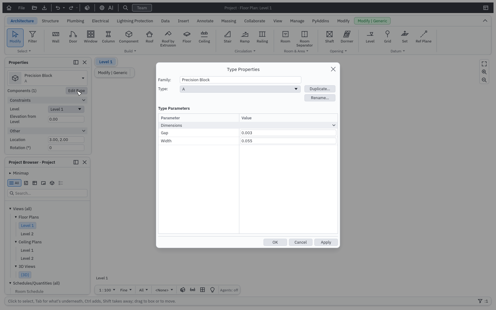

# Type Properties length precision — issue #513

BIMCraft Rust v0.12.0, based on upstream `046b3575db132777da22655d6a44aa75b32b349c`. All models and screenshots here are synthetic. The test fixture is in `crates/ui-egui/src/tests/parameter_precision.rs`; [fixture.txt](fixture.txt) provides a visible wall and generic block for a separate desktop/CLI run.

## Reproduction and repair

The unchanged base fails three behavioral regressions in [before-tests.log](before-tests.log):

| Metre-project action | Raw result before | Required result |
|---|---:|---:|
| Family type, untouched Apply | Gap 3 → 0 mm | 3 mm |
| Type `0.003`, Apply twice | first 3 mm, second 0 mm | 3 mm both times |
| Native wall type, untouched Apply | total 58 → 60 mm | 58 mm (3 + 55) |

The UI initialized editable fields with `Units::length`, the rounded drawing format, then parsed every field back into a command. A wall's rounded total also changed its structure layer through the normal type command. This was model-value loss, not only display rounding.

`Units::length_input` keeps the usual notation when it represents the value and otherwise shows decimal units. Native type fields, layer rows, room offsets and family type lengths retain the original number alongside their text, so untouched values finer than the parser's micron survive too. Edited text uses the existing parser and commands. Unchanged Apply/OK skips resubmission, avoiding a redundant Undo step. No model/file format or command schema changes.

## Workflow checks

The 12 UI behavioral tests plus the optional screenshot test pass in [after-tests.log](after-tests.log). They cover all six unit systems; `0.003`, `0.055`, fractional millimetres, explicit metric and imperial input; untouched and repeated Apply; editing another field; Cancel/Escape; invalid input with atomic refusal; one Undo/Redo of the real edit; native save/reopen; layer edits and reordering; Duplicate; submicron stored values; and existing instance/project-type-parameter change-only controls. The core formatter test checks representative positive, negative and zero lengths in every unit.

Newly typed lengths keep the established 0.001 mm input precision. Instance Properties and project type parameters already skip unchanged text and remain rounded in their display; these controls are tested but their formatting is outside this fix. Family Editor has its own parameter editing path. Drawing/schedule precision, a project-wide precision setting, and broad Revit parity are not implemented here.

## Automated visual evidence

The original values appear as `0.00` and `0.06` before, and `0.003` and `0.055` after. The native egui harness rendered both profiles in Light, Dark and Dark UI/Light Canvas. All six after images were inspected. These are automated captures, not manual user acceptance.

| Before | After |
|---|---|
|  |  |

The remaining images are in [before](before/) and [after](after/). An initial sandbox render had no graphics adapter; the separate capture runs with Mac graphics access succeeded.

## Revit reference and bounded comparison

Reference versions: Revit LT 2026 [Project Units](https://help.autodesk.com/cloudhelp/2026/ENU/RevitLT-Customize/files/GUID-3AC18F2E-AEB3-43F5-A77A-4E9B72CE9357.htm) and Revit API 26.4.0.0 [FormatOptions.Accuracy](https://help.autodesk.com/cloudhelp/2026/ENU/Revit-API-MainReference/files/html/bbba6604-8961-3a26-4e1f-73c2a2169464.htm). Documentation was consulted for behavior; no Autodesk assets or prose are included in implementation or fixtures.

| Topic | Evidence and BIMCraft Rust scope |
|---|---|
| Display versus editable precision | Autodesk documents distinct editable model-size precision. This fix uses precise type-edit text while keeping drawing rounding. |
| Type versus instance | Type edits use the shared `family`/`type` commands; instance Properties keeps its existing changed-field path. UI controls tested. |
| Numeric input | Existing metric/imperial parsing, explicit units and 0.001 mm input precision retained; tested. |
| Apply/Cancel/history/persistence | Automated BIMCraft checks above. No native Revit run was performed for this slice. |
| Activation/selection | Select the synthetic element, Edit Type, edit the staged fields; selection and type assignment use existing flows. |
| Geometry/layers | Generic family dimensions and native wall layers covered; no cabinet-specific behavior or new hosting semantics. |
| Grips/snapping/export/drawing formats | No interaction change. Drawing and schedule rounding remains supported as before; customizable project-wide precision remains unavailable. |

## Reproduce

```sh
cargo test -p bimcraft-ui-egui --lib precision_
cargo test -p bimcraft-core editable_lengths_keep_small_values_in_every_unit
BIMCRAFT_PRECISION_DUMP=/absolute/output/folder cargo test -p bimcraft-ui-egui --lib precision_screenshots
python3 docs/evidence/parameter-precision/mcp_probe.py /absolute/path/bimcraft-cli /absolute/output/folder
```

The MCP probe uses real JSON-RPC stdio, the same semantic commands as the UI, raw queries, refusal, Undo/Redo, native reopen and IFC export. `--connect PORT` runs against an isolated desktop opened on the generated `fixture.bimc`. Both modes passed; transcripts and summaries are in [runtime](runtime/). The final raw values are Gap 3 mm, Width 125 mm and wall layers 3 + 125 mm. A separate CLI reopen of the desktop's saved native file retained those values.

`desktop_probe.py DESKTOP CLI OUTPUT_DIR` starts the fixture with isolated preferences and update checking disabled, runs the connected probe, captures plan/3D through the native benchmark runner and closes that test process. Both native images were inspected. The 500 mm-high UI harness block and the 2000 mm-high runtime block are deliberately separate synthetic cases; the latter is visible at the plan cut height.

Independent IfcOpenShell 0.8.4.post1 validation found zero schema/EXPRESS findings in standalone, connected and reopened exports. Mesh bounds measure the wall at 4 × 0.128 × 3 m and the block at 0.125 × 0.5 × 2 m. Reproduce with `ifc_probe.py OUTPUT_DIR` in an environment containing `ifcopenshell` and `pytest`. The connected reopen/export commands are:

```sh
bimcraft-cli run OUTPUT_DIR/connected.bimc --cmd 'elements {"category":"component"}' --cmd 'inspect {}'
bimcraft-cli run OUTPUT_DIR/connected.bimc --save OUTPUT_DIR/connected-reopened.ifc
```

## Contribution scope and attribution

Small generic repair for the data-loss alternative in [#513](https://github.com/IPedrax/BIMCraft/issues/513). Open upstream PRs were checked before implementation; no duplicate precision fix was found. The separate SolidCraft compatibility upgrade is not part of this contribution. The [proposed wiki patch](../../wiki-patches/parameter-precision.md) is unpublished.

Agent: Codex desktop, `gpt-6-astra`, high reasoning effort, verified from this chat's recorded turn configuration. No subagents were used.

## Final local validation

macOS arm64, Rust 1.99.1 (`58cf8f9c3`), Cargo 1.99.1. Source/catalog hashes used for the checks are in [checks/source-hashes.json](checks/source-hashes.json); the PR head identifies this source snapshot.

- `cargo fmt --check`: passed.
- `cargo clippy --locked --workspace --all-targets -- -D warnings`: passed.
- `cargo test --locked --workspace`: **5,330 passed, 0 failed, 22 ignored**, including the hostile-input sweep. The wasm sample plugin was built first.
- `cargo i18n update` and `cargo i18n check`: passed; only source references changed.
- `cargo build --locked -p bimcraft -p bimcraft-cli`: passed. Both binaries report v0.12.0; this is an isolated development build, not a release or installed-app replacement.
- Standalone/connected MCP, native reopen and the three independently checked IFC exports: passed as described above.

Actual logs are in [checks](checks/). Commands used `CARGO_TARGET_DIR=/tmp/parameter-precision-target`, `CARGO_PROFILE_DEV_DEBUG=0`, `CARGO_PROFILE_TEST_DEBUG=0` and `CARGO_INCREMENTAL=0`. Graphics/socket tests ran with macOS access. The first workspace compile in Documents stopped on file-provider OS error 60 before tests ran; a matching local `/tmp` source copy completed the full suite. The Documents Git index was also evicted, so a fresh local publishing clone at the same base was used, with every staged source/catalog hash compared to the tested copy.
