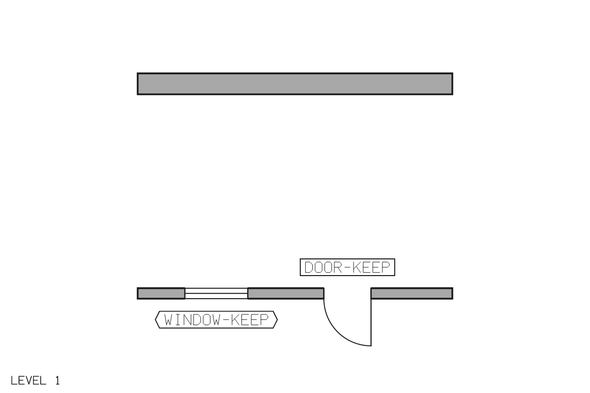
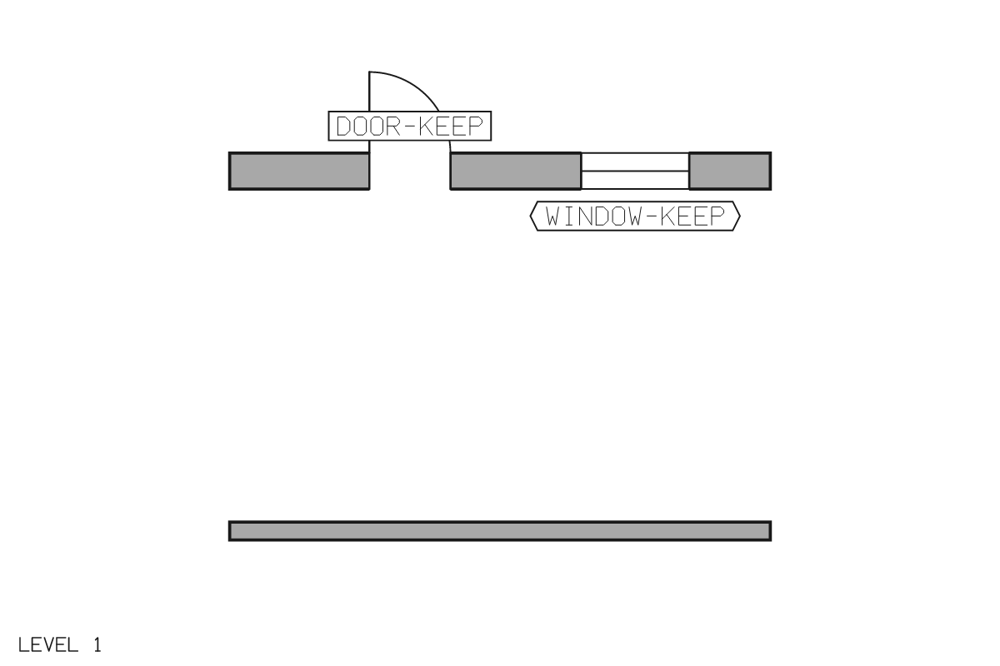
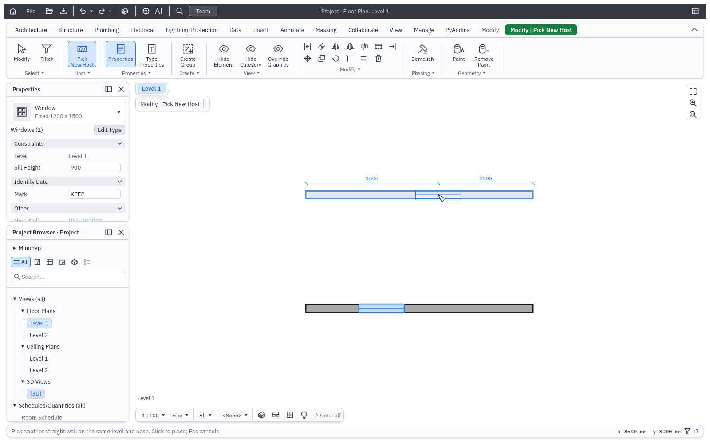

# Pick New Host evidence

## November 25 compatibility refresh

Merged main `73aceeae81efdece268de404644a2b72822ce408`, including slanted/profiled walls and net planar quantities.
The ordinary-host boundary is now explicit for both source and target: nonzero `slant` and nonempty `profile` are refused.
The new eligibility regression first failed because rehosting to a slanted target returned success; after adding the
shared guard, all **12 focused core tests passed**. The initial attempt stopped at unresolved catalog markers and is
not counted as a behavioral RED. Formatting, catalog checking and all-target Clippy with warnings denied also passed.

The new quantity test moves a window and door between 200/400 mm walls and checks net/opening areas, volumes, opening
identity, one-step history, Undo/Redo and fresh native reopen. `replay.py` repeats the quantities through standalone MCP;
`verify_ifc.py` independently tessellates the exported walls and compares their net side-area quantities with geometry.
No native desktop, local egui harness or updater launch test is run for this refresh. Full hosted CI results and the
audited local subset are reported separately; these checks do not claim manual workflow acceptance.

On macOS arm64, Rust 1.99.1, the audited headless subset passed **4,205 tests, 0 failed, 15 ignored**:
`cargo test --locked --config ci/fast-build.toml --workspace --exclude bimcraft --exclude bimcraft-ui-egui --exclude bimcraft-update`.
The wasm sample plugin was rebuilt first; the hostile-input sweep and both scene random-edit oracles passed. Builds used
two jobs with incremental compilation disabled. [Exact local totals](refresh-2026-11-25.json).

Standalone MCP and independent IfcOpenShell 0.9.0.post1 checks passed, including preservation of `slanted: true` on an upright
host. Both exports have zero schema/EXPRESS findings. Source/target net side areas change from 14.31/18.00 to 18.00/14.31 m²;
the corresponding volumes are 2.862/7.200 before and 3.600/5.724 m³ after. [Measurements](ifc-measurements-2026-11-25.json).
Fresh software renders were inspected; these are model-output checks, not native UI captures:

| Before | After |
|---|---|
|  |  |

BIMCraft Rust, refreshed against `81ebe7f2a937786387c81775daed18d793a48120` (November 21 development main, package 0.12.0).
All public cases are synthetic. Agent: Codex desktop, `gpt-6-astra`, high reasoning effort, verified from this chat's local
turn configuration. No native Revit session or manual user acceptance is claimed.

Select one ordinary door/window in a floor or ceiling plan, choose **Pick New Host**, hover another ordinary straight wall,
and click. The original element and GUID survive; only host and offset change. Preview runs the same command in a scratch
session. A successful command is one Undo/Redo step. Escape, bad fit and stale previews leave the live model untouched.

Orientation follows the target wall's interior/exterior faces. Both hand/facing flags remain unchanged, so a reversed wall
can reverse the world direction. This was the requesting user's explicit policy, not an inference from Autodesk's docs.
Targets must share level and base elevation; sill remains unchanged. With the integrated family origins (#437), offset and
sill locate the insertion point; the physical opening centre and bottom follow its origin and flips. A negative stored
sill can be valid. Rehosting preserves physical height and does not settle the origin again. Group contexts, curved/curtain hosts, panel replacement
walls and pinned openings are refused. Activation outside plans and cross-host dragging are outside this slice.

## November 21 merge refresh

Merged development main `81ebe7f2` without rewriting the published branch. Only generated translation catalogs conflicted;
they were regenerated from upstream translations. No rehost semantics changed. All eleven focused core regressions pass.
The existing proposed wiki patch still applies to the freshly fetched wiki at `19f7fb6e`.

Formatting, catalog validation and all-target workspace Clippy (`-D warnings`) pass. The audited headless workspace subset
has **3,658 passed, 0 failed, 15 ignored** across 54 target summaries, including the hostile-input sweep. The wasm sample
plugin was rebuilt. Exact commands, exclusions, build settings and IFC measurements are in the
[dated results](refresh-2026-11-21.json). A sandboxed mock-server test initially failed because loopback sockets were denied;
the same subset passed with loopback permitted, without changing the test or implementation.

Local desktop launches, egui harnesses and updater subprocess tests were deliberately omitted to avoid creating windows on
the contributor's desktop. The November 18 UI pictures and connected replay below are historical evidence, not acceptance
of this refreshed base. Full native/UI execution belongs to hosted CI on the pushed SHA; a coordinated native acceptance
session is still needed. This refresh does not install the app or change the accepted baseline.

Fresh standalone MCP replay passes identity/value preservation, invalid-fit/read-only refusal, Undo/Redo, native-file
reopen and old-host deletion. IfcOpenShell 0.9.0.post1 reports zero schema/EXPRESS findings, correct opening/host relations
and the same independently expected wall volumes listed below. These November 21 software renders were inspected:

| Before rehosting | After rehosting | After in 3D |
|---|---|---|
|  |  |  |

## Test-first evidence

Before the command existed, `cargo test --locked -p bimcraft-core rehost_tests -- --nocapture` failed with
an unknown-command error naming `pick_new_host`. Before the UI action existed, the first egui test failed with
a missing-node query for `Pick New Host`. The same cases pass after implementation.

The focused core suite has eleven tests covering GUID/value preservation, reversed/rotated face orientation, raised hosts,
existing wall-top notch policy, thicker-wall family evaluation, tags/dimension references, save/reopen, old-host deletion,
read-only refusal, history, groups and curtain hosts. The geometry test compares incremental scene pixels with a fresh scene.
The UI suite exercises actual contextual activation/clicks, hover/Escape/refusal, view/selection/model changes and a TCP
control-port command interleaved with a pending user pick. The hostile-input sweep includes real opening/target payloads.
The November 18 refresh added door/window cases for all four hand/facing combinations, moved XYZ origins, actually mirrored and rotated
target walls, independent vertex/hole calculations, Undo/Redo and native reopen. A UI case checks origin-aware preview and
click placement, including Space leaving the live opening unchanged during the pending pick.

This base includes #437 origins, #443 flips, #455 same-host dragging, #473 clipboard, #490 vertical tools and #495 roofs.
Their existing paths remain intact. The November 25 refresh includes #504 and explicitly refuses slanted/profiled source
and target walls through the shared eligibility guard. Controls reset each form to an ordinary wall and verify rehosting
works again. A command regression checks both hosts' net/opening areas and volumes, identity, Undo/Redo and native reopen;
the IFC replay independently measures both solids and verifies their net side-area quantities.

## November 18 automated UI captures

These are egui_kittest captures of the feature build before placement, during preview and after placement, not screenshots
of the upstream baseline or manual acceptance. Both profiles and all three appearances were rendered and visually inspected.
The public sample below uses Rev / Light; the reproducible capture test also produces BIMCraft / Light, Dark and Dark UI with
Light Canvas. Set `BIMCRAFT_REHOST_DUMP` to an output directory and run the `pick_new_host_screenshots` test with GPU access.

| Before placement | Preview | After placement |
|---|---|---|
|  |  |  |

## Revit comparison

Versioned references: Revit 2026 [door rehosting](https://help.autodesk.com/cloudhelp/2026/ENU/Revit-ArchDesign/files/GUID-9958015A-2449-4EA0-804C-E561C3D24D6B.htm)
and [window rehosting](https://help.autodesk.com/cloudhelp/2026/ENU/Revit-ArchDesign/files/GUID-D293BF67-A76A-4A61-8ECA-6CD92E54EF97.htm).
Only independently written behavior descriptions and links are used; no Autodesk assets or model contents are included.

| Workflow | This slice | Evidence boundary |
|---|---|---|
| Selection → Pick New Host → preview → click | Supported in floor/ceiling plans | Documentation reference and automated UI |
| Properties/type distinction | Keeps original type and instance values | Core and MCP; no default-type recreation |
| Interior/exterior-relative facing | Preserves both flags | User policy, rotated/reversed tests |
| Sill and levels | Same level/base only, unchanged sill | Explicit bounded policy; broader Revit rules not asserted |
| Placement precision | Insertion-point projection, origin-aware existing centre snap; command offset in mm | No separate snap engine added |
| Cancel/history | Escape cancels; one command/Undo/Redo; failed fit is atomic | Automated UI/core/MCP |
| Persistence/drawings | Native reopen and rebuilt old/new host cuts | Core and exported-output verification |
| 3D/section activation, curved/curtain/group hosts | Unavailable | Honest disabled UI/refusals; no parity claim |
| Ordinary same-host dragging | Integrated #455 behavior | This PR does not change it |

Area/user docs and a [proposed wiki patch](../../wiki-patches/pick-new-host.md) accompany the change. The wiki patch is not
published. This does not claim completion of the broader agentic document/revision contract or Co-Work acceptance.

## Independent output replay

`python3 replay.py /absolute/path/to/bimcraft-cli /absolute/output/directory` drives the real standalone MCP binary. Its
synthetic fixture has 6 m source/target walls, 200/400 mm thickness, matching 400 mm bases, one 1200 × 1500 mm window at
900 mm sill, and one 900 × 2100 mm door. The plan cut is 1500 mm above Level 1 to cross the raised window. The target wall
runs in the opposite direction. The replay checks identities/values, refusal, Undo/Redo including redo after refusal,
fresh-process native reopen, deletion of the old wall, read-only mode, and exports PNG, IFC and GLB.

With IfcOpenShell and pytest installed, `python3 verify_ifc.py /absolute/output/directory` checks the exported schema and
EXPRESS rules, product/void/host relationships, builds the wall/opening shapes and measures the actual wall net volumes.
Both exports have zero schema/EXPRESS findings. Measured volumes agree with independent rectangular-prism calculations:

| Wall | Before (m³) | After (m³) |
|---|---:|---:|
| Source, 200 mm | 2.862 | 3.600 |
| Target, 400 mm | 7.200 | 5.724 |

The source regains both cuts and the target loses the same opening area at its own thickness.
[Measurement output](ifc-measurements.json). The exported plan and 3D pictures were visually inspected.

## November 18 completed checks

On macOS arm64 with Rust 1.99.1:

- `cargo fmt --all -- --check`: passed.
- `cargo clippy --locked --workspace --all-targets -- -D warnings`: passed.
- `cargo test --locked --workspace`: **5,335 passed, 0 failed, 22 ignored**, including the hostile-input sweep. The wasm
  sample plugin was built before the suite. [Result totals](test-results.json).
- `cargo i18n update` and `cargo i18n check`: passed; new messages fall back to English until translated.
- Desktop and CLI development builds: passed. The desktop linker warned that its debug exception-unwind section exceeded
  the compact-unwind encoding limit; this is a build warning, not a test failure or a release-build result.

The same synthetic fixture was opened in the real candidate desktop with its own settings and control port. The replay
then used `bimcraft-cli mcp --connect`, exported the live result, and repeated the identity/history/refusal checks and IFC
measurements. Connected read-only MCP also refused mutation. This is automated desktop/MCP verification, distinct from
manual UI acceptance. Only that test desktop was closed afterward; no installed app was replaced.
