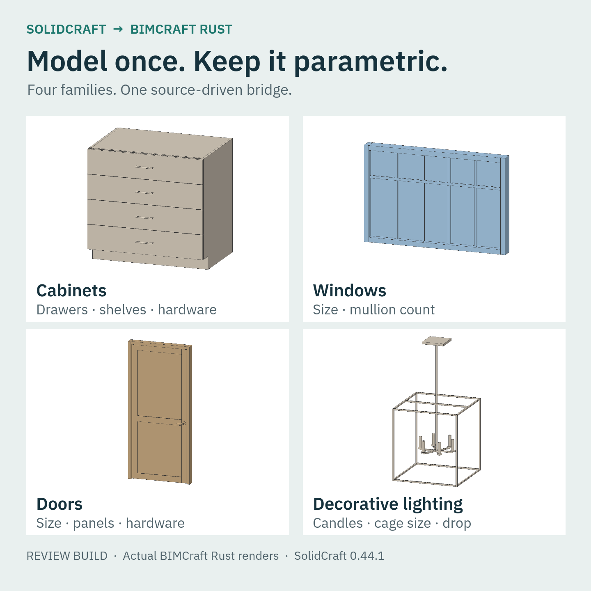
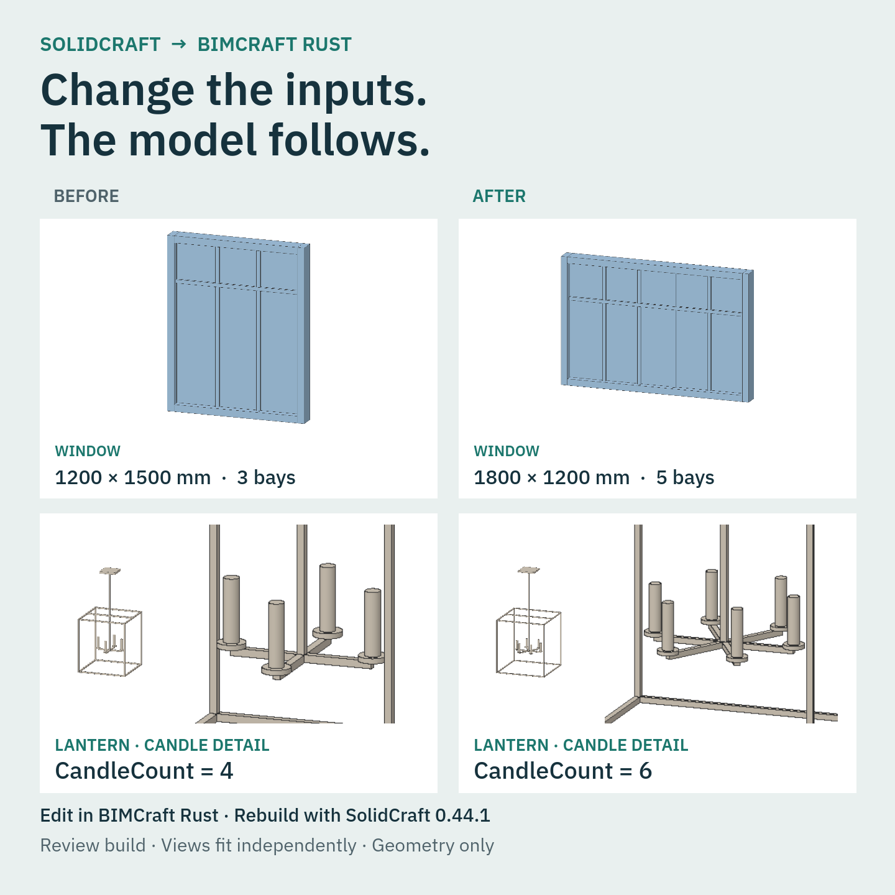
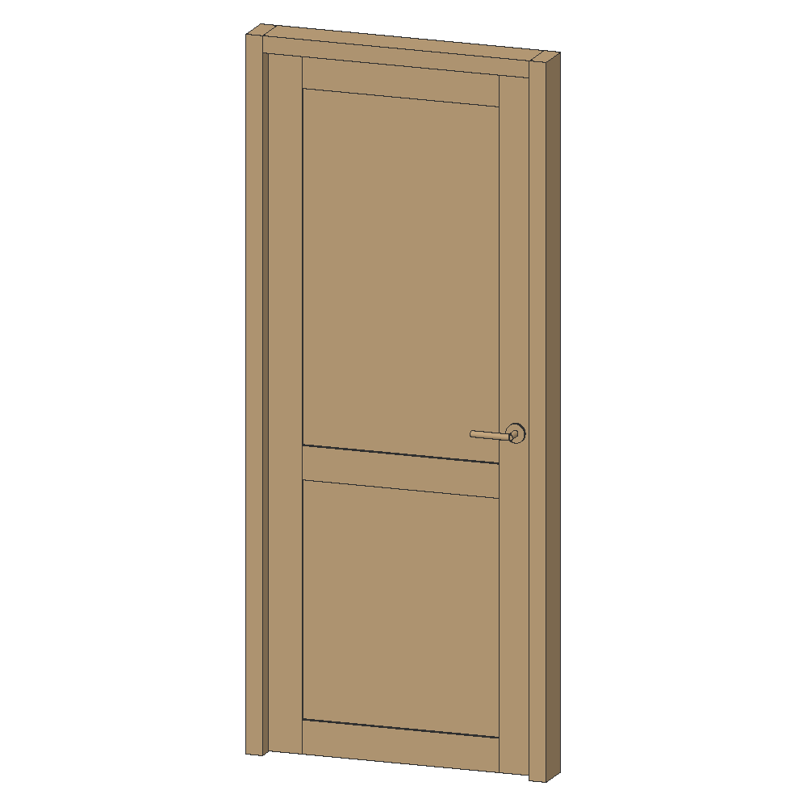
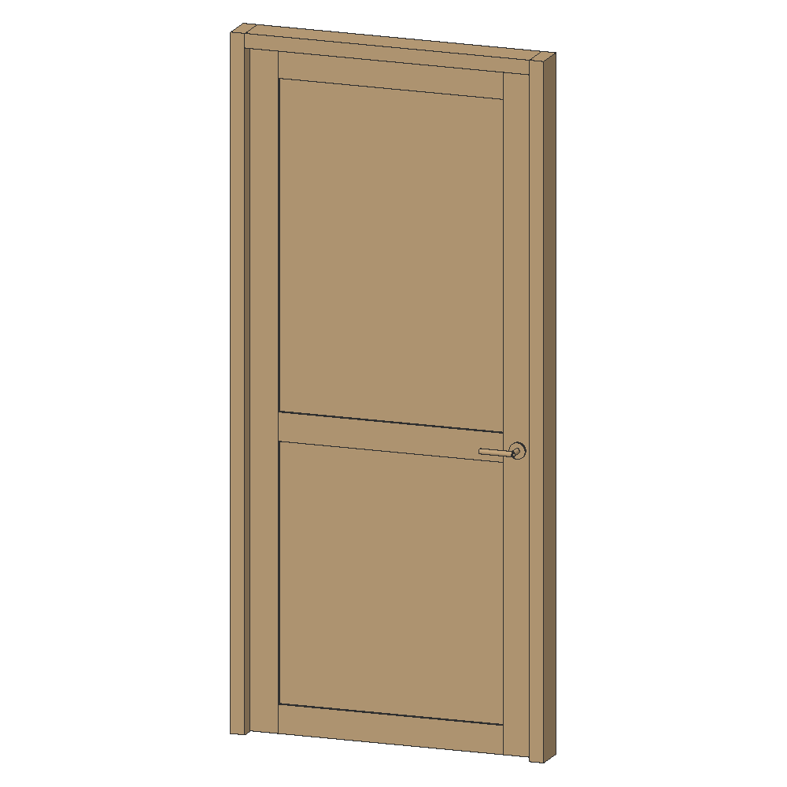
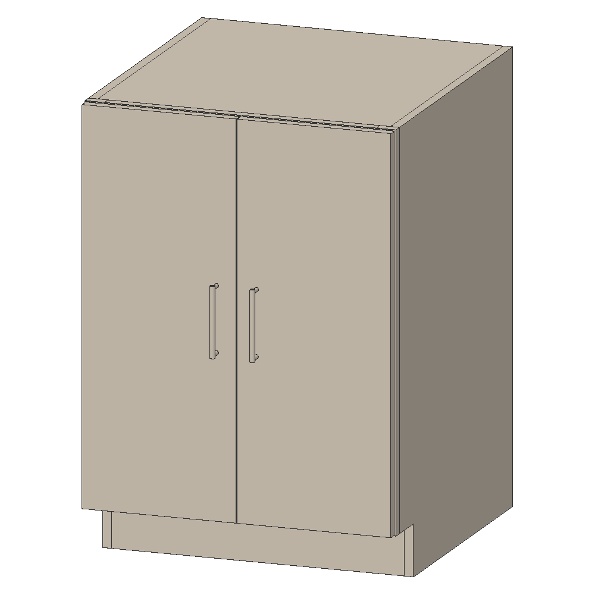
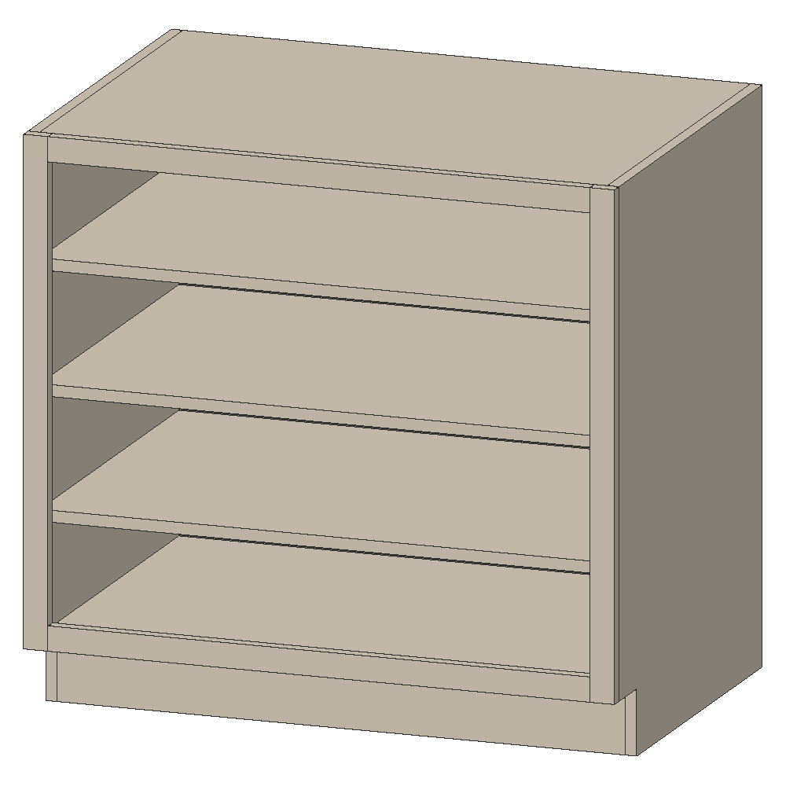
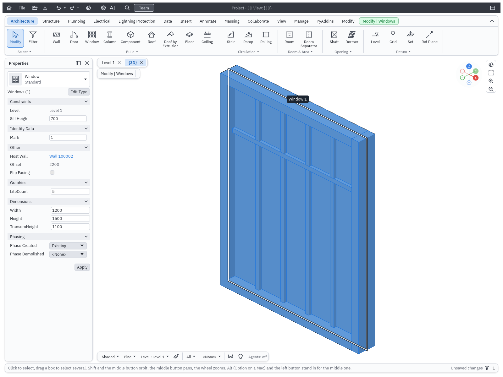
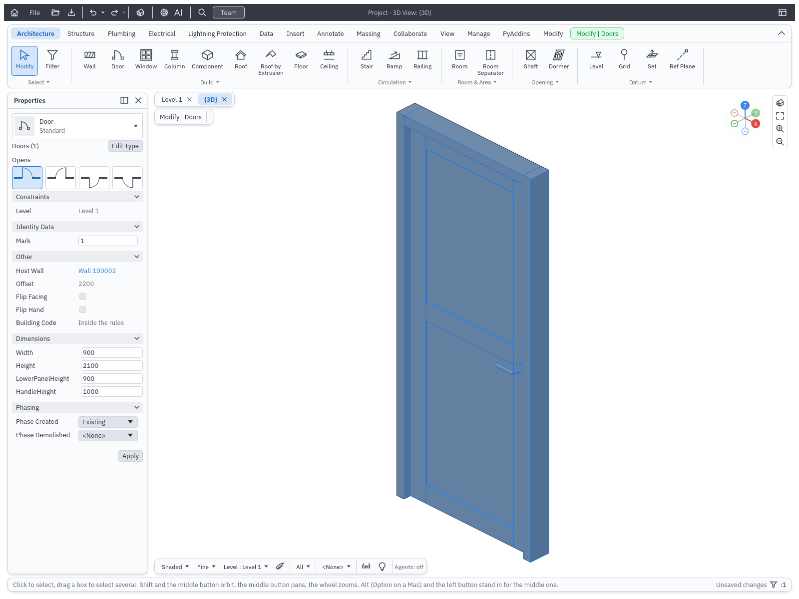
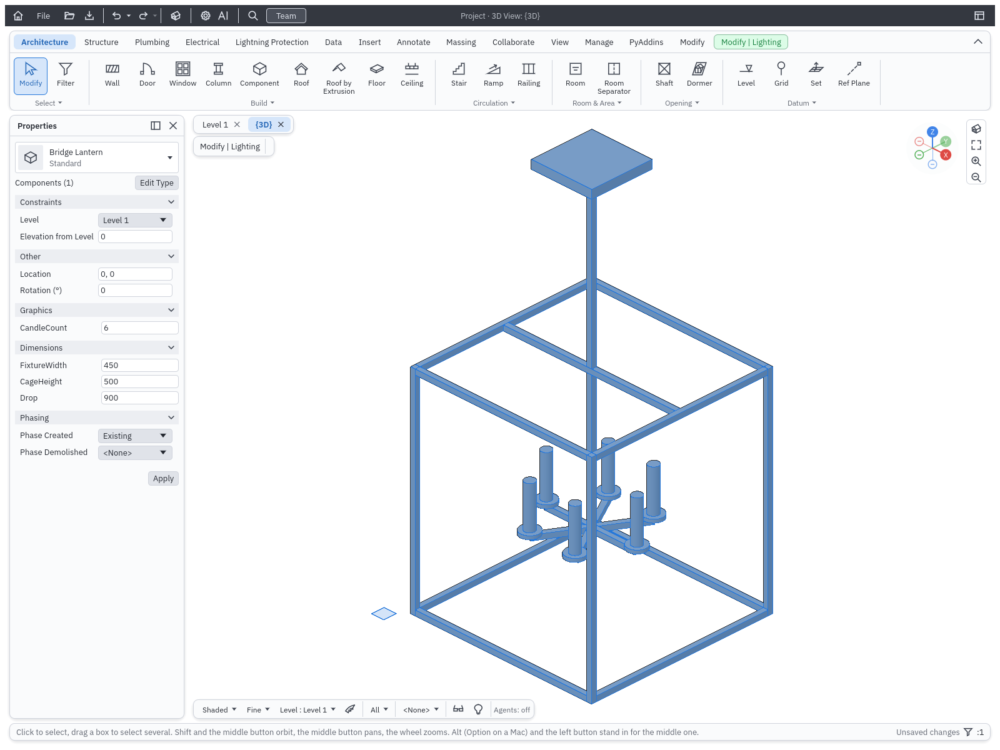

# Source-family bridge qualification — 2026-11-18

BIMCraft Rust review branch, based on `e61e6d6d6999416ea2282de7d3d60b84ccce2401`.
Evaluator: unmodified SolidCraft **0.44.1**, `e151d5ea6866fb055e011379153fb1cae0566f22`.
The five original sources and explicit mappings are in `examples/solidcraft/`.
Installed applications were not changed. UI captures are automated test-harness output, **not manual user acceptance**.

## Reproduce

Follow [setup and behavior](../../solidcraft-bridge.md), then run the showcase and independent geometry verifier.
The verifier compares every triangle, including nested component transforms, with stock `model.mesh` output at
0.001 mm tolerance for GLB float32. Exact saved Undo/Redo triangle sets are checked as well.
See [machine-readable geometry results](geometry-verification.json).

The public examples also drive the native Properties/editor integration test (a working GPU is required):

```sh
BRIDGE_SHOWCASE_FIXTURES=/tmp/bridge-showcase \
SOURCE_EDITOR_CAPTURES=/tmp/bridge-native-ui \
cargo test -p bimcraft-ui-egui source_showcase_properties_and_editor_roundtrip -- --ignored --nocapture
```

The other three opt-in regression tests use earlier local study fixtures and are not self-contained in this PR;
the standalone public test above covers the newly supplied window, door and light sources.

| Fixture | Before triangles | After triangles | Changed inputs |
|---|---:|---:|---|
| Drawer base | 100,322 | 133,632 | Drawer count 3 → 4; width 914.4 mm |
| Two-door base | 66,818 | 236 | Hide fronts; three shelves; width 914.4 mm |
| Window | 96 | 120 | Width/height 1200×1500 → 1800×1200 mm; bays 3 → 5; transom position |
| Door | 34,358 | 34,356 | Width/height 900×2100 → 1100×2400 mm; panel/handle positions |
| Decorative lantern | 101,808 | 152,652 | Candles 4 → 6; cage width/height and drop |

All ten states passed the independent geometry comparison and remain below the unchanged 400,000-triangle budget.
The largest observed coordinate discrepancy was below 0.00011 mm, from GLB float32 conversion; this is a sampled
mesh comparison, not a certified continuous-surface tolerance.

## Test scope and limitations

- New evaluator configuration/encoded-source-budget test was recorded failing to compile before its helper/limit
  implementation existed; the focused filter then passed 6 tests with 1 external integration test ignored.
  This is test-first compile-failure evidence, not a fabricated behavioral red result.
- Native integration tests exercise drawer counts 1–4, shelf counts 0/1/3/6, front/hardware flags, positions,
  type/instance separation, source-bound rename/delete refusals, and Family Editor save/reload/history.
- Window, door and light change a native Properties input, Undo/Redo, and preserve source through editor save.
- The original older project fixtures encountered a missing `Grid - ASME Chain` migration dependency on this
  main baseline. Legacy files were preserved; unchanged family definitions were loaded into fresh projects
  for the bridge regression checks. This does **not** qualify migration of those older projects.
- Geometry uses existing rectangular wall opening behavior for the door/window. Decorative light is geometry
  only. Source materials, electrical connectors, photometry and source feature editing are not translated.
- Cache-miss evaluation is synchronous, and only the pinned 0.44.1 evaluator is qualified.
- Full native mapping UI remains separate trial work; the public reproducible publisher is a Python CLI.

## Visual evidence

The overview and before/after cards use actual BIMCraft Rust CLI renders. Views are fitted independently.
The lantern close-ups are crops of those renders; no geometry was drawn over them.




| Door before | Door after |
|---|---|
|  |  |

| Two-door base before | Two-door base after |
|---|---|
|  |  |

## Attribution

Implemented and tested with Codex (identified as based on GPT-6). The exact serving model variant and reasoning
effort are not exposed in this session, so the contribution guide's model/effort floor cannot be independently
verified. Two separate design critics reviewed only the graphics, not implementation correctness.
No Autodesk family, template, icon, help prose or model content is included.

## Native UI captures

These captures change one source input in native Properties (separate from the multi-input CLI cards).





The source-preservation hint in Family Types is captured in both UI profiles and all three canvas/theme configurations:

| Profile | Light | Dark | Dark with light canvas |
|---|---|---|---|
| Rev | [Capture](../../images/solidcraft/source-types-rev-light.png) | [Capture](../../images/solidcraft/source-types-rev-dark.png) | [Capture](../../images/solidcraft/source-types-rev-dark-light.png) |
| BIMCraft | [Capture](../../images/solidcraft/source-types-bimcraft-light.png) | [Capture](../../images/solidcraft/source-types-bimcraft-dark.png) | [Capture](../../images/solidcraft/source-types-bimcraft-dark-light.png) |
