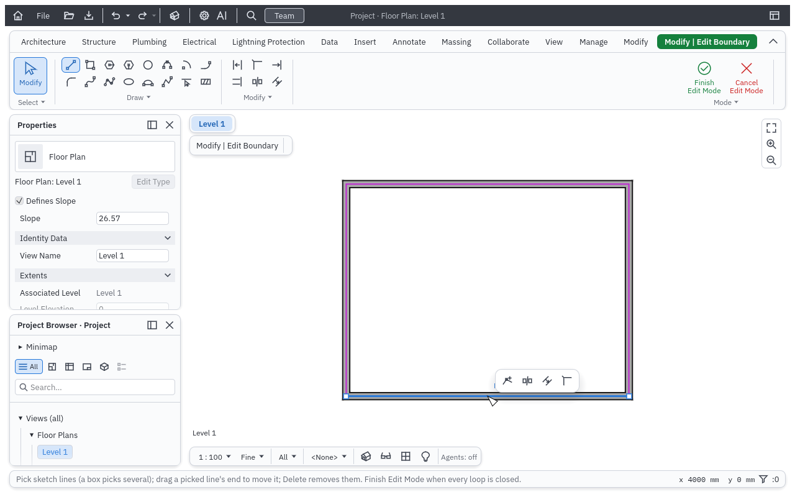

# Roof footprint slope editing

Select a footprint roof, choose **Edit Boundary**, and select one boundary line. **Defines Slope** controls whether
that edge contributes a sloping face. Turn it off to leave the edge upright; its remembered pitch is kept.
Enter the line's **Slope**, then choose **Finish Edit Mode** to apply the draft in one history step. **Cancel Edit Mode**
discards it. A rectangular footprint with only one defining edge makes a shed, rising inward from that low eave.

Both a selected roof's **Slope** field and a selected footprint line's **Slope** field accept:

| Input | Result |
|---|---|
| `26.56505117707799` | Degrees |
| `6:12`, `6/12`, `1/2` | Rise divided by horizontal run, approximately 26.565° |
| `50%` | 100 × rise/run; the same pitch as 6:12 |
| `100%` | 45° |
| `12.5%` | Approximately 7.125° |

Stored commands and displayed values remain degrees. A roof's own pitch does not replace independent edge overrides.
Ratios and percentages must be positive and yield no more than 75°. Bare `0` makes a whole roof flat; on a boundary
line, bare `0` or blank inherits the roof's pitch. A pitched roof with all edges disabled refuses Finish.
The Roof creation Options Bar still accepts degrees. Project-wide slope display formats and extrusion **Edit Profile**
UI are separate work; this change does not provide them.

## Actual before and after

These are native egui harness renders of a synthetic 8000 × 6000 mm roof. They are automated UI evidence, not a manual
desktop acceptance session. No Autodesk model, screenshot or graphic is included.

**Before — upstream `3e08223f1ab9d3d68953804c8c5c54ed482b4af1`:** the selected roof boundary line has no Defines Slope
checkbox; entering `50%` is refused. Only a test capture helper was added to this isolated baseline.


**After — implementation `683aeda63181ba9a3f3f917836623d34af7ee58c`:** the selected line has Defines Slope enabled;
`50%` has been accepted and displays as 26.57°. The other three lines are disabled in this shed draft. Finish/Cancel,
Undo/Redo and a 24-inch rise over 48-inch run are exercised by the same test journey.



Reproduce the after captures with an absolute output folder and native graphics access:

```sh
BIMCRAFT_ROOF_DUMP=/absolute/output/folder cargo test -p bimcraft-ui-egui roof_sketch_defines_slope_can_be_cancelled_then_finished_as_a_shed
```

## Proposed wiki update

This text is proposed for the wiki's **Roofs and Dormers → Changing a roof** section once this PR is accepted.
The live wiki is not changed while the feature remains a draft.

> Select a footprint roof and choose **Edit Boundary**. Select one boundary line, then use **Defines Slope** and
> **Slope** in Properties. Turn Defines Slope off for an upright edge. On a rectangular footprint, leaving just one
> defining edge makes a shed that rises inward from that edge. **Finish Edit Mode** applies the draft as one undo step;
> **Cancel Edit Mode** discards it.
>
> The selected roof's Slope and its boundary-line Slope accept degrees, positive rise:run or rise/run (`6:12`, `6/12`),
> and positive percentages (`50%`). 50% equals 6:12; 100% equals 45°. Values display in degrees and the 75° limit still
> applies. Bare zero on the roof makes it flat; on a boundary line, blank or bare zero inherits the roof's slope.
> The creation Options Bar still uses degrees. Extrusion profile editing is not part of this footprint workflow.

Also proposed for **Sketch Mode → For agents** and the roof command's `sketch` row: a roof line may include numeric
`slope` in degrees and boolean `defines_slope`. `edit_boundary {id}` returns their effective values; sending the edited
lines through `edit_boundary {id, sketch}` applies them through the normal model validation and history. These are
command/draft properties, not new saved sketch fields. Percentage strings are UI input, not command values.

## Verification and attribution

Implementation head `683aeda63181ba9a3f3f917836623d34af7ee58c` passed `cargo test --workspace --no-fail-fast`:
4,405 passed, 0 failed, 21 ignored, exit 0. It also passed `cargo clippy --workspace --all-targets -- -D warnings`,
`cargo fmt --all -- --check`, `cargo i18n check`, and desktop/CLI debug builds on macOS arm64.
The selected-roof percentage test was run before implementing percentage parsing and failed on `100%` (exit 101).
After implementation, all 18 `tests::sketch::` UI tests passed (exit 0), including the percentage cases and shed journey.
Real CLI/MCP replay and independent GLB measurements also passed for a synthetic shed, attached wall and unequal slopes
after save/reopen. Those command inputs remain numeric degrees; percentage input is tested through egui.

Agent: **Codex desktop, `gpt-6-astra`, high effort**, verified from the owner chat's runtime metadata.
Live issues, PRs and discussions were audited before implementation. No separate pre-start public coordination
announcement was posted; this draft is the public review point. Manual desktop acceptance and wiki publication remain
pending. The implementation and visual fixtures are independent, synthetic work; no Autodesk prose or assets are included.
