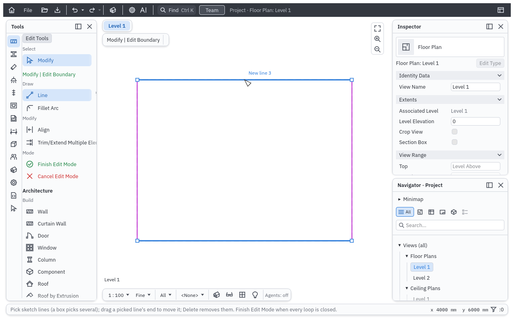
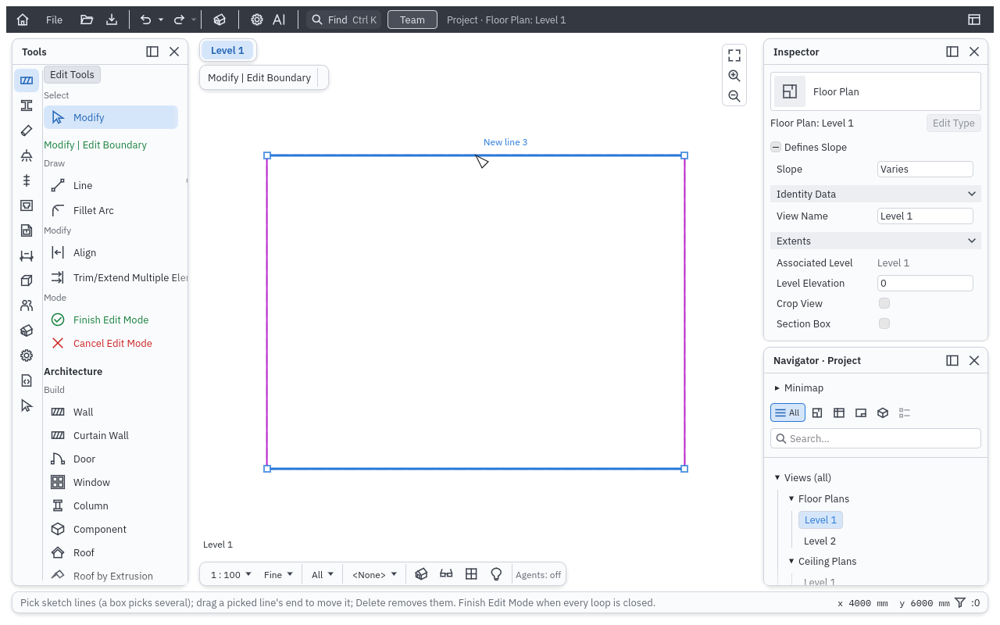
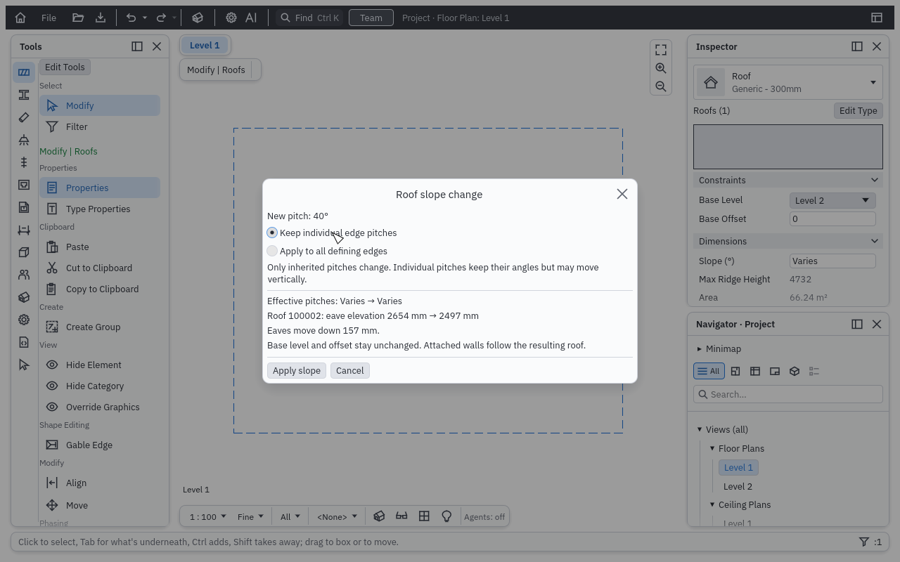
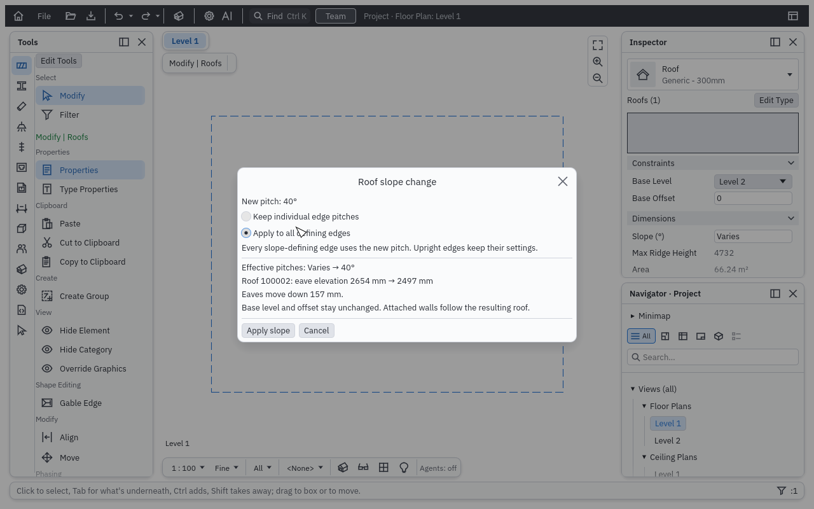
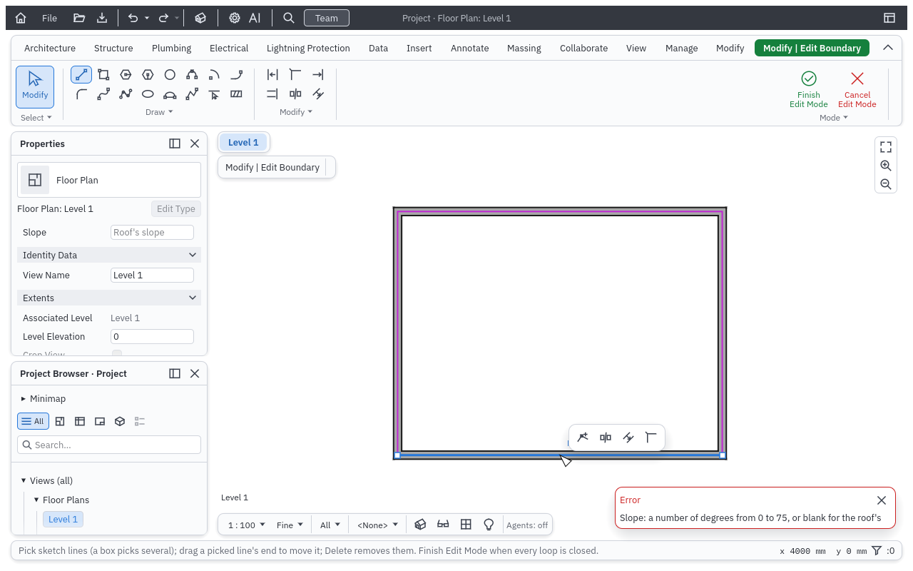
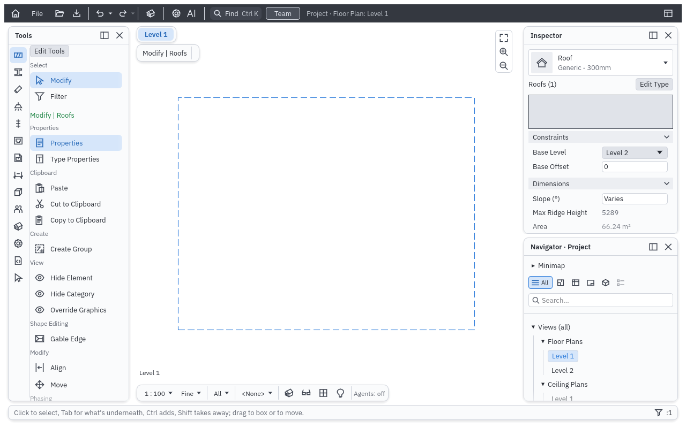
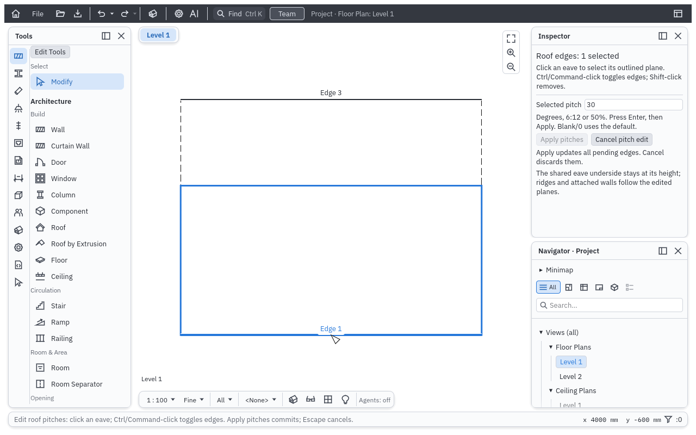
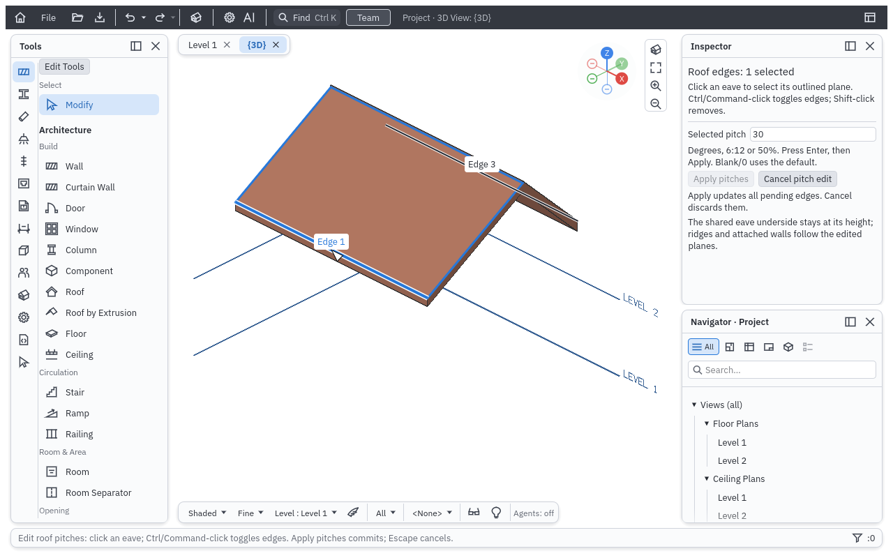

# Roof footprint slope editing

Select a pitched footprint roof and use **Edit roof pitches** in Properties for pitch-only changes. Click its numbered
eave edge: the thicker edge and the outline of its sloping plane identify the selection. Ctrl/Command-click toggles
additional edges; Shift-click removes. Properties says **Roof edges: N selected** and shows **Selected pitch**, with
**Varies** for different pitches. Enter degrees, a ratio or a percentage and press Enter. All pending edge numbers are listed;
**Apply pitches** commits them together, **Cancel pitch edit** or Escape discards them. The drawing changes on Apply.
This works in plan and 3D; entry from a section opens the roof's level plan. The shared underside eave datum and
default pitch stay unchanged. The separate overall Slope field still offers Keep individual / Apply to all below.

This pitch-only mode does not change gable definitions, footprint geometry, ridge/valley grips or opening outlines.
Use Edit Boundary for definitions and geometry. Outlines are selection overlays through other geometry, not rendered
visibility or a geometry preview. Switching tools, leaving plan/3D, external selection or a model revision cancels the
draft. Apply/Cancel before Undo/Redo; after Apply the single command supports normal Undo/Redo and save/reopen.

Select a footprint roof, choose **Edit Boundary**, and select one or several boundary lines (Ctrl-click or a selection box).
**Defines Slope** controls whether those edges contribute sloping faces. Turn it off to leave edges upright; their remembered pitches are kept.
Mixed definitions show an indeterminate checkbox; clicking it enables all selected edges. Different pitch overrides show **Varies**.
Enter a common **Slope**, then choose **Finish Edit Mode** to apply the draft in one history step. **Cancel Edit Mode**
discards it. A rectangular footprint with only one defining edge makes a shed, rising inward from that low eave.

Both a selected roof's **Slope** field and a selected footprint line's **Slope** field accept:

| Input | Result |
|---|---|
| `26.56505117707799` | Degrees |
| `6:12`, `6/12`, `1/2` | Rise divided by horizontal run, approximately 26.565° |
| `50%` | 100 × rise/run; the same pitch as 6:12 |
| `100%` | 45° |
| `12.5%` | Approximately 7.125° |

Stored commands and displayed values remain degrees. The selected roof reports its common effective pitch or **Varies**,
ignoring upright gables. Entering a new overall value when individual pitches are involved opens **Roof slope change**:

- **Keep individual edge pitches:** only inherited pitches change. Explicit pitches keep their angles.
- **Apply to all defining edges:** explicit defining pitches change too; upright-edge settings and inheritance markers are retained.

The dialog shows the before/after eave elevation and how far it moves, in project units. **Apply slope** commits once;
**Cancel** leaves the roof untouched. A changed project invalidates the preview. For example, with a 24-inch overhang,
changing the default from 6:12 to 8:12 lowers the common eave by 4 inches. An explicit 12:12 face keeps its angle and moves
down under the first choice; under the second choice it becomes 8:12. Base level and offset stay unchanged, and attached
walls follow the result. Roofs with only inherited pitches retain direct overall editing.

Ratios and percentages must be positive and yield no more than 75°. Bare `0` makes a whole roof flat; on a boundary
line, bare `0` or blank inherits the roof's pitch. A pitched roof with all edges disabled refuses Finish.
The Roof creation Options Bar still accepts degrees. Project-wide slope display formats remain separate work.
Extrusion **Edit Profile** is supplied by the separately merged #495; this footprint contribution does not change it.

## Actual before and after

The November 17 follow-up adds multiple-line controls and the per-edit overall-pitch choice. Before is the merged
baseline `0d36d580434a089b864b5e479d58ee5f849c05eb` with a capture test only; after is this revision. Both use the same
synthetic two-line selection. The baseline has no slope controls for multiple lines; after shows mixed values.
The after images were refreshed from integration commit `409fd0f4` on November 18, retaining the current upstream controls.





The two choices below preview the same overall 40° edit. Keeping individual pitches leaves the effective pitch summary
at Varies; applying to all produces a common 40°. Both warn that this fixture's eave moves down 157 mm before Apply.





All 18 follow-up captures were inspected across BIMCraft and Rev profiles in Light, Dark, and Dark UI with Light Canvas.
These are automated egui harness renders, not manual desktop acceptance. Reproduce them with absolute output folders:

```sh
BIMCRAFT_ROOF_MULTI_DUMP=/absolute/output/multi BIMCRAFT_ROOF_CHOICE_DUMP=/absolute/output/choice cargo test -p bimcraft-ui-egui --lib roof_
```

The original single-line and percentage evidence below remains pinned to its original source.

These are native egui harness renders of a synthetic 8000 × 6000 mm roof. They are automated UI evidence, not a manual
desktop acceptance session. No Autodesk model, screenshot or graphic is included.

**Before — upstream `3e08223f1ab9d3d68953804c8c5c54ed482b4af1`:** the selected roof boundary line has no Defines Slope
checkbox; entering `50%` is refused. Only a test capture helper was added to this isolated baseline.



**After — implementation `683aeda63181ba9a3f3f917836623d34af7ee58c`:** the selected line has Defines Slope enabled;
`50%` has been accepted and displays as 26.57°. The other three lines are disabled in this shed draft. Finish/Cancel,
Undo/Redo and a 24-inch rise over 48-inch run are exercised by the same test journey.


Reproduce the after captures with an absolute output folder and native graphics access:

```sh
BIMCRAFT_ROOF_DUMP=/absolute/output/folder cargo test -p bimcraft-ui-egui roof_sketch_defines_slope_can_be_cancelled_then_finished_as_a_shed
```

## Proposed wiki update

This text is proposed for the wiki's **Roofs and Dormers → Changing a roof** section once this PR is accepted.
The live wiki is not changed while the feature remains a draft.

> For pitch-only edits, select a pitched footprint roof and choose **Edit roof pitches** in Properties. Click a numbered
> eave edge to select its sloping plane; Ctrl/Command-click adds/removes edges and Shift-click removes. Properties shows
> the selection count and Selected pitch. Apply pitches commits all listed pending edge edits; Cancel pitch edit or
> Escape discards them. Plan and 3D show selected edge/plane outlines; the drawing updates after Apply. This leaves
> the roof default and shared underside eave datum unchanged. Use the overall Slope field for Keep individual / Apply
> to all; use Edit Boundary to change slope definition or geometry.
>
> Select a footprint roof and choose **Edit Boundary**. Select one or several boundary lines with Ctrl-click or a box, then use **Defines Slope** and
> **Slope** in Properties. Turn Defines Slope off for an upright edge. On a rectangular footprint, leaving just one
> defining edge makes a shed that rises inward from that edge. **Finish Edit Mode** applies the draft as one undo step;
> **Cancel Edit Mode** discards it.
>
> The selected roof's Slope and its boundary-line Slope accept degrees, positive rise:run or rise/run (`6:12`, `6/12`),
> and positive percentages (`50%`). 50% equals 6:12; 100% equals 45°. Values display in degrees and the 75° limit still
> applies. Bare zero on the roof makes it flat; on a boundary line, blank or bare zero inherits the roof's slope.
> The creation Options Bar still uses degrees. Extrusion profile editing is not part of this footprint workflow.
>
> A multi-line selection shows an indeterminate Defines Slope checkbox or Varies when its settings differ. Editing a
> value applies to every selected line; unselected lines keep their settings. The overall roof Slope shows its common
> effective pitch or Varies. When individual pitches are involved, entering a new overall pitch offers a per-edit choice:
> keep individual pitches, or apply the new pitch to all defining edges. Review the eave-height change, then Apply slope
> or Cancel. Base level and offset stay unchanged; attached walls follow the result.

Also proposed for **Sketch Mode → For agents** and the roof command's `sketch` row: a roof line may include numeric
`slope` in degrees and boolean `defines_slope`. `edit_boundary {id}` returns their effective values; sending the edited
lines through `edit_boundary {id, sketch}` applies them through the normal model validation and history. These are
command/draft properties, not new saved sketch fields. Percentage strings are UI input, not command values.

Also proposed for **Roofs and Dormers → For agents**: an overall `modify {id, slope}` involving individual pitches
requires `roof_slope_mode: "inherited"` to retain them or `"all"` to change all defining edges. A changed eave datum is
refused with its signed movement in mm until `allow_eave_change: true` explicitly accepts it. Refusal adds no model
change or history. The flags are not saved properties. Do not combine `all` with a separate `slopes` array.

## Revit comparison and scope

Reference version: Revit 2026, documentation reviewed November 17, 2026. References are
[roof instance properties](https://help.autodesk.com/cloudhelp/2026/ENU/Revit-ArchDesign/files/GUID-A5745932-897D-4F28-85B8-F5B70BB661DD.htm)
and [boundary-line properties](https://help.autodesk.com/cloudhelp/2026/ENU/Revit-ArchDesign/files/GUID-682B3B19-A4F7-4EE7-B994-F3EA3154BB08.htm).
The table describes this implementation independently; it is not a native Revit acceptance result.

| Workflow | This contribution |
| --- | --- |
| Select an existing footprint and edit its boundary | Supported through Edit Boundary and existing selection tools |
| Direct eave/plane pitch selection | Intentional contributor-requested adaptation: numbered physical eaves, plane outlines and selected count in plan/3D; no native Revit observation or parity claim |
| Set slope definition and pitch on selected edges | Supported for one or several lines, with mixed states |
| Numeric pitch entry | Degrees, ratios and percentages supported in these Properties fields; global display formats remain separate |
| Overall pitch versus individual pitches | Common pitch/Varies summary; per-edit choice and height warning are an intentional adaptation requested by the contributor |
| Cancel, validation and history | Draft cancellation, atomic shared commands, one Finish/Apply Undo/Redo |
| Hosts, persistence and output | Synthetic attached-wall, save/reopen and independently measured GLB cases verified |
| Broader roof tools | Extrusion profile editing and general sketch-tool expansion are separate work; no full Revit parity claim |

## Verification and attribution

The November 18 integration refresh includes upstream main `046b3575db132777da22655d6a44aa75b32b349c`, including the
separately merged extrusion editor and current guide/typed-input routing. The two source conflicts were neighboring
Properties methods and command help text: both footprint controls and extrusion coordinates, and both roof and Pick
Walls documentation, are retained. Generated catalogs were refreshed from upstream translations. An additional
Tab/Shift+Tab/Escape journey checks that dismissing a pending pitch choice retains roof selection and adds no history.
This refresh preserves the per-edit pitch and eave semantics above; original test-first evidence remains recorded below.

The November 17 refinement on merged baseline `0d36d580` passed `cargo test --workspace`: 4,872 passed, 0 failed,
21 ignored, exit 0. Formatting, workspace/all-target Clippy with warnings denied, and `cargo i18n check` passed.
The final capture run passed all 11 roof UI tests, including the explicit metric-unit warning assertion, and rendered
18 captures. The new tests failed before implementation on unconfirmed plane movement, missing command choices,
immediate UI mutation and missing multi-line controls. Real stdio MCP replay verified both choices, refusal, Undo/Redo
and save/reopen; independent GLB measurements verified the 4-inch eave movement and retained/changed explicit pitch.
The existing synthetic shed still rises 24 inches over 48 inches. Initial workspace execution inside the restricted
sandbox stopped at a local-server permission error; the unrestricted rerun completed successfully. Native desktop
user acceptance remains pending.

Implementation head `683aeda63181ba9a3f3f917836623d34af7ee58c` passed `cargo test --workspace --no-fail-fast`:
4,405 passed, 0 failed, 21 ignored, exit 0. It also passed `cargo clippy --workspace --all-targets -- -D warnings`,
`cargo fmt --all -- --check`, `cargo i18n check`, and desktop/CLI debug builds on macOS arm64.
The selected-roof percentage test was run before implementing percentage parsing and failed on `100%` (exit 101).
After implementation, all 18 `tests::sketch::` UI tests passed (exit 0), including the percentage cases and shed journey.
Real CLI/MCP replay and independent GLB measurements also passed for a synthetic shed, attached wall and unequal slopes
after save/reopen. Those command inputs remain numeric degrees; percentage input is tested through egui.

Agent: **Codex desktop, `gpt-6-astra`, high effort**, verified from the owner chat's runtime metadata.
Live issues, PRs and discussions were audited before implementation. The original single-line contribution had no separate
pre-start announcement; the November 17 multiple-line/overall-pitch follow-up was publicly coordinated before implementation
in [PR #489](https://github.com/IPedrax/BIMCraft/pull/489#issuecomment-6952630156). Manual desktop acceptance and wiki publication remain
pending. The implementation and visual fixtures are independent, synthetic work; no Autodesk prose or assets are included.

## November 18 selection follow-up

User testing found ordinary whole-roof highlighting misleading when only an individual pitch changed. The bounded
follow-up was [announced before implementation](https://github.com/IPedrax/BIMCraft/pull/489#issuecomment-6992159220),
after screening open PRs/issues/discussions and adjacent roof framing work. The original regression failed because
**Edit roof pitches** did not exist. Subsequent UI journeys cover single/multiple edge scope, pending edits across
selection changes, cancellation, stale model, Undo/Redo and 3D picking on both painters. The core regression preserves
source-edge identities across reversed winding and joined-face clipping. Captures use synthetic roofs only; the
contributor's private recording is neither copied nor published. Agent attribution remains Codex desktop,
`gpt-6-astra`, high effort, verified for this turn. Automated captures do not constitute manual user acceptance.

Selection captures (automated egui harness, synthetic 8 × 6 m roof, mixed 30°/45° pitches, 600 mm overhang).
Before is the original whole-roof selection on `17ddd76e`; after is this follow-up's explicit edge selection. The 3D
capture shares the app's actual GPU render state; both renderers, both profiles and all three looks were inspected.





Reproduce the selection captures with native graphics access:

```sh
BIMCRAFT_ROOF_EDGE_DUMP=/absolute/output/folder cargo test -p bimcraft-ui-egui --lib roof_edge_ -- --test-threads=1
```
