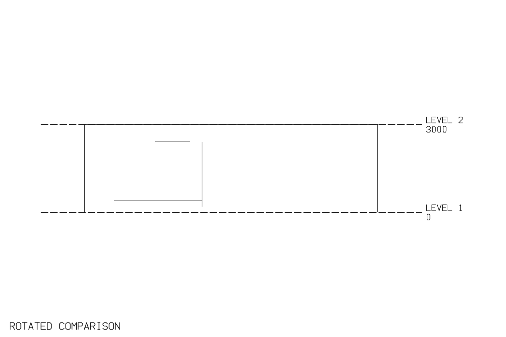
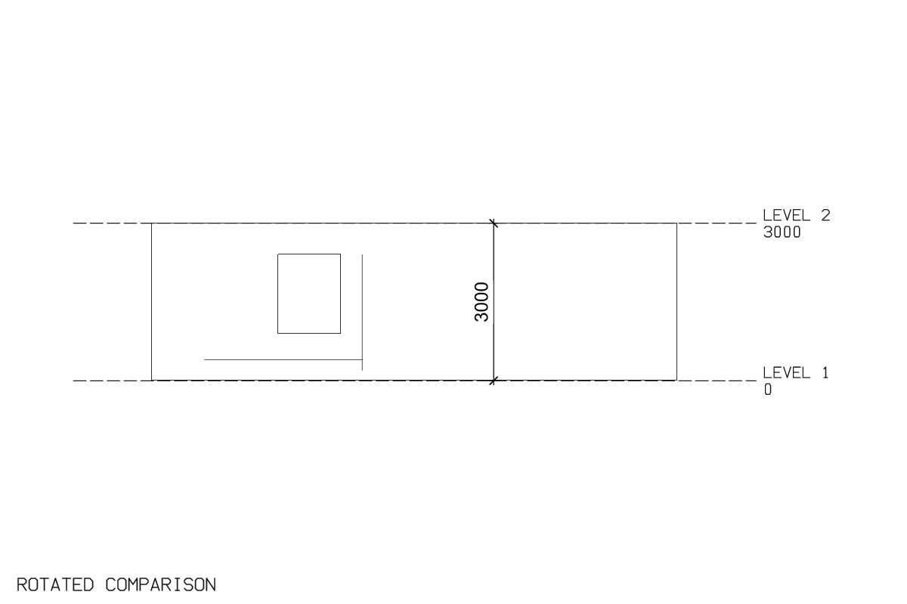

# Vertical drawing tools: synthetic comparison and verification

This is one bounded section/elevation editing slice: shared drawing-plane references, aligned/linear measurement,
own-view detail drawing/Trim and supported Move. It does not enable arbitrary model edits or driving dimensions.

## Actual before and after

Both images were generated by BIMCraft's CLI renderer at 1200 × 800 from the same
[synthetic fixture](../samples/vertical-tools-comparison.txt). They are not mockups or native desktop screenshots.

| Before: upstream `3e08223f1ab9d3d68953804c8c5c54ed482b4af1` | After: implementation `1febe8dd3658a30593a57f35b3a4e748acd0ecd3` |
|---|---|
|  |  |

The baseline binary was built from an unchanged detached checkout. Attempting the dimension there fails because a level
is not an accepted plan reference; the before image renders the unchanged fixture after that rejection. The implementation
accepts the same explicit references, reports `[3000.0]` mm and draws the dimension. The geometry and framing are unchanged.
Both are custom builds of package version 0.12.0 on macOS arm64 with Rust 1.99.1.

In each checkout, use its own built `bimcraft-cli` and the fixture above:

```sh
# Baseline: this fails. Implementation: this reports a 3000 mm dimension.
bimcraft-cli run --script samples/vertical-tools-comparison.txt \
  --cmd 'dimension {"view":"Rotated comparison","refs":[{"id":100000},{"id":100001}],"at":[6500,1500]}'

# Before: render the baseline fixture without the rejected annotation.
bimcraft-cli run --script samples/vertical-tools-comparison.txt \
  --cmd 'render {"view":"Rotated comparison","width":1200,"height":800,"path":"before.png"}'

# After: the same fixture plus the accepted annotation.
bimcraft-cli run --script samples/vertical-tools-comparison.txt \
  --cmd 'dimension {"view":"Rotated comparison","refs":[{"id":100000},{"id":100001}],"at":[6500,1500]}' \
  --cmd 'render {"view":"Rotated comparison","width":1200,"height":800,"path":"after.png"}'
```

The comparison fixture is supplied by this PR; copy it unchanged into the baseline checkout when reproducing.

## What was actually checked

Two initial core regressions were run and observed failing on the baseline before the implementation. The recorded output was:

```text
vertical_tools_dimensions_follow_levels_and_view_owned_lines_through_history ... FAILED
vertical_tools_move_refuses_model_xy_and_foreign_annotations_atomically ... FAILED
test result: FAILED. 0 passed; 2 failed; 0 ignored
```

The first rejected the level reference. The second showed that `move` accepted a foreign-view annotation instead of refusing
it. Later verification expanded to five core tests and three UI tests; this does not claim all eight existed before implementation.

At implementation commit `1febe8dd3658a30593a57f35b3a4e748acd0ecd3`:

- `cargo fmt --check`, `cargo i18n check` and `cargo clippy --workspace --all-targets -- -D warnings` passed.
- `cargo test --workspace --no-fail-fast`: **4409 passed, 0 failed, 21 existing ignored tests**, including 2368 core and 1314 UI tests.
- Five core regressions cover rotated planes, dimensions, host/world displacement, pins, foreign-view and mixed-selection
  refusals, Undo/Redo, Trim, save/reopen and drawing ownership/export.
- Two egui-driven workflows cover click placement, detail drawing/Trim, numeric Move, Escape, Undo/Redo and view switching.
  The third test rendered both interface profiles in Light, Dark and Dark UI/Light Canvas; all six captures were inspected.
- Actual standalone stdio MCP passed dimensions, rotated hosted Move, Undo/Redo, atomic refusal, Trim, save and fresh-process
  reopen, and PNG export. Desktop and CLI builds passed; the packaged CLI repeated the replay successfully.

An initial sandbox run stopped at an existing localhost-listener test. The unrestricted verification uncovered old fixed
format-number assertions and a screen-rounding assertion, which were corrected before the complete passing run above.
The subsequent documentation/evidence commit changes no Rust implementation. Its checks are documentation/link/patch
validation and reproduction of these before/after renders; the full-suite result is explicitly pinned to the implementation.

Native desktop pointer/trackpad use, contributor manual acceptance, arbitrary model editing, copied details and PDF/sheet
layout have not been accepted by this evidence. The launcher and synthetic project are available to the contributor for that
manual review. Versioned external behavior references are pointers, not a claim of full Revit parity.

## Contribution disclosure and remaining handoff

Agent: **OpenAI Codex desktop**. Recorded model: **`gpt-6-astra`**, **high effort**, for both implementation and this compliance
follow-up. This was verified from the session's turn metadata rather than inferred from an agent name or default setting.

A read-only overlap audit preceded implementation, but **no pre-start public issue/discussion announcement was posted**.
The PR was the first public coordination for this slice; that does not retroactively satisfy the wiki's pre-start guidance.
No extra coordination comment was posted to imply otherwise.

The source, fixture and images are original synthetic/open-project work. No Autodesk help prose, icons, families, templates,
RFA/RVT content or private project data is included. The implementation uses the existing authoritative commands, validation
and history, with model millimetres and existing project-unit parsing/display; it adds no regional building-code assumptions.

README and area documentation are updated. The [concrete wiki patch](wiki-proposals/vertical-tools.md) is proposed for
publication with the merged feature, not silently applied to the live wiki while this PR is unmerged. Remaining handoff:
maintainer review/wiki publication and contributor manual desktop acceptance; the missing historical announcement cannot
be repaired after the fact. Hosted-check status is reported separately on the PR.
